# PRD — SIMPRO Kemahasiswaan, Mutu & Tata Kelola (Modul 7–13)

> Sumber: SKPL SIMPRO Kemahasiswaan, Mutu & Tata Kelola v2. Cakupan PRD ini hanya **Modul 7–13** (FR-26 s.d. FR-51) beserta kebutuhan non-fungsional yang relevan. Modul 1–6 **tidak dibangun** pada fase ini. Modul 7–13 adalah **penambahan fitur pada website SIMPRO yang sudah berjalan**, sehingga seluruh tampilan, komponen, dan pola kode **mengikuti codebase existing** (lihat Bab 2 poin 10 dan Bab 13 Fase 0).
>
> Peta dokumen: Bab 1–4 (produk dan alur) · Bab 5 (arsitektur, diagram, peta halaman) · Bab 6 (skema database) · Bab 7 (tech stack) · Bab 8 (aktor dan hak akses) · Bab 9 (API) · Bab 10 (RLS) · Bab 11 (keputusan desain dan nilai default) · Bab 12 (acceptance criteria) · Bab 13 (fase pembangunan).

## 1. **Overview**

SIMPRO Modul 7–13 adalah penambahan pada aplikasi *web* internal Program Studi Sarjana Sistem Informasi yang memusatkan pencatatan dan pelaporan **kepuasan mitra KP/PSI/PDLK, publikasi dosen dan mahasiswa, perjalanan dinas, Rencana Kerja dan Anggaran (RKA), review RPS, post evaluasi perkuliahan, dan layanan aduan mahasiswa anonim**. Pengguna utamanya adalah Kaprodi, GKM, Admin Prodi, dosen, koordinator KP/PSI/PDLK, dan mahasiswa; mitra eksternal mengakses halaman publik berbasis tautan tanpa akun. Model bisnisnya *single-tenant* (satu prodi, satu instansi), bukan *marketplace* atau SaaS multi-pihak, dan berbagi login serta data induk dengan SKPL SIMPRO Manajemen Program Studi dan SIAKAD sehingga tidak ada input ganda.

**Masalah yang diselesaikan:** Saat ini data modul-modul ini tersebar di *spreadsheet*, grup WhatsApp, dan folder berkas pribadi. Koordinator KP/PSI/PDLK mengirim formulir kepuasan mitra manual lalu merekap jawaban satu per satu. Status publikasi dan bukti LoA/DOI tidak terlacak. Realisasi perjalanan dinas dan serapan RKA baru diketahui di akhir tahun dan sering tidak cocok dengan bukti. Review RPS bergantung pada surel dan berkas berversi ganda, serta temuan evaluasi perkuliahan tidak pernah masuk ke revisi RPS berikutnya. Aduan mahasiswa lewat pesan pribadi ke dosen membuat pelapor takut identitasnya diketahui, sehingga aduan sensitif (perundungan/kekerasan) jarang disampaikan dan tidak ada jejak penanganan. Akibatnya laporan akreditasi dan audit mutu memakan waktu berhari-hari untuk disusun dan angkanya sulit dipertanggungjawabkan.

**Tujuan Utama:** Bagi pengguna operasional (dosen, koordinator, Admin Prodi, mahasiswa), sistem menyediakan formulir terstruktur dengan status jelas, pengingat tenggat, dan unggah bukti dari *smartphone*. Mitra cukup membuka tautan dari WhatsApp/surel dan mengisi kuesioner kurang dari 3 menit, dan pelapor mendapat kode tiket untuk melacak aduan tanpa membuka identitas. Bagi pimpinan (Kaprodi dan GKM), sistem menyajikan rekap otomatis berupa indeks kepuasan mitra, status publikasi, serapan anggaran per triwulan, status review RPS, ketercapaian CPMK, dan statistik aduan. Semua rekap ter-*generate* ≤ 5 detik, dapat diekspor ke Excel/PDF, dan setiap persetujuan tercatat di log audit untuk kebutuhan akreditasi.

## 2. **Requirements**

- **Lingkup & Dependensi Modul:** Hanya Modul 7–13 (FR-26 s.d. FR-51) yang dibangun sebagai penambahan pada website existing. Data induk (*profiles*, mata kuliah, kelas, periode akademik, mitra, penempatan mahasiswa, ringkasan umpan balik mahasiswa) berstatus *shared* dari SIAKAD dan SIMPRO Manajemen Prodi (NF-12) dan diperlakukan *read-only* oleh modul ini; selama integrasi belum siap, diisi lewat skrip *seed*/impor CSV dengan skema yang sama. NF yang terkait Modul 1–6 (NF-03, NF-05) dan NF-14 (ringkasan naratif otomatis, terkait FR-22 di Modul 5) **tidak berlaku** dan tidak dibangun.
- **Model Data & Tenancy:** *Single-tenant*, satu proyek Supabase (Postgres) bersama aplikasi SIMPRO Manajemen Prodi, tanpa kolom `tenant_id`. Isolasi data memakai rantai *foreign key* (contoh: Periode → Kelas → Evaluasi → Rencana Perbaikan), semua kunci utama `uuid`, semua nominal rupiah `numeric(15,2)`, dan semua waktu `timestamptz` zona Asia/Jakarta. Tahun anggaran diasumsikan Januari–Desember dan triwulan TW1–TW4 mengikuti kalender.
- **Zona Akses (Privat, Token, Anonim):** Ada tiga zona. (1) Privat, wajib login Supabase Auth dengan RBAC. (2) Publik berbasis *token* khusus untuk mitra eksternal (tanpa akun, satu tautan per penempatan, kedaluwarsa). (3) Aduan anonim: mahasiswa login hanya untuk mengambil *permit* kirim anonim berumur pendek (tanpa data pengguna di dalamnya), lalu pengiriman dan pelacakan aduan berjalan di *endpoint* `/public/aduan/*` tanpa identitas. Zona 2 dan 3 hanya boleh memanggil *endpoint* `/public/*` dengan cakupan data sangat sempit.
- **RBAC & Row-Level Scoping:** Otorisasi berlapis. (1) *Service layer* Go memeriksa peran dan kepemilikan data. (2) RLS Postgres menegakkan ulang aturan yang sama: Go memakai *role* DB non-*bypass* `app_api` yang menerima identitas per transaksi (`SET LOCAL app.user_id`), sehingga kebocoran satu lapis tidak membuka data. Satu pengguna dapat multi-peran, dan peran dibaca dari tabel `user_roles` pada setiap *request* (bukan dari *claim* JWT) agar pencabutan langsung berlaku. Selain peran tetap, ada **peran kontekstual** yang diturunkan dari data (dosen pengampu, reviewer, dosen verifikator, penanggung jawab disposisi). Matriks lengkap di Bab 8, kebijakan RLS per tabel di Bab 10.
- **Anonimitas Aduan:** Tabel aduan tidak memiliki *foreign key* ke pengguna, tidak menyimpan IP, *user-agent*, ataupun waktu presisi jam dari pelapor (hanya tanggal), dan *middleware* Go untuk `/public/aduan/*` tidak mencatat IP/UA maupun identitas apa pun. *Permit* kirim tidak memuat ID pengguna; kuota harian per mahasiswa dihitung di memori memakai *hash* berkunci rotasi harian dan tidak pernah ditulis ke basis data atau log. Kode tiket disimpan sebagai *hash* ber-*pepper*. Lampiran diunggah Go memakai *service role* (pemilik objek kosong) dan metadata EXIF dibuang. Aduan kategori perundungan/kekerasan bersifat sensitif: isinya hanya dapat dibaca Pengelola Aduan yang ditunjuk Kaprodi menangani kekerasan (PGL-K) dan penanggung jawab disposisinya, sedangkan Kaprodi hanya melihat metadata (FR-50, keputusan D1 di Bab 11).
- **Validasi Anggaran & Anti-Konflik Data:** Formulir perjalanan dinas dan RKA tidak bisa dikirim bila rincian anggaran wajib kosong; setiap nominal berupa angka ≥ 0 (*constraint* DB), dan total dihitung otomatis di server (kolom *generated* atau agregasi), bukan dikirim dari klien (NF-07). Penyuntingan versi kerja RKA memakai *optimistic locking* (`row_version`, header `If-Match`). Realisasi RKA dari perjalanan dinas bersifat idempoten (satu perjalanan menghasilkan paling banyak satu realisasi aktif). Satu tautan mitra hanya bisa dipakai sekali (`UNIQUE invitation_id` pada respons). Pos atau kegiatan RKA yang sudah memiliki realisasi atau terhubung ke perjalanan dinas tidak boleh dihapus maupun dinonaktifkan, hanya boleh dinolkan nominalnya.
- **Alur Status/Lifecycle:** Setiap entitas utama memiliki kolom `status` dengan enum tetap dan transisi yang divalidasi API (diagram *state* di Bab 5). Tautan mitra: DIBUAT → TERKIRIM → DIISI / KEDALUWARSA / DIBATALKAN. Publikasi: DRAF → REVIEW_INTERNAL (opsional) → DIAJUKAN → DALAM_REVIEW → REVISI → DITERIMA → TERBIT, atau DITOLAK. Perjalanan dinas: DRAF → DIAJUKAN → PERLU_REVISI / DISETUJUI / DITOLAK; DISETUJUI → DILAPORKAN → SELESAI, atau DILAPORKAN → DISETUJUI bila dikembalikan untuk dilengkapi; DIBATALKAN. Dokumen RKA: DRAF → AKTIF → DITUTUP, sedangkan alur persetujuan ada di **versi RKA**: DRAF → DIAJUKAN → PERLU_REVISI / DISETUJUI → DIGANTIKAN. RPS: DRAF → DIAJUKAN → DIREVIEW → PERLU_REVISI / DISETUJUI → DISAHKAN. Evaluasi perkuliahan: DRAF → TERKIRIM → DITINJAU. Aduan: DITERIMA → DIVERIFIKASI → DITINDAKLANJUTI → SELESAI → DITUTUP.
- **Audit, Versi & Verifikasi Berkas:** Setiap persetujuan, penolakan, verifikasi, dan perubahan status ditulis ke `audit_logs` (pelaku, waktu, nilai lama/baru) yang bersifat *append-only* (NF-09); pengecualian: tindakan pelapor aduan tidak dicatat (NF-04). Revisi RKA dan RPS disimpan sebagai versi tak berubah. Data yang diisi mahasiswa (publikasi mahasiswa) tidak masuk rekap sebelum diverifikasi dosen dan tidak bisa diubah pengisi setelah terverifikasi (NF-06). Unggahan dibatasi pada PDF, JPG, PNG, DOCX, XLSX dengan ukuran maksimum yang dapat diatur Admin lewat `app_settings` (NF-08).
- **Penjadwal, Notifikasi, Laporan & Keandalan:** Pekerjaan terjadwal berjalan harian pukul 07:00 WIB di layanan Go. Tugasnya: mengedarkan pengingat (mitra belum mengisi, laporan perjalanan dinas, tenggat review RPS dan publikasi, batas pengisian evaluasi), mengubah tautan mitra menjadi KEDALUWARSA, mengeskalasi aduan yang melewati tenggat ke Kaprodi, dan menutup otomatis aduan SELESAI tanpa respons pelapor. Notifikasi dikirim lewat *in-app* dan surel; untuk mitra, koordinator juga mendapat tombol *Bagikan via WhatsApp* (tautan `wa.me`, tanpa biaya WhatsApp Business API di tahap MVP). Semua rekap dapat diekspor ke Excel dan PDF (NF-13) dan ter-*generate* ≤ 5 detik untuk data satu tahun akademik (NF-10) dengan indeks DB yang sesuai. Seluruh angka tenggat dan ambang dikonfigurasi lewat `app_settings`; nilai default dan alasannya ada di Bab 11. Untuk keandalan (NF-11): target ketersediaan ≥ 99% per bulan dipantau lewat *endpoint* `/healthz` dan layanan *uptime monitoring*; pencadangan data harian dipastikan (paket Supabase yang menyertakan pencadangan harian, atau `pg_dump` terjadwal ke penyimpanan terpisah untuk Postgres dan Storage); uji restorasi dilakukan dan dicatat minimal setiap semester.
- **Konsistensi dengan Codebase Website Existing & Mobile-First:** Modul 7–13 ditambahkan ke repositori website yang sudah ada, bukan repositori baru. **Codebase existing adalah sumber kebenaran UI dan pola kode**: *layout shell* (sidebar/navbar), komponen UI, *design token* (warna, tipografi, spasi, radius, bayangan), pola *routing*, pola pengambilan data dan penjagaan autentikasi, penanganan *loading/empty/error/toast*, pola tabel/filter/paginasi, serta konvensi penamaan wajib dipakai ulang. Komponen baru hanya dibuat bila tidak ada padanannya (daftar komponen baru di Bab 5) dan harus memakai *design token* existing. Antarmuka berbahasa Indonesia, responsif (*mobile-first*) karena mitra, mahasiswa, dan dosen banyak memakai *smartphone*, dan seluruh formulir mendukung simpan sebagai draf (NF-01). Langkah wajib sebelum menulis fitur ada di **Fase 0 (Bab 13)**.

## 3. **Core Features**

- **Kepuasan Mitra KP/PSI/PDLK (Modul 7, FR-26–FR-28):** Koordinator mengelola instrumen, mengirim tautan, dan memantau hasil kepuasan mitra per program.
  - **Instrumen (FR-26):** Koordinator membuat *template* per program dengan aspek yang dapat ditambah, diubah, dan dinonaktifkan (nama aspek, deskripsi, bobot, skala 1–5). Aspek bawaan: Kompetensi, Etika, Komunikasi Mahasiswa, Koordinasi dengan Prodi. *Template* yang sudah memiliki respons terkunci; perubahan dilakukan lewat duplikasi sebagai *template* baru.
  - **Input & Tautan (FR-27):** Koordinator memilih program dan periode, sistem menampilkan daftar penempatan (mitra + mahasiswa) dari data induk. Aksi **Kirim Tautan** membuat URL unik per penempatan berisi *token* acak (kedaluwarsa default 30 hari) yang dikirim lewat surel atau dibagikan via WhatsApp. Halaman mitra tanpa login, selesai < 3 menit, hanya bisa dikirim sekali. Koordinator juga dapat menginput hasil atas nama mitra (sumber `INPUT_KOORDINATOR`).
  - **Rekap & Tren (FR-28):** Indeks per aspek = rata-rata skor; indeks keseluruhan = Σ(bobot × rata-rata aspek) / Σ bobot, ditampilkan juga sebagai persentase terhadap skala maksimum. Rekap per aspek, per program, dan per mitra, dengan grafik tren antar periode. Tingkat respons = undangan DIISI / undangan yang pernah terkirim (status TERKIRIM, DIISI, atau KEDALUWARSA) × 100%. Respons berstatus VOID tidak dihitung.

- **Publikasi Dosen & Mahasiswa (Modul 8, FR-29–FR-32):** Pencatatan publikasi dengan pelacakan tahapan, review internal, verifikasi, dan rekap.
  - **Pencatatan (FR-29):** Judul, jenis (jurnal/prosiding/buku/HKI), target publikasi, peringkat (SINTA 1–6, Scopus Q1–Q4, WoS, non-peringkat), serta daftar penulis dengan peran (penulis pertama, korespondensi, anggota, pembimbing) dan tipe (dosen, mahasiswa, eksternal). Mahasiswa wajib memilih dosen verifikator dari penulis dosen berperan pembimbing atau anggota pendamping (keputusan D6).
  - **Tahapan (FR-30):** Pelacak tahapan Draf → Review Internal (opsional) → Diajukan → Dalam Review → Revisi → Diterima → Terbit, atau Ditolak, tiap tahap bertanggal dan wajib bukti (bukti *submit* saat Diajukan, LoA saat Diterima, DOI/URL saat Terbit). Pada publikasi catatan mahasiswa, tahap baru berstatus MENUNGGU dan baru mengubah status publikasi setelah diverifikasi.
  - **Review Internal & Verifikasi (FR-31):** Kaprodi atau penulis berstatus dosen menetapkan reviewer internal (bukan penulis) yang mengisi rekomendasi (LAYAK_DIAJUKAN/PERLU_PERBAIKAN) dan catatan. Dosen verifikator menyetujui/menolak pencatatan mahasiswa beserta alasan; Kaprodi dapat mengganti verifikator.
  - **Rekap (FR-32):** Jumlah publikasi terverifikasi per status, jenis, peringkat, dan tahun, termasuk jumlah yang melibatkan mahasiswa (≥ 1 penulis bertipe MAHASISWA). Publikasi dosen terverifikasi diteruskan ke kinerja dosen di SIMPRO Manajemen Prodi lewat *view* `v_publikasi_dosen_terverifikasi`.

- **Perjalanan Dinas (Modul 9, FR-33–FR-35):** Pengajuan, persetujuan, pelaporan, dan rekap perjalanan dinas yang terhubung ke pos RKA.
  - **Rencana (FR-33):** Dosen (atau Admin Prodi atas nama dosen) mengisi pelaksana, tujuan, maksud kegiatan, tanggal berangkat/kembali, sumber dana, pos RKA (wajib bila sumber dana RKA Prodi), nomor surat tugas, dan estimasi biaya per komponen (transportasi, akomodasi, uang harian, lain-lain; nilai ≥ 0 wajib diisi). Bila total estimasi melebihi sisa anggaran pos RKA atau pengajuan kurang dari 3 hari sebelum berangkat, sistem menampilkan peringatan kepada Kaprodi (tidak memblokir). Kaprodi menyetujui, meminta revisi, atau menolak dengan catatan.
  - **Bukti & Laporan (FR-34):** Setelah perjalanan, pelaksana mengunggah tiket, bukti penginapan, kuitansi, foto kegiatan, mengisi realisasi biaya per komponen, dan menulis laporan hasil dengan tenggat default 7 hari setelah tanggal kembali (dapat diatur). **Admin Prodi** memeriksa kelengkapan (bukan pelaksana atau pengaju perjalanan itu; bila konflik, Kaprodi): bila lengkap ditandai SELESAI, bila belum dikembalikan ke status DISETUJUI dengan catatan kelengkapan (keputusan D2).
  - **Rekap (FR-35):** Rekap per pelaksana dan per periode dengan perbandingan estimasi vs realisasi per komponen. Perjalanan ditandai **belum lengkap** bila ada komponen berealisasi > 0 tanpa bukti yang sesuai, tidak ada foto kegiatan, laporan hasil kosong, atau tenggat lewat; realisasi melebihi estimasi lebih dari 10% ditandai **melebihi estimasi**.

- **Rencana Kerja dan Anggaran (RKA) Prodi (Modul 10, FR-36–FR-38):** Penyusunan RKA tahunan berversi, pencatatan realisasi, dan pemantauan serapan.
  - **Penyusunan & Revisi (FR-36):** Per tahun anggaran (satu RKA per tahun), Kaprodi/Admin Prodi menyusun kegiatan (indikator kinerja, jadwal, penanggung jawab) dan pos anggaran (volume × harga satuan = nominal otomatis, sumber dana) pada **versi kerja**. Data aktif yang dipakai realisasi dan monitoring hanya berubah saat Kaprodi menyetujui. Revisi setelah disetujui dimulai dengan **Buka Revisi** yang menyalin versi aktif menjadi versi kerja baru (alasan revisi wajib); Kaprodi melihat **perbandingan (*diff*)** tambah/ubah/hapus lalu menyetujui atau meminta revisi; saat disetujui, perubahan diterapkan atomik dan versi lama berstatus DIGANTIKAN tetapi tetap tersimpan sebagai riwayat (keputusan D3).
  - **Realisasi (FR-37):** Realisasi biaya per pos dicatat manual oleh Admin Prodi/Kaprodi (tanggal, nominal, uraian, bukti), dan realisasi dari perjalanan dinas masuk otomatis saat perjalanan berstatus SELESAI (nominal = Σ realisasi komponen), hanya bila perjalanan bersumber dana RKA Prodi dan tertaut ke pos RKA. Realisasi kegiatan mencatat tanggal pelaksanaan aktual, status, dan capaian indikator.
  - **Monitoring (FR-38):** *Dashboard* persentase serapan (Σ realisasi aktif / Σ anggaran × 100) per kegiatan, per pos, dan per triwulan berdasarkan tanggal realisasi. Kegiatan yang jadwal selesainya lewat tetapi belum TERLAKSANA ditandai terlambat. Pos dengan realisasi melebihi anggaran ditandai **over-realisasi**. Karena monitoring memakai data aktif, angkanya tidak terpengaruh revisi yang belum disetujui.

- **Review RPS & Post Evaluasi Perkuliahan (Modul 11–12, FR-39–FR-46):** Satu siklus mutu pembelajaran dari pengajuan RPS, review, pengesahan, evaluasi akhir, hingga tindak lanjut ke RPS berikutnya.
  - **Pengajuan & Reviewer (FR-39):** Dosen pengampu mengunggah RPS per mata kuliah per periode akademik; Kaprodi/GKM menetapkan reviewer dengan tenggat. Reviewer tidak boleh sama dengan dosen pengampu mata kuliah tersebut.
  - **Instrumen & Revisi (FR-40, FR-41):** Reviewer mengisi *checklist* lima komponen (keselarasan CPL–CPMK–Sub-CPMK, bahan kajian, metode pembelajaran, bentuk dan bobot penilaian, referensi) dengan hasil SESUAI/PERLU_PERBAIKAN/TIDAK_SESUAI dan catatan per komponen, lalu rekomendasi akhir. Bila semua reviewer merekomendasikan DISETUJUI, status menjadi DISETUJUI; bila ada PERLU_REVISI, dosen mengunggah versi baru dan siklus berulang. Kaprodi mengesahkan (status DISAHKAN) dengan pencatatan pelaku dan waktu.
  - **Rekap RPS (FR-42):** Status review seluruh mata kuliah yang ditawarkan per semester, termasuk yang belum diajukan atau belum direvisi.
  - **Evaluasi Akhir (FR-43):** Dosen mengisi per kelas: ketercapaian CPMK (target vs capaian, otomatis tercapai/tidak), distribusi nilai, kesesuaian pelaksanaan dengan RPS, kendala, dan rencana perbaikan.
  - **Umpan Balik Mahasiswa (FR-44):** Ringkasan kuesioner mahasiswa dari SIMPRO Manajemen Prodi ditampilkan berdampingan pada halaman evaluasi, tanpa kuesioner baru.
  - **Tindak Lanjut (FR-45):** Rencana perbaikan berstatus BARU otomatis diteruskan ke pengajuan RPS berikutnya mata kuliah yang sama (status DITERUSKAN) dan tampil di panel review. Dosen wajib menandai tiap rencana DITERAPKAN atau TIDAK_DITERAPKAN beserta catatan sebelum RPS dikirim.
  - **Rekap Evaluasi (FR-46):** Status pengisian evaluasi per kelas (Belum Diisi/Draf/Terkirim/Ditinjau) dan persentase CPMK tercapai per mata kuliah dan per semester untuk GKM dan Kaprodi.

- **Layanan Aduan Mahasiswa Anonim (Modul 13, FR-47–FR-51):** Kanal aduan dengan pelacakan berkode tiket, disposisi, eskalasi, dan penanganan khusus kekerasan.
  - **Formulir Anonim (FR-47):** Mahasiswa aktif/cuti login hanya untuk mengambil *permit* kirim anonim (berlaku 15 menit, tanpa data pengguna), lalu mengisi kategori (akademik, layanan administrasi, fasilitas, dosen/tenaga kependidikan, perundungan/kekerasan, lainnya), judul, uraian, dan lampiran opsional; pengiriman < 2 menit. Identitas tidak disimpan di data maupun log aplikasi dan tidak ditampilkan kepada siapa pun. Mode alternatif tanpa login (*captcha*) tersedia lewat konfigurasi (keputusan D5).
  - **Kode Tiket & Pelacakan (FR-48):** Setelah terkirim, sistem menampilkan kode tiket sekali saja (format `ADU-XXXX-XXXX-XXXX`, ±80 bit *entropy*, tidak dapat dipulihkan) dengan tombol salin/unduh. Dengan kode ini pelapor (tanpa login) melihat status, membaca tanggapan (catatan internal petugas disembunyikan), dan membalas lewat utas; balasan setelah SELESAI membuka kembali aduan selama belum DITUTUP.
  - **Disposisi & Eskalasi (FR-49):** Pengelola memverifikasi aduan (valid atau ditutup dengan alasan), mendisposisikan ke penanggung jawab (pengguna yang sudah ada, mis. dosen atau admin prodi) dengan tenggat; penanggung jawab (ekstensi E9) hanya melihat aduan yang didisposisikan kepadanya. Penjadwal harian mengeskalasi aduan yang melewati SLA verifikasi atau tenggat disposisi ke Kaprodi.
  - **Aduan Kekerasan (FR-50):** Kategori perundungan/kekerasan otomatis sensitif dan hanya terlihat oleh Pengelola Aduan yang ditunjuk Kaprodi menangani kekerasan (PGL-K); ini penunjukan pada peran Pengelola Aduan, bukan peran baru. PGL-K dapat mencatat penerusan ke Satgas PPKPT perguruan tinggi (tanggal, nomor referensi). Kaprodi hanya melihat metadata (nomor, kategori, status, umur, tenggat) tanpa isi aduan.
  - **Rekap (FR-51):** Jumlah aduan per kategori dan status, rata-rata waktu penyelesaian (hari), dan rata-rata penilaian kepuasan pelapor (1–5) yang diberikan setelah status SELESAI.

## 4. **User Flow**

### Koordinator KP / PSI / PDLK

**Alur K1 — Menyiapkan instrumen dan mengirim tautan kepuasan mitra**
1. Login lalu buka menu *Kepuasan Mitra* → *Instrumen*.
2. Klik *Buat Template*, pilih program (KP/PSI/PDLK), isi nama, lalu tambahkan atau ubah aspek (nama, deskripsi, bobot).
3. Klik *Aktifkan* sehingga status *template* menjadi AKTIF.
4. Buka tab *Pengiriman*, pilih program dan periode akademik; sistem menampilkan daftar penempatan (mitra + mahasiswa).
5. Pilih penempatan lalu klik *Kirim Tautan*; sistem membuat tautan unik dan status undangan menjadi TERKIRIM.
6. Kirim lewat surel otomatis atau klik *Bagikan via WhatsApp* (membuka WhatsApp dengan pesan terisi).
7. Alternatif: klik *Input Manual* untuk mengisi skor atas nama mitra (sumber INPUT_KOORDINATOR).
8. Buka *Rekap* untuk melihat indeks per aspek/program/mitra, tren antar periode, dan tingkat respons; klik *Ekspor* untuk Excel/PDF.

### Mitra (Eksternal, tanpa akun)

**Alur M1 — Mengisi kuesioner kepuasan**
1. Buka tautan dari WhatsApp/surel di *smartphone*.
2. Sistem memvalidasi *token* (belum kedaluwarsa dan belum dipakai) lalu menampilkan nama mitra, program, dan nama mahasiswa.
3. Memberi skor 1–5 untuk tiap aspek, mengisi nama dan jabatan pengisi, serta komentar opsional.
4. Klik *Kirim*; sistem menyimpan respons, mengubah status undangan menjadi DIISI, dan menampilkan halaman terima kasih. Membuka ulang tautan menampilkan "sudah diisi".

### Dosen & Mahasiswa (Publikasi)

**Alur P1 — Mencatat publikasi dan memperbarui tahapan**
1. Buka *Publikasi* → *Tambah Publikasi*.
2. Isi judul, jenis, target publikasi, peringkat, dan penulis dengan peran masing-masing; mahasiswa memilih dosen verifikator. Simpan sebagai Draf atau lanjut.
3. Saat naskah maju, klik *Perbarui Tahapan*, pilih tahap berikutnya, isi tanggal, lalu unggah bukti (bukti *submit*, LoA) atau isi DOI/URL.
4. Untuk publikasi mahasiswa, tahap baru berstatus MENUNGGU verifikasi; untuk dosen, status publikasi langsung berubah.

**Alur P2 — Review internal oleh reviewer**
1. Kaprodi atau penulis dosen membuka detail publikasi, klik *Tetapkan Reviewer*, memilih dosen (bukan penulis) dan tenggat; status publikasi menjadi REVIEW_INTERNAL.
2. Reviewer menerima notifikasi, membuka naskah, mengisi catatan dan rekomendasi (LAYAK_DIAJUKAN/PERLU_PERBAIKAN), lalu klik *Selesaikan Review*.

**Alur P3 — Verifikasi publikasi mahasiswa oleh dosen verifikator**
1. Buka *Antrean Verifikasi*, pilih entri publikasi atau tahapan berstatus MENUNGGU.
2. Periksa data dan bukti, lalu klik *Verifikasi* atau *Tolak* (alasan wajib).
3. Setelah TERVERIFIKASI, entri masuk rekap dan tidak dapat diubah mahasiswa. Bila verifikator berhalangan, Kaprodi mengganti verifikator dari detail publikasi.

**Alur P4 — Rekap publikasi (Kaprodi)**
1. Buka *Rekap Publikasi*, pilih rentang tahun, lalu lihat jumlah per status/jenis/peringkat/tahun dan jumlah yang melibatkan mahasiswa.
2. Klik *Ekspor* untuk Excel/PDF.

### Dosen, Admin Prodi & Kaprodi (Perjalanan Dinas & RKA)

**Alur D1 — Mengajukan perjalanan dinas (Dosen / Admin Prodi)**
1. Buka *Perjalanan Dinas* → *Ajukan Perjalanan*.
2. Isi pelaksana, tujuan, maksud kegiatan, tanggal berangkat/kembali, sumber dana, dan pos RKA bila sumber dana RKA Prodi.
3. Isi estimasi biaya per komponen (transportasi, akomodasi, uang harian, lain-lain); total terhitung otomatis dan peringatan muncul bila melebihi sisa pos RKA atau pengajuan mendadak.
4. Klik *Ajukan*; status menjadi DIAJUKAN dan Kaprodi mendapat notifikasi.

**Alur D2 — Persetujuan perjalanan dinas (Kaprodi)**
1. Buka daftar pengajuan, lalu periksa rincian dan peringatan anggaran.
2. Pilih *Setujui*, *Minta Revisi*, atau *Tolak* dengan catatan (nomor surat tugas wajib sebelum *Setujui*).
3. Saat DISETUJUI, sistem menghitung batas laporan (tanggal kembali + 7 hari).

**Alur D3 — Bukti, laporan, dan penyelesaian perjalanan**
1. Perjalanan berlangsung di luar sistem.
2. Pelaksana membuka perjalanan yang DISETUJUI, mengunggah tiket, bukti penginapan, kuitansi, dan foto kegiatan, mengisi realisasi biaya per komponen, menulis laporan hasil, lalu klik *Kirim Laporan*; status menjadi DILAPORKAN.
3. Admin Prodi (yang bukan pelaksana/pengaju perjalanan itu) memeriksa kelengkapan. Bila belum lengkap, klik *Kembalikan untuk Dilengkapi* dengan catatan; status kembali DISETUJUI dan pelaksana mendapat notifikasi (lanjut ke langkah 2). Bila lengkap, klik *Tandai Selesai*.
4. Saat SELESAI, sistem otomatis membuat realisasi pada pos RKA terkait (hanya untuk perjalanan bersumber dana RKA Prodi).
5. Admin/Kaprodi membuka *Rekap Perjalanan* untuk membandingkan estimasi vs realisasi dan melihat perjalanan yang ditandai belum lengkap atau melebihi estimasi.

**Alur R1 — Menyusun, merevisi, dan menyetujui RKA (Admin Prodi / Kaprodi)**
1. Admin Prodi atau Kaprodi membuka *RKA* → *Buat RKA Tahun Anggaran*; sistem membuat dokumen RKA (DRAF) dan versi kerja nomor 1.
2. Di editor versi kerja, tambahkan kegiatan (indikator, jadwal, penanggung jawab), lalu pos anggaran (volume, satuan, harga satuan, sumber dana); draf tersimpan dengan pemeriksaan *row_version*.
3. Klik *Ajukan*; sistem memvalidasi (setiap kegiatan ≥ 1 pos, nominal ≥ 0), mengunci versi, dan statusnya menjadi DIAJUKAN.
4. Kaprodi membuka versi dan memilih *Setujui* atau *Minta Revisi* dengan catatan. Saat disetujui, sistem menerapkan isi versi ke data aktif; dokumen menjadi AKTIF.
5. Untuk revisi setelah disetujui, klik *Buka Revisi*: sistem menyalin versi aktif menjadi versi kerja baru (n+1). Isi alasan revisi, ubah data, lalu *Ajukan*.
6. Kaprodi melihat perbandingan (tambah/ubah/hapus per kegiatan dan pos) lalu menyetujui; perubahan diterapkan atomik dan versi sebelumnya berstatus DIGANTIKAN. Selama revisi belum disetujui, monitoring tetap memakai angka aktif.

**Alur R2 — Realisasi dan monitoring serapan (Admin Prodi / Kaprodi)**
1. Buka kegiatan RKA yang AKTIF, klik *Catat Realisasi*, isi tanggal, nominal, uraian, lalu unggah bukti; realisasi perjalanan dinas muncul otomatis.
2. Perbarui status pelaksanaan dan capaian indikator kegiatan.
3. Buka *Monitoring Serapan* untuk melihat persentase serapan per kegiatan/pos/triwulan, kegiatan terlambat, dan pos over-realisasi.

### Dosen Pengampu, Reviewer RPS, GKM & Kaprodi (Mutu Pembelajaran)

**Alur Q1 — Pengajuan, review, dan pengesahan RPS**
1. Dosen pengampu membuka *RPS* → *Ajukan RPS*, memilih mata kuliah dan periode akademik, mengunggah berkas RPS, menandai status tiap rencana perbaikan dari evaluasi sebelumnya (DITERAPKAN/TIDAK_DITERAPKAN + catatan), lalu klik *Kirim*; status DIAJUKAN.
2. Kaprodi atau GKM membuka daftar pengajuan, klik *Tetapkan Reviewer*, memilih dosen (bukan pengampu) dan tenggat.
3. Reviewer mengisi *checklist* lima komponen beserta catatan, memberi rekomendasi, lalu klik *Selesaikan Review*.
4. Bila PERLU_REVISI, dosen mengunggah versi baru dan siklus kembali ke langkah 2 atau 3; bila semua reviewer DISETUJUI, status menjadi DISETUJUI.
5. Kaprodi membuka RPS DISETUJUI lalu klik *Sahkan*; status DISAHKAN dan pelaku serta waktu tercatat.
6. Kaprodi/GKM membuka *Rekap Status RPS* untuk melihat status semua mata kuliah per semester, termasuk yang belum diajukan.

**Alur Q2 — Post evaluasi perkuliahan**
1. Setelah perkuliahan berakhir, dosen pengampu menerima pengingat dan membuka *Evaluasi Perkuliahan* → pilih kelas.
2. Isi ketercapaian CPMK (target dan capaian), distribusi nilai, kesesuaian dengan RPS, kendala, dan rencana perbaikan; simpan sebagai Draf atau klik *Kirim*.
3. Halaman evaluasi menampilkan ringkasan umpan balik mahasiswa (dari SIMPRO Manajemen Prodi) berdampingan dengan isian dosen.
4. GKM membuka *Rekap Evaluasi*, meninjau evaluasi berstatus TERKIRIM, mengisi catatan lalu klik *Tandai Ditinjau*.
5. Pada pengajuan RPS berikutnya untuk mata kuliah yang sama, rencana perbaikan berstatus BARU otomatis berstatus DITERUSKAN dan muncul di panel review (lanjut ke Alur Q1 langkah 1).

### Mahasiswa Pelapor, Pengelola Aduan (termasuk PGL-K) & Kaprodi (Aduan)

**Alur L1 — Mahasiswa mengirim dan melacak aduan anonim**
1. Mahasiswa login ke website lalu membuka menu *Aduan*; halaman menampilkan pernyataan privasi bahwa identitas tidak disimpan.
2. Sistem memverifikasi peran mahasiswa (AKTIF/CUTI) dan kuota harian, lalu menerbitkan *permit* anonim berumur 15 menit yang tidak memuat data pengguna.
3. Pilih kategori, isi judul dan uraian, lampirkan berkas bila perlu, lalu klik *Kirim*; pengiriman memakai *permit*, bukan sesi login.
4. Sistem menampilkan kode tiket sekali saja beserta peringatan agar disimpan (tidak dapat dipulihkan).
5. Kapan pun setelahnya, buka `/aduan/lacak` (tanpa login), masukkan kode tiket, lalu lihat status dan tanggapan petugas.
6. Pelapor dapat membalas di utas (termasuk mencantumkan kontak secara sukarela). Setelah status SELESAI, pelapor mengisi penilaian kepuasan 1–5.

**Alur L2 — Pengelola aduan menangani aduan non-sensitif**
1. Login lalu buka *Antrean Aduan* (aduan sensitif tidak tampil di antrean ini kecuali pengelola ditunjuk menangani kekerasan).
2. Buka detail dan klik *Verifikasi*; bila valid status menjadi DIVERIFIKASI, bila tidak valid atau duplikat klik *Tutup* dengan alasan.
3. Klik *Disposisi*, pilih penanggung jawab dan tenggat; status menjadi DITINDAKLANJUTI.
4. Penanggung jawab menulis tanggapan di utas (bisa dengan catatan internal yang tidak terlihat pelapor); pengelola menandai *Selesai*.
5. Penjadwal harian mengeskalasi aduan yang melewati SLA verifikasi atau tenggat disposisi (status disposisi DIESKALASI) dan memberi notifikasi ke Kaprodi.
6. Pelapor yang membalas setelah SELESAI membuka kembali aduan (status DITINDAKLANJUTI); tanpa respons selama 14 hari status menjadi DITUTUP otomatis.

**Alur L3 — Pengelola Aduan penanganan kekerasan (PGL-K) menangani aduan sensitif**
1. Login lalu buka *Antrean Aduan Sensitif* (hanya muncul bagi Pengelola Aduan yang ditunjuk menangani kekerasan).
2. Verifikasi aduan lalu buat disposisi ke dirinya sendiri atau Pengelola Aduan penanganan kekerasan lain dengan tenggat default 3 hari.
3. Tulis tanggapan di utas dan catatan internal sesuai kebutuhan penanganan.
4. Bila perlu, klik *Teruskan ke Satgas PPKPT*, isi tanggal dan nomor referensi; penerusan dokumen terjadi di luar sistem.
5. Tandai *Selesai* setelah penanganan; eskalasi otomatis ke Kaprodi hanya membawa nomor, kategori, dan status.

**Alur L4 — Kaprodi memantau aduan**
1. Buka *Rekap Aduan* untuk melihat jumlah per kategori/status, rata-rata waktu penyelesaian, dan penilaian kepuasan.
2. Buka daftar eskalasi; untuk aduan non-sensitif isi aduan terlihat, untuk aduan sensitif hanya nomor, kategori, status, umur aduan, tenggat, dan nama penanggung jawab.
3. Tindakan Kaprodi pada aduan sensitif: menunjuk atau mencabut penunjukan Pengelola Aduan (termasuk penunjukan penanganan kekerasan) dan menetapkan ulang tenggat, tanpa membuka isi.

## 5. **Architecture**

Frontend memakai **Next.js (App Router, TypeScript)** yang sudah ada untuk halaman privat, halaman publik mitra, dan halaman aduan anonim, sedangkan logika bisnis, RBAC, penjadwal, dan ekspor dijalankan oleh *REST API* **Go** (satu layanan modular, *router* `chi`) yang menjadi satu-satunya klien yang mengakses basis data **Supabase Postgres**; peramban tidak pernah mengakses tabel secara langsung, hanya Supabase Auth untuk login. Pemisahan Next.js dan Go dipilih karena Go cocok untuk aturan akses ketat, penjadwal harian, dan *generate* Excel/PDF cepat (NF-10) dalam satu *binary* ringan, sementara Next.js mempercepat pembuatan UI *mobile-first* yang konsisten dengan website existing. Modul 7–13 ditambahkan ke repositori dan struktur folder yang sudah ada; bila repositori existing belum memisahkan `/api` dan `/web`, ikuti struktur yang berlaku dan hanya menambah paket baru per modul. Isolasi data memakai rantai *foreign key*, pemeriksaan kepemilikan di *service layer* Go, dan RLS Postgres dengan *role* `app_api` non-*bypass* (Bab 10). Halaman aduan anonim dipanggil lewat *route handler* Next.js (BFF) yang membuang header IP/*user-agent* sebelum meneruskan ke `/public/aduan/*` di Go, dan Go tidak mencatat identitas jaringan pada rute tersebut. Catatan: log infrastruktur penyedia *hosting* (Vercel/Fly.io) tetap berpotensi merekam IP di tingkat platform, jadi pengaturan log harus dikonfirmasi sebelum produksi (NF-04). Lampiran disimpan di Supabase Storage (*bucket* privat, akses lewat *signed URL* berumur pendek), dan surel notifikasi dikirim lewat penyedia SMTP/Resend.

**Diagram 5.1 — Arsitektur dan zona akses:**

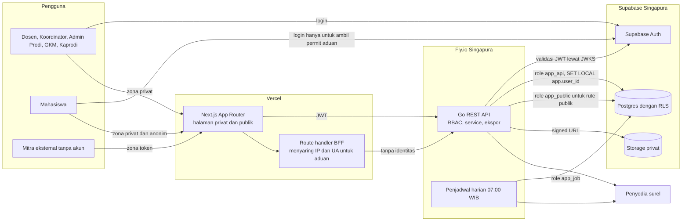

**Diagram 5.2 — Siklus status (*state*) entitas utama.** Catatan: pada publikasi catatan mahasiswa, setiap transisi tahap baru berlaku setelah diverifikasi dosen verifikator. Status disposisi aduan (AKTIF, SELESAI, DIESKALASI, DIBATALKAN) terpisah dari status aduan.

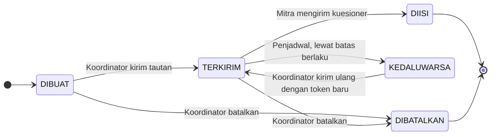

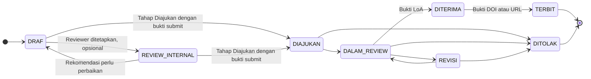

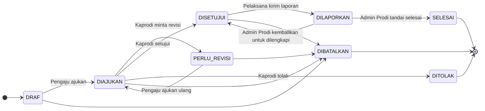

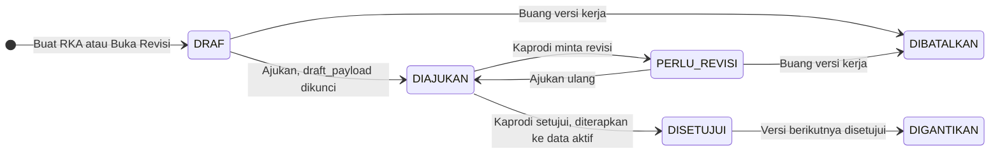

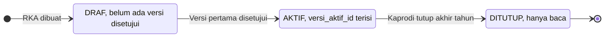

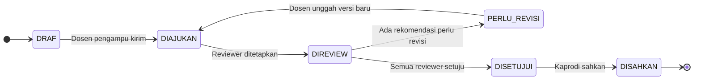

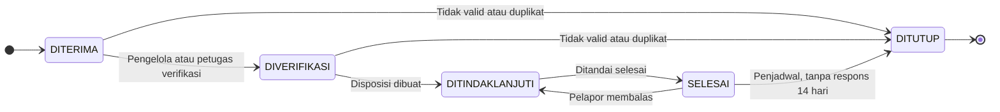

**Diagram 5.3 — Aduan anonim: ambil *permit*, kirim, dan lacak (Alur L1).** Aktor: Mahasiswa Pelapor. Setelah *permit* terbit, sesi login tidak dipakai lagi sehingga *endpoint* kirim tidak pernah melihat identitas.

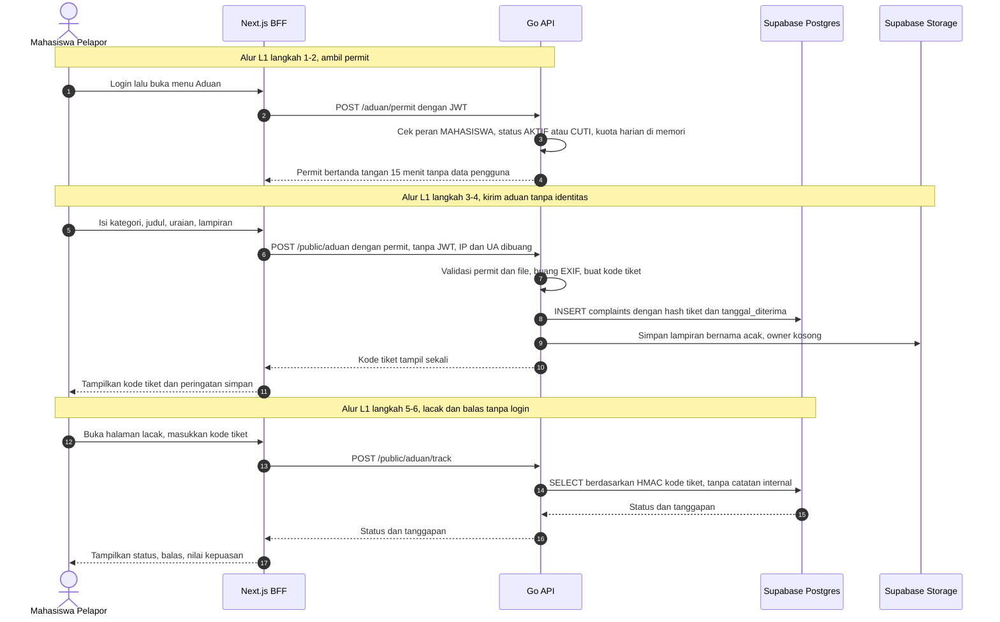

**Diagram 5.4 — Aduan: penanganan, eskalasi, dan akses Kaprodi (Alur L2, L3, L4).** Aktor: Pengelola Aduan, Pengelola Aduan penanganan kekerasan (PGL-K), Penanggung Jawab, Kaprodi, dan Penjadwal sistem.

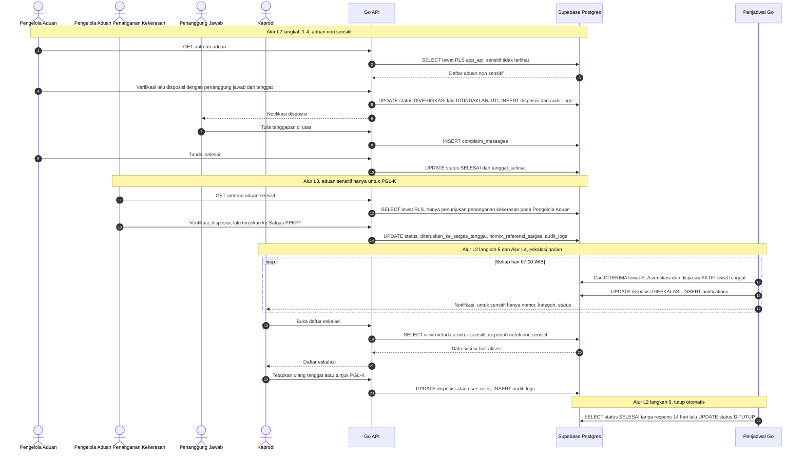

**Diagram 5.5 — Perjalanan dinas hingga realisasi RKA (Alur D1–D3, R2).** Aktor: Dosen (pelaksana), Kaprodi, Admin Prodi.

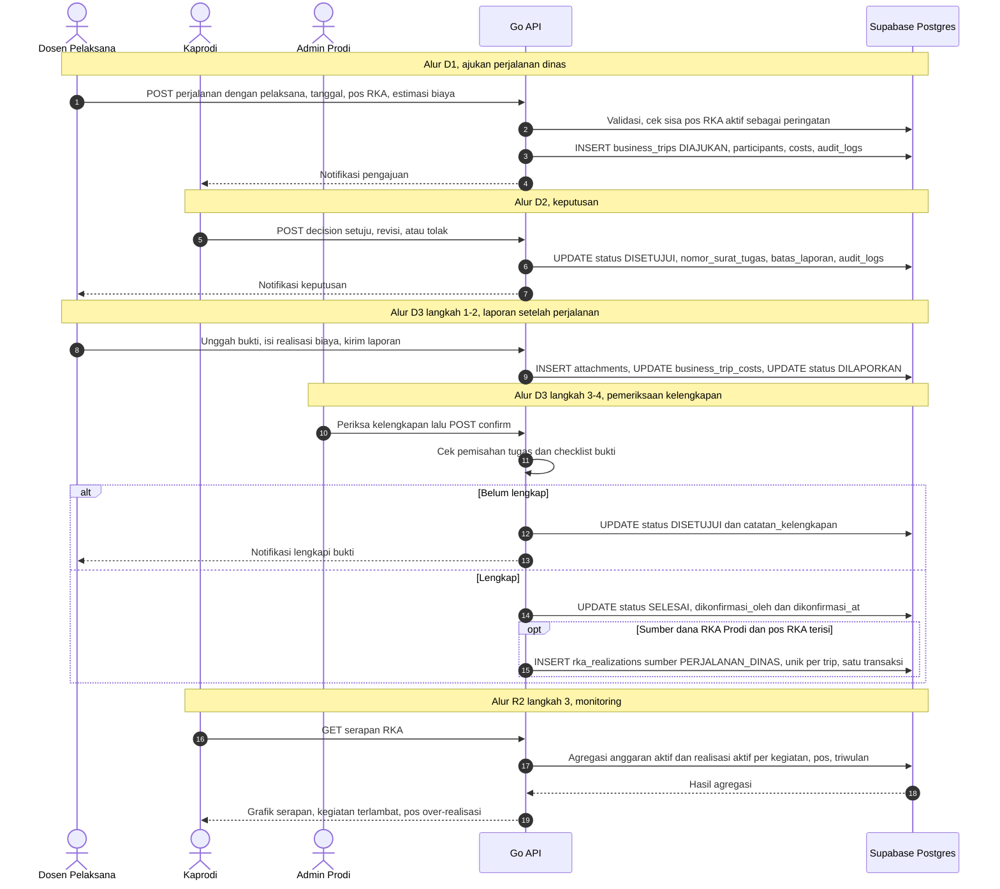

**Diagram 5.6 — Revisi RKA dengan versi kerja dan penerapan atomik (Alur R1).** Aktor: Admin Prodi (atau Kaprodi sebagai penyusun) dan Kaprodi sebagai pemberi persetujuan.

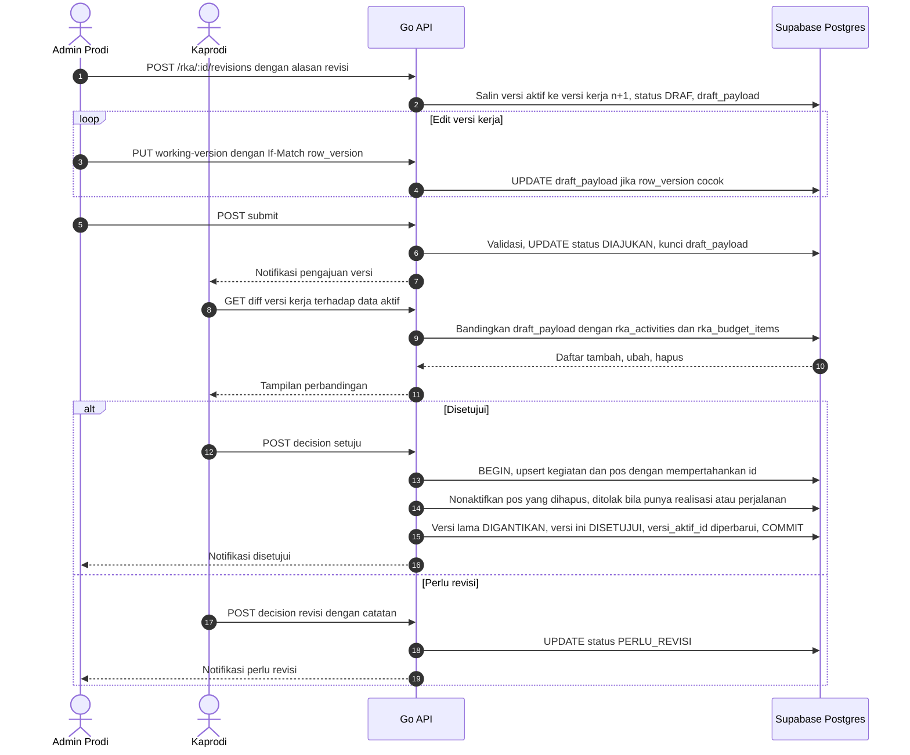

**Diagram 5.7 — Kepuasan mitra: kirim tautan, isi, dan rekap (Alur K1, M1).** Aktor: Koordinator dan Mitra.

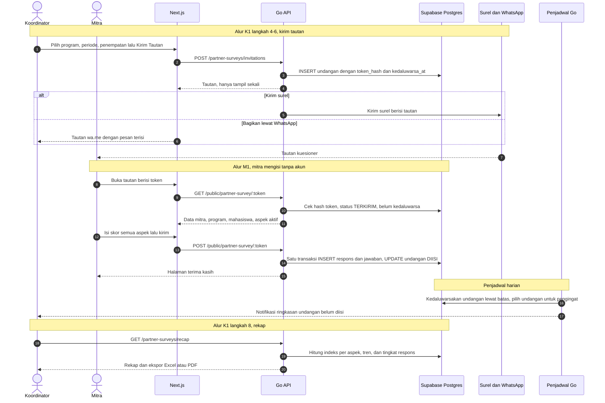

**Diagram 5.8 — Siklus mutu pembelajaran: evaluasi, RPS berikutnya, review, pengesahan (Alur Q1, Q2).** Aktor: Dosen Pengampu, GKM, Kaprodi, Reviewer RPS. Frontend tidak digambar agar ringkas.

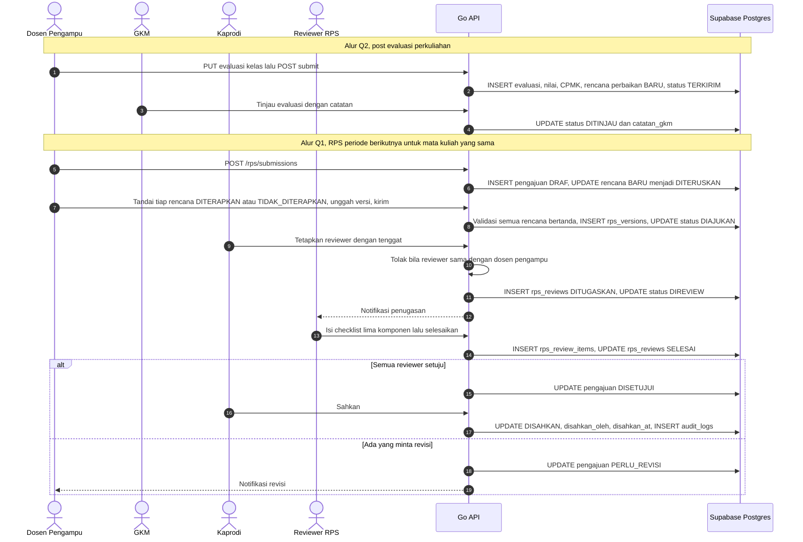

**Diagram 5.9 — Publikasi mahasiswa dengan verifikasi dan review internal (Alur P1–P3).** Aktor: Mahasiswa, Dosen Verifikator, Reviewer Internal, Kaprodi.

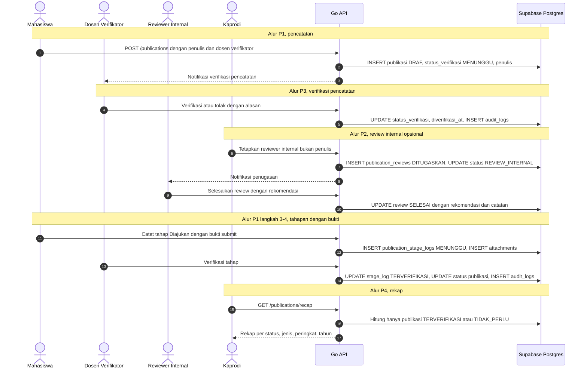

### Peta Halaman Frontend

Rute di bawah adalah usulan; **sesuaikan penamaan dan letak menu dengan struktur navigasi website existing**. Kolom pola menunjuk jenis halaman yang harus meniru halaman existing yang sepadan (hasil audit Fase 0).

| Rute | Aktor | Fungsi | Pola halaman |
|---|---|---|---|
| `/kepuasan-mitra` | Koordinator, Kaprodi | Dashboard rekap indeks, tren, tingkat respons | Dashboard |
| `/kepuasan-mitra/instrumen` | Koordinator | Daftar template per program | List + Filter |
| `/kepuasan-mitra/instrumen/[id]` | Koordinator | Atur aspek, aktifkan, duplikasi | Detail + Form |
| `/kepuasan-mitra/pengiriman` | Koordinator | Daftar penempatan, kirim/ingatkan/batalkan tautan, input manual | List + Filter + Aksi massal |
| `/mitra/isi/[token]` | Mitra | Isi kuesioner tanpa login | Halaman publik tanpa sidebar |
| `/publikasi` | Dosen, Mahasiswa, Kaprodi | Daftar publikasi milik/terkait | List + Filter |
| `/publikasi/baru`, `/publikasi/[id]/ubah` | Dosen, Mahasiswa | Form publikasi dan penulis | Form |
| `/publikasi/[id]` | Terkait publikasi | Detail, stepper tahapan, bukti, review, verifikasi | Detail + Timeline |
| `/publikasi/verifikasi` | Dosen Verifikator, Kaprodi | Antrean verifikasi | List + Aksi |
| `/publikasi/review-saya` | Reviewer Internal | Penugasan review | List |
| `/publikasi/rekap` | Kaprodi | Rekap per status/jenis/peringkat/tahun | Dashboard |
| `/perjalanan-dinas` | Dosen, Admin Prodi, Kaprodi | Daftar perjalanan | List + Filter |
| `/perjalanan-dinas/baru`, `/perjalanan-dinas/[id]/ubah` | Dosen, Admin Prodi | Form pengajuan dan estimasi | Form |
| `/perjalanan-dinas/[id]` | Terkait perjalanan | Detail, keputusan, status, rekap biaya | Detail + Timeline |
| `/perjalanan-dinas/[id]/laporan` | Pelaksana, Admin Prodi | Bukti, realisasi biaya, laporan hasil | Form + Upload |
| `/perjalanan-dinas/persetujuan` | Kaprodi | Antrean persetujuan | List + Aksi |
| `/perjalanan-dinas/rekap` | Admin Prodi, Kaprodi | Estimasi vs realisasi, penanda belum lengkap | Dashboard + Tabel |
| `/rka` | Kaprodi, Admin Prodi | Daftar RKA per tahun | List |
| `/rka/[tahun]` | Kaprodi, Admin Prodi | Ringkasan data aktif, riwayat versi | Detail |
| `/rka/[tahun]/versi-kerja` | Kaprodi, Admin Prodi | Editor kegiatan dan pos, ajukan | Form editor tabel |
| `/rka/[tahun]/versi/[nomor]` | Kaprodi, Admin Prodi | Lihat versi, perbandingan, keputusan | Detail + Diff |
| `/rka/[tahun]/kegiatan/[id]` | Kaprodi, Admin Prodi | Realisasi kegiatan dan pos | Detail + Form |
| `/rka/[tahun]/realisasi` | Kaprodi, Admin Prodi | Daftar dan catat realisasi | List + Form |
| `/rka/[tahun]/serapan` | Kaprodi, Admin Prodi | Monitoring serapan | Dashboard |
| `/rps` | Dosen Pengampu, Kaprodi, GKM | Daftar pengajuan RPS | List + Filter |
| `/rps/ajukan`, `/rps/[id]` | Dosen Pengampu | Unggah RPS, tindak lanjut evaluasi, riwayat versi | Form + Detail |
| `/rps/review-saya`, `/rps/review/[id]` | Reviewer RPS | Daftar tugas dan checklist review | List + Form checklist |
| `/rps/rekap` | Kaprodi, GKM | Status RPS seluruh mata kuliah | Dashboard + Tabel |
| `/evaluasi-perkuliahan` | Dosen Pengampu, GKM, Kaprodi | Daftar kelas dan status evaluasi | List + Filter |
| `/evaluasi-perkuliahan/[kelasId]` | Dosen Pengampu, GKM | Form evaluasi, umpan balik mahasiswa | Form + Panel samping |
| `/evaluasi-perkuliahan/rekap` | GKM, Kaprodi | Status pengisian dan ketercapaian CPMK | Dashboard |
| `/aduan` | Mahasiswa | Pernyataan privasi, ambil permit, form aduan | Form (tidak menampilkan data pengguna) |
| `/aduan/lacak` | Pemegang kode tiket | Status, utas, penilaian kepuasan | Halaman publik tanpa sidebar |
| `/kelola/aduan` | Pengelola Aduan | Antrean aduan non-sensitif | List + Filter |
| `/kelola/aduan/sensitif` | PGL-K (Pengelola Aduan penanganan kekerasan) | Antrean aduan sensitif | List + Filter |
| `/kelola/aduan/[id]` | Pengelola, Petugas, Penanggung Jawab | Detail, utas, disposisi, penerusan Satgas | Detail + Thread |
| `/kelola/aduan/tugas-saya` | Penanggung Jawab | Aduan yang didisposisikan | List |
| `/kelola/aduan/rekap` | Pengelola, Petugas, Kaprodi | Rekap dan eskalasi | Dashboard |
| `/pengaturan/mutu` | Kaprodi (semua pengaturan), Admin Prodi (hanya ukuran maksimum berkas) | Pengaturan tenggat, ambang, berkas | Form pengaturan |
| `/pengaturan/peran` | Kaprodi | Penunjukan Pengelola Aduan (termasuk penunjukan penanganan kekerasan) dan Dosen Verifikator | List + Form |

### Komponen Baru yang Mungkin Diperlukan

Periksa dulu di codebase existing; buat hanya yang belum ada, dengan *design token* existing.

- **StatusBadge dan StatusStepper:** satu pemetaan status → warna/label untuk semua enum di Bab 2.
- **Timeline:** riwayat tahapan publikasi, riwayat versi RKA/RPS, dan log audit.
- **FileUploader berkategori:** validasi tipe dan ukuran dari `app_settings`, pratinjau, kategori berkas.
- **CurrencyInput (Rp):** input nominal ≥ 0 dengan pemisah ribuan; total selalu dihitung server.
- **BudgetTableEditor:** editor dua tingkat kegiatan → pos untuk versi kerja RKA.
- **DiffViewer RKA:** perbandingan tambah/ubah/hapus per kegiatan dan pos.
- **ReviewChecklist:** tiga status (SESUAI/PERLU_PERBAIKAN/TIDAK_SESUAI) dengan catatan per komponen.
- **ThreadChat:** utas aduan dengan penanda catatan internal.
- **CopyOnceDialog:** menampilkan kode tiket sekali, tombol salin dan unduh.
- **ChartTrend dan ChartBar:** pakai pustaka *chart* yang sudah ada di website; bila belum ada, gunakan Recharts.
- **ExportMenu:** tombol ekspor Excel/PDF yang memanggil `?format=xlsx|pdf`.
- **PublicShell:** layout tanpa sidebar untuk halaman mitra dan lacak aduan.

## 6. **Database Schema**

Hierarki utama modul ini terbagi per domain. **Kepuasan Mitra:** Periode Akademik → Penempatan Mahasiswa (Mitra + Mahasiswa) → Undangan → Respons → Jawaban Aspek. **Publikasi:** Publikasi → Penulis, Tahapan, Review Internal. **Perjalanan Dinas & RKA:** Dokumen RKA → Versi (berisi `draft_payload`) dan, setelah disetujui, **data aktif** Kegiatan → Pos Anggaran → Realisasi ← Perjalanan Dinas (Pelaksana, Komponen Biaya). **Mutu Pembelajaran:** Mata Kuliah + Periode → Pengajuan RPS → Versi → Review → Item Review, dan Kelas → Evaluasi → (Nilai, CPMK, Rencana Perbaikan) → kembali ke Pengajuan RPS berikutnya. **Aduan:** Aduan → Pesan dan Disposisi. Tabel lintas modul: Lampiran, Log Audit, Notifikasi, Pengaturan Sistem. Semua tabel memiliki `id` (uuid, *Primary Key*, default `gen_random_uuid()`), `created_at` dan `updated_at` (timestamptz), kecuali yang disebut berbeda: `app_settings` (PK `key`), `audit_logs` (PK `bigint`), dan tabel aduan (`complaints`, `complaint_messages`) yang sengaja tidak memiliki waktu presisi jam demi anonimitas. Tabel nomor 1–8 adalah data induk *shared* (read-only dari sisi modul ini). Diagram ER di akhir bab ini **dihasilkan otomatis dari daftar tabel di bawah**, sehingga nama tabel, kolom, dan relasinya selalu sama dengan skema.

### A. Data Induk (Shared)

1. **`Pengguna (profiles)` - profil pengguna, `id` sama dengan `auth.users.id` Supabase**
   - `id` (uuid): *Primary Key*, sama dengan `auth.users.id`.
   - `nomor_induk` (text, unique): NIM/NIDN/NIP.
   - `nama_lengkap` (text): nama pengguna.
   - `email` (text, unique): surel untuk notifikasi.
   - `tipe_pengguna` (enum): MAHASISWA, DOSEN, TENDIK.
   - `angkatan` (smallint, nullable): hanya untuk mahasiswa.
   - `status_akademik` (enum, nullable): AKTIF, CUTI, LULUS, MENGUNDURKAN_DIRI, DIKELUARKAN; sinkron dari SIAKAD.
   - `is_active` (boolean): akun boleh login.
   - `siakad_synced_at` (timestamptz, nullable): waktu sinkron terakhir.

2. **`Peran Pengguna (user_roles)` - peran RBAC, satu pengguna dapat memiliki banyak peran**
   - `id` (uuid): *Primary Key*.
   - `user_id` (uuid): *Foreign Key* ke `profiles.id`.
   - `role` (enum): KAPRODI, GKM, ADMIN_PRODI, DOSEN, KOORDINATOR_KP, KOORDINATOR_PSI, KOORDINATOR_PDLK, PENGELOLA_ADUAN, MAHASISWA; ditambah DOSEN_VERIFIKATOR, DOSEN_WALI, DOSEN_PEMBINA, KETUA_KELAS, PENGURUS_HIMPUNAN untuk kompatibilitas Modul 1–6 dan SIMPRO Manajemen Prodi.
   - `ditetapkan_oleh` (uuid, nullable): *Foreign Key* ke `profiles.id`.
   - `berlaku_dari` (date): awal masa berlaku.
   - `berlaku_sampai` (date, nullable): akhir masa berlaku.
   - `penanganan_kekerasan` (boolean): default `false`; `true` menandai Pengelola Aduan yang ditunjuk Kaprodi menangani aduan kekerasan (FR-50). Ini penunjukan pada peran, bukan peran baru.
   - Constraint: `UNIQUE (user_id, role)`; `CHECK (penanganan_kekerasan = false OR role = 'PENGELOLA_ADUAN')`.

3. **`Periode Akademik (academic_periods)` - tahun akademik dan semester**
   - `id` (uuid): *Primary Key*.
   - `tahun_akademik` (text): misal `2025/2026`.
   - `semester` (enum): GANJIL, GENAP.
   - `tanggal_mulai` (date): awal periode.
   - `tanggal_selesai` (date): akhir periode.
   - `tanggal_selesai_perkuliahan` (date): penanda dibukanya evaluasi akhir.
   - `batas_pengisian_evaluasi` (date): tenggat pengisian evaluasi (FR-43).
   - `is_active` (boolean): periode berjalan.
   - Constraint: `UNIQUE (tahun_akademik, semester)`.

4. **`Mata Kuliah (courses)` - katalog mata kuliah**
   - `id` (uuid): *Primary Key*.
   - `kode_mk` (text, unique): kode mata kuliah.
   - `nama_mk` (text): nama mata kuliah.
   - `sks` (smallint): bobot SKS.
   - `is_active` (boolean): masih dibuka pada kurikulum aktif.

5. **`Kelas Mata Kuliah (course_classes)` - kelas yang dibuka per periode**
   - `id` (uuid): *Primary Key*.
   - `course_id` (uuid): *Foreign Key* ke `courses.id`.
   - `academic_period_id` (uuid): *Foreign Key* ke `academic_periods.id`.
   - `kode_kelas` (text): misal A, B, C.
   - `dosen_pengampu_id` (uuid): *Foreign Key* ke `profiles.id` (dosen koordinator pengampu).
   - `jumlah_mahasiswa` (smallint): jumlah peserta kelas.
   - Constraint: `UNIQUE (course_id, academic_period_id, kode_kelas)`.

6. **`Ringkasan Umpan Balik Mahasiswa (course_feedback_summaries)` - ringkasan kuesioner mahasiswa, sinkron dari SIMPRO Manajemen Prodi (FR-44)**
   - `id` (uuid): *Primary Key*.
   - `course_class_id` (uuid, unique): *Foreign Key* ke `course_classes.id`.
   - `jumlah_responden` (integer): jumlah mahasiswa yang mengisi.
   - `skor_rata_rata` (numeric(4,2)): rata-rata skor kepuasan.
   - `rincian_aspek` (jsonb): skor per aspek.
   - `disinkronkan_at` (timestamptz): waktu sinkron terakhir.

7. **`Mitra (partners)` - basis data mitra KP/PSI/PDLK, sinkron dari SIMPRO Manajemen Prodi (FR-31 di SKPL tersebut)**
   - `id` (uuid): *Primary Key*.
   - `external_ref_id` (text, nullable): ID mitra di sistem sumber.
   - `nama_mitra` (text): nama perusahaan/instansi.
   - `bidang_usaha` (text, nullable): bidang mitra.
   - `alamat` (text, nullable): alamat mitra.
   - `nama_kontak` (text): narahubung.
   - `email_kontak` (text, nullable): surel narahubung.
   - `telepon_kontak` (text, nullable): format internasional `62...` untuk tautan WhatsApp.
   - `is_active` (boolean): mitra masih aktif.

8. **`Penempatan Mahasiswa (student_placements)` - penempatan mahasiswa pada mitra per program**
   - `id` (uuid): *Primary Key*.
   - `partner_id` (uuid): *Foreign Key* ke `partners.id`.
   - `student_id` (uuid): *Foreign Key* ke `profiles.id`.
   - `academic_period_id` (uuid): *Foreign Key* ke `academic_periods.id`.
   - `program` (enum): KP, PSI, PDLK.
   - `tanggal_mulai` (date, nullable): awal penempatan.
   - `tanggal_selesai` (date, nullable): akhir penempatan.
   - Constraint: `UNIQUE (student_id, program, academic_period_id)`.

### B. Modul 7 — Kepuasan Mitra

9. **`Template Kuesioner Mitra (partner_survey_templates)` - instrumen kepuasan per program (FR-26)**
   - `id` (uuid): *Primary Key*.
   - `program` (enum): KP, PSI, PDLK.
   - `nama` (text): nama *template*.
   - `skala_maks` (smallint): default 5 (skala 1–5).
   - `status` (enum): DRAF, AKTIF, ARSIP.
   - `dibuat_oleh` (uuid): *Foreign Key* ke `profiles.id`.
   - Aturan: *template* yang sudah memiliki respons tidak dapat diubah aspeknya.

10. **`Aspek Kuesioner Mitra (partner_survey_aspects)` - aspek penilaian yang dapat dikonfigurasi**
    - `id` (uuid): *Primary Key*.
    - `template_id` (uuid): *Foreign Key* ke `partner_survey_templates.id`.
    - `nama_aspek` (text): misal Kompetensi, Etika.
    - `deskripsi` (text, nullable): penjelasan aspek untuk mitra.
    - `bobot` (numeric(5,2)): bobot aspek, > 0.
    - `urutan` (smallint): urutan tampil.
    - `is_active` (boolean): aspek dipakai atau tidak.

11. **`Undangan Kuesioner Mitra (partner_survey_invitations)` - tautan pengisian per penempatan (FR-27)**
    - `id` (uuid): *Primary Key*.
    - `template_id` (uuid): *Foreign Key* ke `partner_survey_templates.id`.
    - `placement_id` (uuid): *Foreign Key* ke `student_placements.id`.
    - `token_hash` (text, unique): SHA-256 dari *token* acak 32 byte (token asli hanya ada di tautan).
    - `status` (enum): DIBUAT, TERKIRIM, DIISI, KEDALUWARSA, DIBATALKAN.
    - `dikirim_via` (enum, nullable): EMAIL, WHATSAPP, MANUAL.
    - `dikirim_at` (timestamptz, nullable): waktu pengiriman.
    - `kedaluwarsa_at` (timestamptz): batas berlaku tautan (default 30 hari).
    - `jumlah_pengingat` (smallint): default 0, maksimum 2.
    - `dibuat_oleh` (uuid): *Foreign Key* ke `profiles.id`.
    - Constraint: `UNIQUE (template_id, placement_id)`.

12. **`Respons Kepuasan Mitra (partner_survey_responses)` - respons yang telah dikirim**
    - `id` (uuid): *Primary Key*.
    - `template_id` (uuid): *Foreign Key* ke `partner_survey_templates.id`.
    - `placement_id` (uuid): *Foreign Key* ke `student_placements.id` (mitra, program, periode, dan mahasiswa diturunkan dari sini).
    - `invitation_id` (uuid, nullable, unique): *Foreign Key* ke `partner_survey_invitations.id`; kosong bila input koordinator.
    - `sumber` (enum): TAUTAN_MITRA, INPUT_KOORDINATOR.
    - `status` (enum): TERKIRIM, VOID (dibatalkan koordinator karena salah input; tidak masuk rekap).
    - `nama_pengisi` (text): nama pengisi dari pihak mitra.
    - `jabatan_pengisi` (text, nullable): jabatan pengisi.
    - `komentar` (text, nullable): saran/komentar mitra.
    - `diinput_oleh` (uuid, nullable): *Foreign Key* ke `profiles.id`; hanya untuk INPUT_KOORDINATOR.
    - `submitted_at` (timestamptz): waktu pengiriman.
    - Constraint: `UNIQUE (template_id, placement_id)`.

13. **`Jawaban Aspek Mitra (partner_survey_answers)` - skor per aspek**
    - `id` (uuid): *Primary Key*.
    - `response_id` (uuid): *Foreign Key* ke `partner_survey_responses.id`.
    - `aspect_id` (uuid): *Foreign Key* ke `partner_survey_aspects.id`.
    - `skor` (smallint): 1 sampai `skala_maks`.
    - `catatan` (text, nullable): catatan per aspek.
    - Constraint: `UNIQUE (response_id, aspect_id)`.

### C. Modul 8 — Publikasi

14. **`Publikasi (publications)` - data publikasi dosen dan mahasiswa (FR-29)**
    - `id` (uuid): *Primary Key*.
    - `judul` (text): judul publikasi.
    - `jenis` (enum): JURNAL, PROSIDING, BUKU, HKI.
    - `nama_target` (text): nama jurnal/konferensi/penerbit/sentra HKI.
    - `peringkat` (enum): SINTA_1 sampai SINTA_6, SCOPUS_Q1 sampai SCOPUS_Q4, WOS, NON_PERINGKAT, BELUM_DITENTUKAN.
    - `status` (enum): DRAF, REVIEW_INTERNAL, DIAJUKAN, DALAM_REVIEW, REVISI, DITERIMA, TERBIT, DITOLAK (tahap terkini).
    - `status_verifikasi` (enum): TIDAK_PERLU (dicatat dosen), MENUNGGU, TERVERIFIKASI, DITOLAK.
    - `doi` (text, nullable): DOI bila sudah terbit.
    - `url` (text, nullable): tautan publikasi.
    - `tahun` (smallint): tahun terbit, atau tahun pencatatan bila belum terbit.
    - `dicatat_oleh` (uuid): *Foreign Key* ke `profiles.id`.
    - `verifikator_id` (uuid, nullable): *Foreign Key* ke `profiles.id`; wajib bila dicatat mahasiswa, dipilih dari penulis dosen berperan PEMBIMBING atau ANGGOTA, dapat diganti Kaprodi dengan dosen lain.
    - `diverifikasi_at` (timestamptz, nullable): waktu verifikasi.
    - `catatan_verifikasi` (text, nullable): alasan terima/tolak.

15. **`Penulis Publikasi (publication_authors)` - daftar penulis beserta peran**
    - `id` (uuid): *Primary Key*.
    - `publication_id` (uuid): *Foreign Key* ke `publications.id`.
    - `user_id` (uuid, nullable): *Foreign Key* ke `profiles.id`; kosong untuk penulis eksternal.
    - `nama_penulis` (text): nama tampil.
    - `afiliasi` (text, nullable): institusi penulis.
    - `tipe_penulis` (enum): DOSEN, MAHASISWA, EKSTERNAL.
    - `peran` (enum): PENULIS_PERTAMA, KORESPONDENSI, ANGGOTA, PEMBIMBING.
    - `urutan` (smallint): urutan penulis.

16. **`Tahapan Publikasi (publication_stage_logs)` - riwayat tahapan beserta bukti (FR-30)**
    - `id` (uuid): *Primary Key*.
    - `publication_id` (uuid): *Foreign Key* ke `publications.id`.
    - `tahap` (enum): sama dengan enum `publications.status`.
    - `tanggal_tahap` (date): tanggal tahap terjadi.
    - `jenis_bukti` (enum, nullable): BUKTI_SUBMIT, LOA, DOI_URL, LAINNYA.
    - `tautan_bukti` (text, nullable): DOI/URL bila bukti berupa tautan; berkas ada di `attachments`.
    - `catatan` (text, nullable): catatan tahap.
    - `dicatat_oleh` (uuid): *Foreign Key* ke `profiles.id`.
    - `status_verifikasi` (enum): TIDAK_PERLU, MENUNGGU, TERVERIFIKASI, DITOLAK.
    - `diverifikasi_oleh` (uuid, nullable): *Foreign Key* ke `profiles.id`.
    - `diverifikasi_at` (timestamptz, nullable): waktu verifikasi.
    - `catatan_verifikasi` (text, nullable): alasan terima/tolak.

17. **`Review Internal Publikasi (publication_reviews)` - penugasan dan hasil reviewer internal (FR-31)**
    - `id` (uuid): *Primary Key*.
    - `publication_id` (uuid): *Foreign Key* ke `publications.id`.
    - `reviewer_id` (uuid): *Foreign Key* ke `profiles.id`; tidak boleh termasuk penulis.
    - `ditetapkan_oleh` (uuid): *Foreign Key* ke `profiles.id`.
    - `status` (enum): DITUGASKAN, SELESAI, DIBATALKAN.
    - `tenggat_review` (date, nullable): batas review.
    - `rekomendasi` (enum, nullable): LAYAK_DIAJUKAN, PERLU_PERBAIKAN.
    - `catatan_review` (text, nullable): catatan reviewer.
    - `ditugaskan_at` (timestamptz): waktu penugasan.
    - `selesai_at` (timestamptz, nullable): waktu review selesai.

### D. Modul 9 — Perjalanan Dinas

18. **`Perjalanan Dinas (business_trips)` - pengajuan, persetujuan, dan pelaporan perjalanan dinas (FR-33, FR-34)**
    - `id` (uuid): *Primary Key*.
    - `nomor_surat_tugas` (text, nullable): wajib terisi sebelum DISETUJUI.
    - `diajukan_oleh` (uuid): *Foreign Key* ke `profiles.id`.
    - `tujuan` (text): kota/lokasi tujuan.
    - `maksud_kegiatan` (text): maksud perjalanan.
    - `tanggal_berangkat` (date): tanggal berangkat.
    - `tanggal_kembali` (date): tanggal kembali, ≥ tanggal berangkat.
    - `sumber_dana` (enum): RKA_PRODI, FAKULTAS, HIBAH, MANDIRI, LAINNYA.
    - `rka_budget_item_id` (uuid, nullable): *Foreign Key* ke `rka_budget_items.id`; wajib bila `sumber_dana` = RKA_PRODI.
    - `status` (enum): DRAF, DIAJUKAN, PERLU_REVISI, DISETUJUI, DITOLAK, DILAPORKAN, SELESAI, DIBATALKAN; DILAPORKAN dapat kembali ke DISETUJUI bila dikembalikan untuk dilengkapi.
    - `disetujui_oleh` (uuid, nullable): *Foreign Key* ke `profiles.id`.
    - `disetujui_at` (timestamptz, nullable): waktu keputusan Kaprodi.
    - `catatan_keputusan` (text, nullable): catatan Kaprodi.
    - `batas_laporan` (date, nullable): tanggal kembali + `trip_report_deadline_days`.
    - `laporan_hasil` (text, nullable): laporan hasil perjalanan.
    - `laporan_dikirim_at` (timestamptz, nullable): waktu laporan dikirim.
    - `dikonfirmasi_oleh` (uuid, nullable): *Foreign Key* ke `profiles.id` (Admin Prodi); tidak boleh pengaju atau pelaksana perjalanan itu, bila konflik oleh Kaprodi.
    - `dikonfirmasi_at` (timestamptz, nullable): waktu ditandai SELESAI.
    - `catatan_kelengkapan` (text, nullable): catatan pemeriksaan kelengkapan.

19. **`Pelaksana Perjalanan (business_trip_participants)` - pelaksana per perjalanan**
    - `id` (uuid): *Primary Key*.
    - `trip_id` (uuid): *Foreign Key* ke `business_trips.id`.
    - `user_id` (uuid): *Foreign Key* ke `profiles.id`.
    - `peran` (enum): KETUA_ROMBONGAN, ANGGOTA.
    - Constraint: `UNIQUE (trip_id, user_id)`.

20. **`Komponen Biaya Perjalanan (business_trip_costs)` - estimasi dan realisasi biaya per komponen**
    - `id` (uuid): *Primary Key*.
    - `trip_id` (uuid): *Foreign Key* ke `business_trips.id`.
    - `komponen` (enum): TRANSPORTASI, AKOMODASI, UANG_HARIAN, LAINNYA.
    - `keterangan` (text, nullable): rincian, wajib bila komponen LAINNYA.
    - `estimasi_biaya` (numeric(15,2)): ≥ 0, wajib.
    - `realisasi_biaya` (numeric(15,2), nullable): ≥ 0, diisi saat pelaporan.
    - Aturan: setiap perjalanan wajib memiliki baris TRANSPORTASI, AKOMODASI, dan UANG_HARIAN (nilai boleh 0).

### E. Modul 10 — RKA Prodi

Prinsip: **data aktif** (`rka_activities`, `rka_budget_items`) adalah satu-satunya sumber untuk realisasi, perjalanan dinas, dan monitoring serapan. Perubahan RKA tidak pernah mengedit data aktif secara langsung, melainkan disusun pada **versi kerja** (`rka_versions.draft_payload`) dan baru diterapkan ke data aktif secara atomik saat Kaprodi menyetujui.

21. **`Dokumen RKA (rka_documents)` - RKA per tahun anggaran (FR-36)**
    - `id` (uuid): *Primary Key*.
    - `tahun_anggaran` (smallint, unique): satu RKA per tahun.
    - `judul` (text): judul dokumen.
    - `status` (enum): DRAF (belum ada versi disetujui), AKTIF, DITUTUP.
    - `versi_aktif_id` (uuid, nullable, unique): *Foreign Key* ke `rka_versions.id`; versi DISETUJUI yang sedang berlaku, `NULL` sampai versi pertama disetujui.
    - `versi_kerja_id` (uuid, nullable, unique): *Foreign Key* ke `rka_versions.id`; versi yang sedang disusun (DRAF/DIAJUKAN/PERLU_REVISI), maksimum satu.
    - `total_anggaran` (numeric(15,2)): total data aktif, dihitung ulang server saat penerapan versi.
    - `dibuat_oleh` (uuid): *Foreign Key* ke `profiles.id`.
    - `ditutup_oleh` (uuid, nullable): *Foreign Key* ke `profiles.id` (Kaprodi).
    - `ditutup_at` (timestamptz, nullable): waktu penutupan akhir tahun.

22. **`Versi RKA (rka_versions)` - versi kerja dan riwayat versi tak berubah**
    - `id` (uuid): *Primary Key*.
    - `rka_id` (uuid): *Foreign Key* ke `rka_documents.id`.
    - `nomor_versi` (integer): mulai dari 1.
    - `status` (enum): DRAF, DIAJUKAN, PERLU_REVISI, DISETUJUI, DIGANTIKAN, DIBATALKAN.
    - `total_anggaran` (numeric(15,2)): total isi versi, dihitung server.
    - `draft_payload` (jsonb): isi versi (kegiatan dan pos beserta `id` data aktif bila baris sudah ada). Dapat diubah hanya saat DRAF/PERLU_REVISI; setelah DIAJUKAN dikunci *trigger* dan menjadi *snapshot* permanen.
    - `alasan_revisi` (text, nullable): wajib untuk `nomor_versi` ≥ 2.
    - `row_version` (integer): *optimistic locking* untuk penyimpanan draf (header `If-Match`).
    - `dibuat_oleh` (uuid): *Foreign Key* ke `profiles.id`.
    - `diajukan_oleh` (uuid, nullable): *Foreign Key* ke `profiles.id`.
    - `diajukan_at` (timestamptz, nullable): waktu pengajuan.
    - `ditinjau_oleh` (uuid, nullable): *Foreign Key* ke `profiles.id` (Kaprodi).
    - `ditinjau_at` (timestamptz, nullable): waktu keputusan.
    - `catatan_peninjauan` (text, nullable): catatan Kaprodi.
    - `diterapkan_at` (timestamptz, nullable): waktu versi diterapkan ke data aktif.
    - Constraint: `UNIQUE (rka_id, nomor_versi)`; indeks unik parsial agar hanya satu versi berstatus DRAF/DIAJUKAN/PERLU_REVISI per `rka_id`.

23. **`Kegiatan RKA (rka_activities)` - kegiatan pada data aktif**
    - `id` (uuid): *Primary Key*; dipertahankan lintas versi.
    - `rka_id` (uuid): *Foreign Key* ke `rka_documents.id`.
    - `kode_kegiatan` (text): kode kegiatan.
    - `nama_kegiatan` (text): nama kegiatan.
    - `indikator_kinerja` (text): indikator keberhasilan.
    - `target_indikator` (text): target indikator.
    - `jadwal_mulai` (date): rencana mulai.
    - `jadwal_selesai` (date): rencana selesai.
    - `penanggung_jawab_id` (uuid): *Foreign Key* ke `profiles.id`.
    - `status_pelaksanaan` (enum): BELUM_DILAKSANAKAN, BERJALAN, TERLAKSANA, DIBATALKAN (diubah langsung Admin Prodi/Kaprodi).
    - `tanggal_realisasi_mulai` (date, nullable): pelaksanaan aktual (FR-37).
    - `tanggal_realisasi_selesai` (date, nullable): pelaksanaan aktual (FR-37).
    - `capaian_indikator` (text, nullable): capaian aktual.
    - `is_active` (boolean): `false` bila kegiatan dihapus pada revisi; tidak diperbolehkan bila sudah memiliki realisasi (cukup dinolkan).
    - Dibuat/diubah (kecuali kolom pelaksanaan) hanya oleh fungsi penerapan versi. Constraint: `UNIQUE (rka_id, kode_kegiatan)`; setiap kegiatan wajib memiliki ≥ 1 pos aktif sebelum versi diajukan.

24. **`Pos Anggaran RKA (rka_budget_items)` - pos anggaran pada data aktif, target tautan perjalanan dinas**
    - `id` (uuid): *Primary Key*; dipertahankan lintas versi.
    - `activity_id` (uuid): *Foreign Key* ke `rka_activities.id`.
    - `kode_pos` (text): kode pos.
    - `nama_pos` (text): nama pos.
    - `kategori_pos` (enum): BELANJA_BARANG, BELANJA_JASA, HONOR, PERJALANAN_DINAS, LAINNYA.
    - `volume` (numeric(12,2)): ≥ 0.
    - `satuan` (text): satuan volume.
    - `harga_satuan` (numeric(15,2)): ≥ 0.
    - `nominal_anggaran` (numeric(15,2)): kolom *generated* = `volume × harga_satuan`.
    - `sumber_dana` (enum): DANA_UNIVERSITAS, DANA_FAKULTAS, PNBP, HIBAH, LAINNYA.
    - `is_active` (boolean): `false` bila pos dihapus pada revisi; tidak diperbolehkan bila sudah ada realisasi atau tertaut perjalanan dinas (cukup dinolkan).
    - Dibuat/diubah hanya oleh fungsi penerapan versi. Constraint: `UNIQUE (activity_id, kode_pos)`.

25. **`Realisasi RKA (rka_realizations)` - realisasi biaya per pos (FR-37)**
    - `id` (uuid): *Primary Key*.
    - `rka_budget_item_id` (uuid): *Foreign Key* ke `rka_budget_items.id`.
    - `tanggal_realisasi` (date): menentukan triwulan.
    - `nominal_realisasi` (numeric(15,2)): ≥ 0.
    - `uraian` (text): uraian pengeluaran.
    - `sumber_pencatatan` (enum): MANUAL, PERJALANAN_DINAS.
    - `business_trip_id` (uuid, nullable, unique): *Foreign Key* ke `business_trips.id`; terisi bila dari perjalanan dinas.
    - `status` (enum): AKTIF, DIBATALKAN.
    - `dicatat_oleh` (uuid): *Foreign Key* ke `profiles.id`.

### F. Modul 11 — Review RPS

26. **`Pengajuan RPS (rps_submissions)` - satu RPS per mata kuliah per periode (FR-39, FR-41)**
    - `id` (uuid): *Primary Key*.
    - `course_id` (uuid): *Foreign Key* ke `courses.id`.
    - `academic_period_id` (uuid): *Foreign Key* ke `academic_periods.id`.
    - `dosen_pengampu_id` (uuid): *Foreign Key* ke `profiles.id`.
    - `status` (enum): DRAF, DIAJUKAN, DIREVIEW, PERLU_REVISI, DISETUJUI, DISAHKAN.
    - `versi_terbaru` (integer): nomor versi terakhir.
    - `diajukan_at` (timestamptz, nullable): waktu pengajuan pertama.
    - `disahkan_oleh` (uuid, nullable): *Foreign Key* ke `profiles.id` (Kaprodi).
    - `disahkan_at` (timestamptz, nullable): waktu pengesahan.
    - `catatan_pengesahan` (text, nullable): catatan Kaprodi.
    - Constraint: `UNIQUE (course_id, academic_period_id)`.

27. **`Versi RPS (rps_versions)` - riwayat versi berkas RPS**
    - `id` (uuid): *Primary Key*.
    - `submission_id` (uuid): *Foreign Key* ke `rps_submissions.id`.
    - `nomor_versi` (integer): mulai dari 1.
    - `catatan_perubahan` (text, nullable): ringkasan perubahan dari versi sebelumnya.
    - `diunggah_oleh` (uuid): *Foreign Key* ke `profiles.id`.
    - Berkas RPS disimpan di `attachments` (`entity_type` = RPS_VERSION).
    - Constraint: `UNIQUE (submission_id, nomor_versi)`.

28. **`Review RPS (rps_reviews)` - penugasan dan hasil review per versi (FR-40)**
    - `id` (uuid): *Primary Key*.
    - `version_id` (uuid): *Foreign Key* ke `rps_versions.id`.
    - `reviewer_id` (uuid): *Foreign Key* ke `profiles.id`; tidak boleh sama dengan `dosen_pengampu_id`.
    - `ditetapkan_oleh` (uuid): *Foreign Key* ke `profiles.id` (Kaprodi/GKM).
    - `status` (enum): DITUGASKAN, SELESAI, DIBATALKAN.
    - `tenggat_review` (date): batas review (default 7 hari).
    - `rekomendasi` (enum, nullable): DISETUJUI, PERLU_REVISI.
    - `catatan_umum` (text, nullable): catatan umum reviewer.
    - `ditugaskan_at` (timestamptz): waktu penugasan.
    - `selesai_at` (timestamptz, nullable): waktu review selesai.

29. **`Item Review RPS (rps_review_items)` - hasil checklist per komponen**
    - `id` (uuid): *Primary Key*.
    - `review_id` (uuid): *Foreign Key* ke `rps_reviews.id`.
    - `komponen` (enum): KESELARASAN_CPL_CPMK, BAHAN_KAJIAN, METODE_PEMBELAJARAN, BENTUK_BOBOT_PENILAIAN, REFERENSI.
    - `hasil` (enum): SESUAI, PERLU_PERBAIKAN, TIDAK_SESUAI.
    - `catatan` (text, nullable): catatan per komponen.
    - Constraint: `UNIQUE (review_id, komponen)`; review hanya dapat diselesaikan bila kelima komponen terisi.

### G. Modul 12 — Post Evaluasi Perkuliahan

30. **`Evaluasi Akhir Perkuliahan (course_evaluations)` - evaluasi dosen per kelas (FR-43)**
    - `id` (uuid): *Primary Key*.
    - `course_class_id` (uuid, unique): *Foreign Key* ke `course_classes.id`.
    - `diisi_oleh` (uuid): *Foreign Key* ke `profiles.id`.
    - `status` (enum): DRAF, TERKIRIM, DITINJAU.
    - `kesesuaian_rps` (enum): SESUAI, SEBAGIAN, TIDAK_SESUAI.
    - `penjelasan_kesesuaian` (text, nullable): wajib bila bukan SESUAI.
    - `kendala` (text, nullable): kendala pelaksanaan.
    - `dikirim_at` (timestamptz, nullable): waktu dikirim.
    - `ditinjau_oleh` (uuid, nullable): *Foreign Key* ke `profiles.id` (GKM).
    - `ditinjau_at` (timestamptz, nullable): waktu ditinjau.
    - `catatan_gkm` (text, nullable): catatan GKM.

31. **`Distribusi Nilai Evaluasi (course_evaluation_grades)` - distribusi nilai kelas**
    - `id` (uuid): *Primary Key*.
    - `evaluation_id` (uuid): *Foreign Key* ke `course_evaluations.id`.
    - `nilai_huruf` (text): default A, AB, B, BC, C, D, E (dapat disesuaikan skala kampus).
    - `jumlah_mahasiswa` (integer): ≥ 0; total diperingatkan bila tidak sama dengan `course_classes.jumlah_mahasiswa`.
    - Constraint: `UNIQUE (evaluation_id, nilai_huruf)`.

32. **`Ketercapaian CPMK Evaluasi (course_evaluation_cpmk)` - target vs capaian per CPMK**
    - `id` (uuid): *Primary Key*.
    - `evaluation_id` (uuid): *Foreign Key* ke `course_evaluations.id`.
    - `kode_cpmk` (text): kode CPMK.
    - `deskripsi_cpmk` (text): deskripsi CPMK.
    - `target_persen` (numeric(5,2)): target ketercapaian.
    - `capaian_persen` (numeric(5,2)): capaian aktual.
    - `tercapai` (boolean): kolom *generated* = `capaian_persen >= target_persen`.
    - `analisis` (text, nullable): analisis dosen.
    - Constraint: `UNIQUE (evaluation_id, kode_cpmk)`.

33. **`Rencana Perbaikan (course_improvement_plans)` - rencana perbaikan dan tindak lanjutnya ke RPS (FR-45)**
    - `id` (uuid): *Primary Key*.
    - `evaluation_id` (uuid): *Foreign Key* ke `course_evaluations.id`.
    - `uraian` (text): rencana perbaikan.
    - `kategori` (enum): CPMK_RPS, METODE_PEMBELAJARAN, PENILAIAN, REFERENSI, LAINNYA.
    - `status` (enum): BARU, DITERUSKAN, DITERAPKAN, TIDAK_DITERAPKAN.
    - `target_rps_submission_id` (uuid, nullable): *Foreign Key* ke `rps_submissions.id`; RPS berikutnya mata kuliah yang sama.
    - `catatan_penerapan` (text, nullable): wajib saat DITERAPKAN/TIDAK_DITERAPKAN.
    - `ditandai_oleh` (uuid, nullable): *Foreign Key* ke `profiles.id`.
    - `ditandai_at` (timestamptz, nullable): waktu penandaan.

### H. Modul 13 — Layanan Aduan Mahasiswa

34. **`Aduan (complaints)` - aduan anonim; tanpa kolom identitas, IP, maupun waktu presisi jam (FR-47, FR-48)**
    - `id` (uuid): *Primary Key*.
    - `nomor_aduan` (text, unique): nomor internal petugas, format `ADU-YYYY-NNNN` dari *sequence*.
    - `kode_tiket_hash` (text, unique): HMAC-SHA256 kode tiket dengan *pepper* server.
    - `kategori` (enum): AKADEMIK, LAYANAN_ADMINISTRASI, FASILITAS, DOSEN_TENDIK, PERUNDUNGAN_KEKERASAN, LAINNYA.
    - `judul` (text): judul aduan.
    - `uraian` (text): isi aduan.
    - `is_sensitif` (boolean): otomatis `true` bila kategori PERUNDUNGAN_KEKERASAN.
    - `status` (enum): DITERIMA, DIVERIFIKASI, DITINDAKLANJUTI, SELESAI, DITUTUP.
    - `tanggal_diterima` (date): hanya tanggal, tanpa jam.
    - `tanggal_selesai` (date, nullable): tanggal status SELESAI.
    - `alasan_penutupan` (text, nullable): diisi bila ditutup karena tidak valid/duplikat.
    - `diteruskan_ke_satgas_tanggal` (date, nullable): tanggal penerusan ke satuan tugas (FR-50).
    - `nomor_referensi_satgas` (text, nullable): nomor referensi dari satuan tugas.
    - `rating_kepuasan` (smallint, nullable): 1–5 dari pelapor setelah SELESAI (FR-51).
    - `komentar_kepuasan` (text, nullable): komentar pelapor.
    - Tidak ada `created_at`/`updated_at` presisi jam dan tidak ada *foreign key* ke `profiles`.

35. **`Pesan Aduan (complaint_messages)` - utas dua arah antara pelapor dan petugas**
    - `id` (uuid): *Primary Key*.
    - `complaint_id` (uuid): *Foreign Key* ke `complaints.id`.
    - `urutan` (integer): urutan pesan dalam utas.
    - `pengirim` (enum): PELAPOR, PETUGAS.
    - `sender_user_id` (uuid, nullable): *Foreign Key* ke `profiles.id`; wajib `NULL` bila pengirim PELAPOR, wajib terisi bila PETUGAS (CHECK).
    - `isi` (text): isi pesan.
    - `is_catatan_internal` (boolean): hanya untuk PETUGAS; tidak tampil kepada pelapor.
    - `tanggal` (date): hanya tanggal.
    - Constraint: `UNIQUE (complaint_id, urutan)`.

36. **`Disposisi Aduan (complaint_dispositions)` - penugasan penanggung jawab dan eskalasi (FR-49)**
    - `id` (uuid): *Primary Key*.
    - `complaint_id` (uuid): *Foreign Key* ke `complaints.id`.
    - `didisposisi_oleh` (uuid): *Foreign Key* ke `profiles.id` (Pengelola Aduan).
    - `penanggung_jawab_id` (uuid): *Foreign Key* ke `profiles.id`; untuk aduan sensitif harus Pengelola Aduan dengan `penanganan_kekerasan = true`.
    - `tenggat` (date): batas tindak lanjut (default dari `app_settings`).
    - `catatan` (text, nullable): arahan pengelola.
    - `status` (enum): AKTIF, SELESAI, DIESKALASI, DIBATALKAN.
    - `dieskalasi_ke_id` (uuid, nullable): *Foreign Key* ke `profiles.id` (Kaprodi).
    - `tanggal_eskalasi` (date, nullable): tanggal eskalasi otomatis.

### I. Lintas Modul

37. **`Lampiran (attachments)` - metadata berkas di Supabase Storage (NF-08)**
    - `id` (uuid): *Primary Key*.
    - `entity_type` (enum): PUBLICATION_STAGE_LOG, BUSINESS_TRIP, RKA_REALIZATION, RPS_VERSION, COURSE_EVALUATION, COMPLAINT, COMPLAINT_MESSAGE.
    - `entity_id` (uuid): ID entitas induk (relasi polimorfik, divalidasi di aplikasi, tanpa *foreign key* DB).
    - `kategori` (text): misal TIKET, BUKTI_PENGINAPAN, KUITANSI, FOTO_KEGIATAN, SURAT_TUGAS, LAPORAN_PENDUKUNG, BUKTI_SUBMIT, LOA, RPS_DOKUMEN.
    - `storage_bucket` (text): nama *bucket* privat.
    - `storage_path` (text): jalur objek (nama acak).
    - `nama_berkas_asli` (text, nullable): `NULL` untuk lampiran aduan.
    - `mime_type` (text): hanya PDF, JPG, PNG, DOCX, XLSX.
    - `ukuran_byte` (bigint): ≤ `max_upload_mb` dari `app_settings`.
    - `checksum_sha256` (text): validasi integritas.
    - `uploaded_by` (uuid, nullable): *Foreign Key* ke `profiles.id`; `NULL` untuk lampiran aduan.
    - Untuk `COMPLAINT*`, `created_at` dibulatkan ke tanggal dan metadata EXIF dibuang sebelum disimpan.

38. **`Log Audit (audit_logs)` - jejak perubahan *append-only* (NF-09)**
    - `id` (bigint, identity): *Primary Key*.
    - `actor_id` (uuid, nullable): *Foreign Key* ke `profiles.id`; `NULL` untuk tindakan sistem/penjadwal.
    - `aksi` (enum): BUAT, UBAH, SETUJUI, TOLAK, VERIFIKASI, UBAH_STATUS, HAPUS, EKSPOR.
    - `entity_type` (text): nama entitas.
    - `entity_id` (uuid): ID entitas.
    - `nilai_lama` (jsonb, nullable): nilai sebelum perubahan.
    - `nilai_baru` (jsonb, nullable): nilai sesudah perubahan.
    - `created_at` (timestamptz): waktu kejadian.
    - Hanya `INSERT` dan `SELECT` yang diizinkan, *trigger* memblokir `UPDATE`/`DELETE`. Tindakan pelapor aduan tidak dicatat, dan untuk aduan hanya perubahan status oleh petugas yang ditulis (tanpa isi aduan).

39. **`Notifikasi (notifications)` - pengingat dan pemberitahuan *in-app*/surel**
    - `id` (uuid): *Primary Key*.
    - `user_id` (uuid): *Foreign Key* ke `profiles.id`.
    - `tipe` (text): misal PENGINGAT_LAPORAN_DINAS, TENGGAT_REVIEW_RPS, ESKALASI_ADUAN.
    - `judul` (text): judul notifikasi.
    - `isi` (text): isi notifikasi.
    - `tautan_internal` (text, nullable): rute halaman terkait.
    - `dibaca_at` (timestamptz, nullable): waktu dibaca.
    - `email_terkirim_at` (timestamptz, nullable): waktu surel terkirim.

40. **`Pengaturan Sistem (app_settings)` - konfigurasi yang dapat diatur Admin**
    - `key` (text): *Primary Key*, daftar kunci dan nilai default ada di Bab 11 (contoh: `max_upload_mb`, `token_mitra_expiry_hari`, `trip_report_deadline_days`, `rps_review_default_days`, `aduan_default_tenggat_hari`, `aduan_autotutup_hari`, `aduan_kaprodi_lihat_isi_sensitif`, `aduan_mode`).
    - `value` (jsonb): nilai pengaturan.
    - `deskripsi` (text, nullable): penjelasan pengaturan.
    - `diubah_oleh` (uuid, nullable): *Foreign Key* ke `profiles.id`.
    - `updated_at` (timestamptz): waktu perubahan terakhir.

**Diagram ER:** diagram dipecah per domain agar terbaca. Setiap tabel menampilkan seluruh kolomnya. Kolom FK ke `profiles` yang bersifat audit (misalnya `ditinjau_oleh`, `disetujui_oleh`) tetap tampil sebagai atribut FK, tetapi garisnya hanya digambar untuk aktor utama.

**ER-0 Peta relasi antar tabel (tanpa kolom dan tanpa `profiles`):**

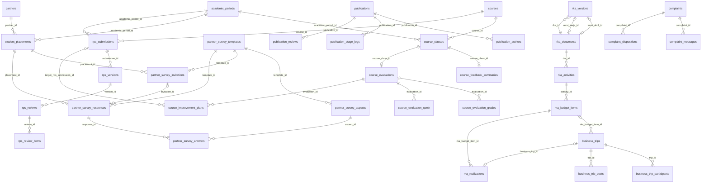

**ER-1 Data induk (shared).** Tabel 1–8. Dibaca oleh seluruh modul; ditulis oleh sinkronisasi SIAKAD dan SIMPRO Manajemen Prodi.

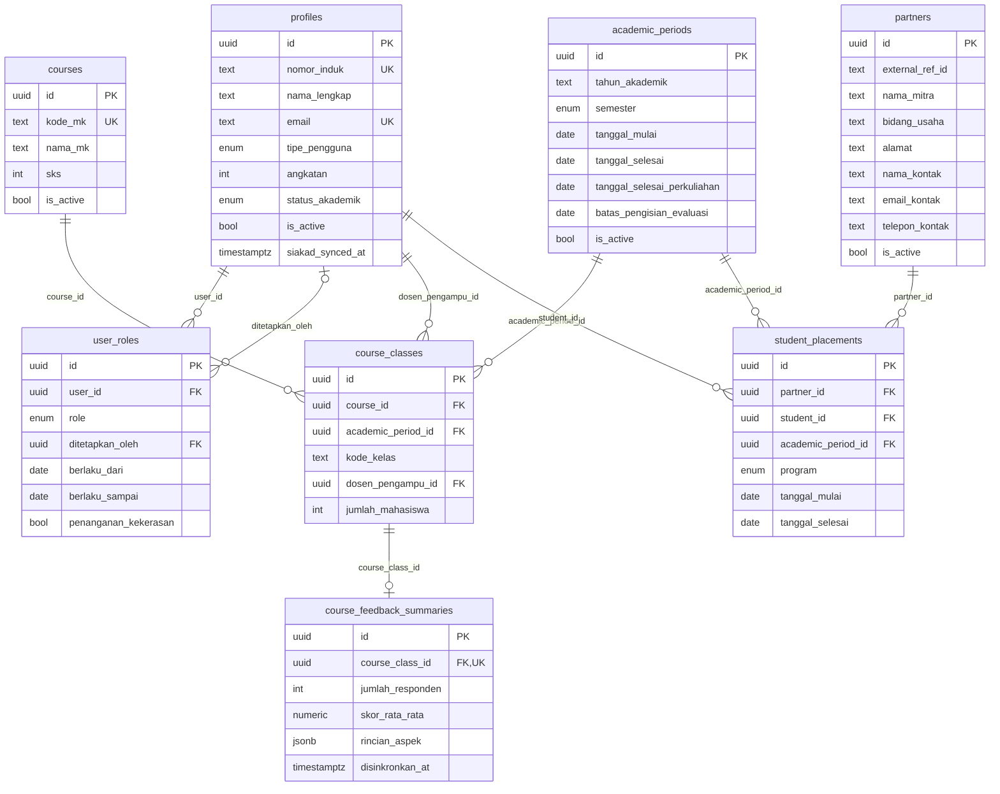

**ER-2 Modul 7: Kepuasan Mitra.** Tabel 9–13. Mitra, program, periode, dan mahasiswa pada respons diturunkan dari `student_placements`.

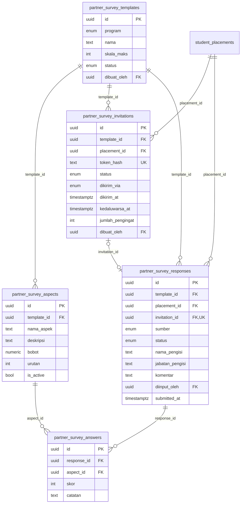

**ER-3 Modul 8: Publikasi.** Tabel 14–17.

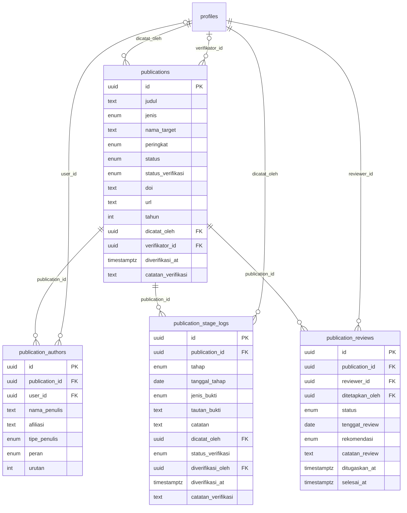

**ER-4 Modul 9: Perjalanan Dinas.** Tabel 18–20. `business_trips` menunjuk pos pada data aktif RKA.

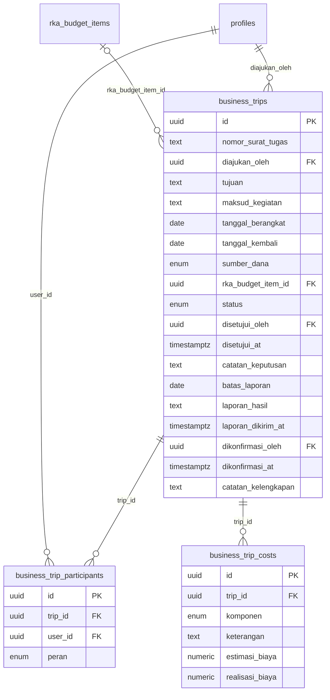

**ER-5 Modul 10: RKA.** Tabel 21–25. Relasi melingkar `rka_documents` dan `rka_versions` adalah penunjuk versi aktif dan versi kerja.

```mermaid
erDiagram
    rka_versions |o--o| rka_documents : "versi_aktif_id"
    rka_versions |o--o| rka_documents : "versi_kerja_id"
    rka_documents ||--o{ rka_versions : "rka_id"
    profiles |o--o{ rka_versions : "diajukan_oleh"
    rka_documents ||--o{ rka_activities : "rka_id"
    profiles ||--o{ rka_activities : "penanggung_jawab_id"
    rka_activities ||--o{ rka_budget_items : "activity_id"
    rka_budget_items ||--o{ rka_realizations : "rka_budget_item_id"
    business_trips |o--o| rka_realizations : "business_trip_id"
    profiles ||--o{ rka_realizations : "dicatat_oleh"

    rka_documents {
        uuid id PK
        int tahun_anggaran UK
        text judul
        enum status
        uuid versi_aktif_id FK, UK
        uuid versi_kerja_id FK, UK
        numeric total_anggaran
        uuid dibuat_oleh FK
        uuid ditutup_oleh FK
        timestamptz ditutup_at
    }
    rka_versions {
        uuid id PK
        uuid rka_id FK
        int nomor_versi
        enum status
        numeric total_anggaran
        jsonb draft_payload
        text alasan_revisi
        int row_version
        uuid dibuat_oleh FK
        uuid diajukan_oleh FK
        timestamptz diajukan_at
        uuid ditinjau_oleh FK
        timestamptz ditinjau_at
        text catatan_peninjauan
        timestamptz diterapkan_at
    }
    rka_activities {
        uuid id PK
        uuid rka_id FK
        text kode_kegiatan
        text nama_kegiatan
        text indikator_kinerja
        text target_indikator
        date jadwal_mulai
        date jadwal_selesai
        uuid penanggung_jawab_id FK
        enum status_pelaksanaan
        date tanggal_realisasi_mulai
        date tanggal_realisasi_selesai
        text capaian_indikator
        bool is_active
    }
    rka_budget_items {
        uuid id PK
        uuid activity_id FK
        text kode_pos
        text nama_pos
        enum kategori_pos
        numeric volume
        text satuan
        numeric harga_satuan
        numeric nominal_anggaran
        enum sumber_dana
        bool is_active
    }
    rka_realizations {
        uuid id PK
        uuid rka_budget_item_id FK
        date tanggal_realisasi
        numeric nominal_realisasi
        text uraian
        enum sumber_pencatatan
        uuid business_trip_id FK, UK
        enum status
        uuid dicatat_oleh FK
    }
```

**ER-6 Modul 11: Review RPS.** Tabel 26–29.

```mermaid
erDiagram
    courses ||--o{ rps_submissions : "course_id"
    academic_periods ||--o{ rps_submissions : "academic_period_id"
    profiles ||--o{ rps_submissions : "dosen_pengampu_id"
    rps_submissions ||--o{ rps_versions : "submission_id"
    rps_versions ||--o{ rps_reviews : "version_id"
    profiles ||--o{ rps_reviews : "reviewer_id"
    rps_reviews ||--o{ rps_review_items : "review_id"

    rps_submissions {
        uuid id PK
        uuid course_id FK
        uuid academic_period_id FK
        uuid dosen_pengampu_id FK
        enum status
        int versi_terbaru
        timestamptz diajukan_at
        uuid disahkan_oleh FK
        timestamptz disahkan_at
        text catatan_pengesahan
    }
    rps_versions {
        uuid id PK
        uuid submission_id FK
        int nomor_versi
        text catatan_perubahan
        uuid diunggah_oleh FK
    }
    rps_reviews {
        uuid id PK
        uuid version_id FK
        uuid reviewer_id FK
        uuid ditetapkan_oleh FK
        enum status
        date tenggat_review
        enum rekomendasi
        text catatan_umum
        timestamptz ditugaskan_at
        timestamptz selesai_at
    }
    rps_review_items {
        uuid id PK
        uuid review_id FK
        enum komponen
        enum hasil
        text catatan
    }
```

**ER-7 Modul 12: Post Evaluasi Perkuliahan.** Tabel 30–33. `course_improvement_plans` menghubungkan evaluasi ke pengajuan RPS berikutnya.

```mermaid
erDiagram
    course_classes ||--o| course_evaluations : "course_class_id"
    profiles ||--o{ course_evaluations : "diisi_oleh"
    course_evaluations ||--o{ course_evaluation_grades : "evaluation_id"
    course_evaluations ||--o{ course_evaluation_cpmk : "evaluation_id"
    course_evaluations ||--o{ course_improvement_plans : "evaluation_id"
    rps_submissions |o--o{ course_improvement_plans : "target_rps_submission_id"

    course_evaluations {
        uuid id PK
        uuid course_class_id FK, UK
        uuid diisi_oleh FK
        enum status
        enum kesesuaian_rps
        text penjelasan_kesesuaian
        text kendala
        timestamptz dikirim_at
        uuid ditinjau_oleh FK
        timestamptz ditinjau_at
        text catatan_gkm
    }
    course_evaluation_grades {
        uuid id PK
        uuid evaluation_id FK
        text nilai_huruf
        int jumlah_mahasiswa
    }
    course_evaluation_cpmk {
        uuid id PK
        uuid evaluation_id FK
        text kode_cpmk
        text deskripsi_cpmk
        numeric target_persen
        numeric capaian_persen
        bool tercapai
        text analisis
    }
    course_improvement_plans {
        uuid id PK
        uuid evaluation_id FK
        text uraian
        enum kategori
        enum status
        uuid target_rps_submission_id FK
        text catatan_penerapan
        uuid ditandai_oleh FK
        timestamptz ditandai_at
    }
```

**ER-8 Modul 13: Layanan Aduan.** Tabel 34–36. Perhatikan bahwa `complaints` sengaja tidak memiliki relasi ke `profiles`.

```mermaid
erDiagram
    complaints ||--o{ complaint_messages : "complaint_id"
    profiles |o--o{ complaint_messages : "sender_user_id"
    complaints ||--o{ complaint_dispositions : "complaint_id"
    profiles ||--o{ complaint_dispositions : "penanggung_jawab_id"

    complaints {
        uuid id PK
        text nomor_aduan UK
        text kode_tiket_hash UK
        enum kategori
        text judul
        text uraian
        bool is_sensitif
        enum status
        date tanggal_diterima
        date tanggal_selesai
        text alasan_penutupan
        date diteruskan_ke_satgas_tanggal
        text nomor_referensi_satgas
        int rating_kepuasan
        text komentar_kepuasan
    }
    complaint_messages {
        uuid id PK
        uuid complaint_id FK
        int urutan
        enum pengirim
        uuid sender_user_id FK
        text isi
        bool is_catatan_internal
        date tanggal
    }
    complaint_dispositions {
        uuid id PK
        uuid complaint_id FK
        uuid didisposisi_oleh FK
        uuid penanggung_jawab_id FK
        date tenggat
        text catatan
        enum status
        uuid dieskalasi_ke_id FK
        date tanggal_eskalasi
    }
```

**ER-9 Lintas modul.** Tabel 37–40. `attachments` memakai relasi polimorfik (`entity_type` + `entity_id`) sehingga tidak digambar sebagai garis.

```mermaid
erDiagram
    profiles |o--o{ attachments : "uploaded_by"
    profiles |o--o{ audit_logs : "actor_id"
    profiles ||--o{ notifications : "user_id"
    profiles |o--o{ app_settings : "diubah_oleh"

    attachments {
        uuid id PK
        enum entity_type
        uuid entity_id
        text kategori
        text storage_bucket
        text storage_path
        text nama_berkas_asli
        text mime_type
        bigint ukuran_byte
        text checksum_sha256
        uuid uploaded_by FK
    }
    audit_logs {
        bigint id PK
        uuid actor_id FK
        enum aksi
        text entity_type
        uuid entity_id
        jsonb nilai_lama
        jsonb nilai_baru
        timestamptz created_at
    }
    notifications {
        uuid id PK
        uuid user_id FK
        text tipe
        text judul
        text isi
        text tautan_internal
        timestamptz dibaca_at
        timestamptz email_terkirim_at
    }
    app_settings {
        text key PK
        jsonb value
        text deskripsi
        uuid diubah_oleh FK
        timestamptz updated_at
    }
```

## 7. **Tech Stack**

- **Framework Fullstack:** **Next.js (App Router, TypeScript) untuk frontend + Go (router `chi`) untuk backend REST API** — sesuai stack pilihan tim dan **mengikuti versi serta konvensi yang sudah dipakai di website existing** (versi Next.js, pola *routing*, struktur folder). Go dipilih untuk modul baru karena ringan, cepat untuk penjadwal harian (`robfig/cron`) serta ekspor Excel (`excelize`) dan PDF, dan cocok untuk aturan RBAC serta transaksi yang ketat. Karena ini tahap MVP, backend dibuat satu layanan modular (bukan *microservice*); bila backend Go sudah ada di repositori existing, modul baru ditambahkan sebagai paket baru di layanan yang sama.
- **Styling/UI:** **Mengikuti stack styling website existing (Tailwind CSS bila sudah dipakai) dan memakai ulang komponen serta *design token* yang ada** — tidak membuat sistem desain baru. Komponen baru (Bab 5, "Komponen Baru") dibuat hanya bila tidak ada padanannya, dengan token existing. Karena ini tahap MVP, pustaka tambahan dibatasi pada kebutuhan nyata (grafik, unggah berkas), dan pustaka *chart* yang sudah ada dipakai lebih dulu.
- **Database:** **Supabase (PostgreSQL, region Singapura) + Supabase Storage** — Postgres terkelola dengan RLS, *backup* harian (NF-11), dan satu proyek yang sama dengan SIMPRO Manajemen Prodi sehingga data induk tidak diinput ganda (NF-12). Karena ini tahap MVP, tidak perlu mengelola server basis data sendiri; lampiran memakai *bucket* privat dengan *signed URL* berumur pendek. Go terhubung lewat Supavisor mode *session* atau koneksi langsung (bila memakai mode *transaction*, atur `simple_protocol` pada `pgx`) agar `SET LOCAL` per transaksi untuk RLS bekerja.
- **ORM:** **`sqlc` + `pgx` (migrasi lewat Supabase CLI `supabase/migrations`)** — skema SQL menjadi satu-satunya sumber kebenaran (termasuk *enum*, *generated column*, RLS, fungsi `app.*`, *trigger* audit *append-only*) dan `sqlc` menghasilkan kode Go bertipe aman tanpa lapisan ORM yang berat. Bila backend existing sudah memakai pendekatan akses data lain, ikuti yang sudah ada. Karena ini tahap MVP, query ditulis eksplisit agar mudah di-*review* dan cepat untuk agregasi rekap ≤ 5 detik.
- **Autentikasi:** **Supabase Auth (JWT) + RBAC di Go + RLS** — login surel/kata sandi (atau Google Workspace kampus bila tersedia) memakai Supabase Auth dengan sesi bersama aplikasi SIMPRO lain; Go memvalidasi JWT lewat JWKS Supabase lalu memuat peran dari `user_roles`. Mitra memakai *token* undangan (hash SHA-256) dan pelapor aduan memakai *permit* anonim (bertanda tangan HMAC, tanpa data pengguna) serta kode tiket (HMAC ber-*pepper*). Karena ini tahap MVP, tidak membangun sistem identitas sendiri.
- **Deployment:** **Vercel (Next.js) + Fly.io region Singapura (Go, kontainer Docker, minimal 1 mesin agar penjadwal dan memori kuota aduan tetap konsisten) + Supabase Cloud** — latensi rendah dari Indonesia, biaya kecil, dan *deploy* otomatis dari Git. Bila website existing sudah memiliki alur *deploy*, gunakan alur yang sama. Karena ini tahap MVP, tidak memakai Kubernetes; pengaturan log IP pada platform *hosting* perlu dikonfirmasi untuk kepatuhan NF-04.

## 8. **Matriks Aktor & Hak Akses**

### 8.1 Daftar aktor dan sumber penentunya

Ada dua jenis aktor. **Peran tetap** disimpan di `user_roles`. Sumbernya sinkronisasi SIAKAD dan SIMPRO Manajemen Prodi; satu-satunya penunjukan yang SKPL serahkan kepada Kaprodi dalam cakupan ini adalah **Pengelola Aduan** (termasuk penunjukan penanganan kekerasan, FR-50) dan **Dosen Verifikator**. **Peran kontekstual** tidak disimpan sebagai peran, tetapi diturunkan dari data pada transaksi tertentu sehingga hak aksesnya hanya berlaku pada baris terkait.

| Aktor | Jenis | Penentu | Modul |
|---|---|---|---|
| Kaprodi | Tetap | `user_roles.role = KAPRODI` | 7–13 (memantau seluruh modul, menyetujui perjalanan dinas dan RKA, mengesahkan RPS) |
| GKM | Tetap | `GKM` | 11, 12 (menetapkan reviewer, memantau evaluasi) |
| Admin Prodi | Tetap | `ADMIN_PRODI` | 9, 10 (mengelola perjalanan dinas dan realisasi RKA); menetapkan ukuran maksimum berkas (NF-08) |
| Koordinator KP / PSI / PDLK | Tetap | `KOORDINATOR_KP`, `KOORDINATOR_PSI`, `KOORDINATOR_PDLK` | 7 (hanya program sendiri) |
| Dosen | Tetap | `DOSEN` (+ `profiles.tipe_pengguna = DOSEN`) | 8, 9, 11, 12 |
| Mahasiswa | Tetap | `MAHASISWA` (+ `status_akademik`) | 8, 13 |
| Pengelola Aduan | Tetap | `PENGELOLA_ADUAN`, ditunjuk Kaprodi | 13 (aduan non-sensitif) |
| Pengelola Aduan penanganan kekerasan (PGL-K) | Tetap (penunjukan pada peran Pengelola Aduan) | `PENGELOLA_ADUAN` dengan `penanganan_kekerasan = true`, ditunjuk Kaprodi (FR-50) | 13 (aduan sensitif dan non-sensitif) |
| Dosen Pengampu | Kontekstual | `course_classes.dosen_pengampu_id`, `rps_submissions.dosen_pengampu_id` | 11, 12 |
| Reviewer RPS | Kontekstual | `rps_reviews.reviewer_id` | 11 |
| Reviewer Internal Publikasi | Kontekstual | `publication_reviews.reviewer_id` | 8 |
| Dosen Verifikator (untuk publikasi mahasiswa) | Kontekstual | `publications.verifikator_id` (dosen pembimbing atau pendamping) | 8 |
| Penulis Publikasi | Kontekstual | `publications.dicatat_oleh`, `publication_authors.user_id` | 8 |
| Pelaksana Perjalanan | Kontekstual | `business_trips.diajukan_oleh`, `business_trip_participants.user_id` | 9 |
| Penanggung Jawab Disposisi | Kontekstual | `complaint_dispositions.penanggung_jawab_id`; pengguna ber-peran yang sudah ada (Dosen, Admin Prodi, GKM, Kaprodi), bukan peran baru (ekstensi E9) | 13 |
| Mitra Eksternal | Token | `partner_survey_invitations.token_hash` | 7 |
| Pelapor | *Permit* + kode tiket | *permit* bertanda tangan, `complaints.kode_tiket_hash`; tidak terhubung ke identitas | 13 |
| Sistem / Penjadwal | Sistem | *role* DB `app_job` | 7, 8, 9, 11, 12, 13 |

### 8.2 Hak akses per modul

Singkatan: **KP** Kaprodi, **ADM** Admin Prodi, **KRD** Koordinator (program sendiri), **DSN** Dosen, **MHS** Mahasiswa, **PGL** Pengelola Aduan, **PGL-K** Pengelola Aduan yang ditunjuk menangani kekerasan (penunjukan pada peran PGL, bukan peran baru). Semua aksi tulis tercatat di `audit_logs`.

**Modul 7 — Kepuasan Mitra**

| Aksi | Aktor yang boleh | Aturan |
|---|---|---|
| Kelola template dan aspek | KRD | Hanya program miliknya; terkunci setelah ada respons |
| Kirim, ingatkan, kirim ulang, batalkan tautan | KRD | Tautan kedaluwarsa dapat dikirim ulang dengan *token* baru |
| Input respons atas nama mitra, batalkan (VOID) | KRD | Sumber `INPUT_KOORDINATOR`; tidak boleh bila sudah ada respons aktif |
| Mengisi kuesioner | Mitra Eksternal | Hanya lewat *token* sendiri, sekali kirim |
| Lihat rekap dan ekspor | KRD (program sendiri), KP (semua program) | |

**Modul 8 — Publikasi**

| Aksi | Aktor yang boleh | Aturan |
|---|---|---|
| Catat dan ubah publikasi | Penulis Publikasi (DSN, MHS) | Mahasiswa wajib memilih dosen verifikator; entri terverifikasi tidak dapat diubah pencatat |
| Catat tahapan dan bukti | Penulis Publikasi | Tahap publikasi mahasiswa berstatus MENUNGGU sampai diverifikasi |
| Verifikasi pencatatan dan tahapan | Dosen Verifikator Publikasi | Alasan wajib saat menolak |
| Ganti verifikator | KP | |
| Tetapkan reviewer internal | KP, Penulis berstatus dosen (ekstensi E10) | Reviewer bukan penulis |
| Isi hasil review | Reviewer Internal | Hanya penugasan miliknya |
| Rekap publikasi | KP (semua), DSN (milik sendiri) | Hanya entri TERVERIFIKASI atau TIDAK_PERLU |

**Modul 9 — Perjalanan Dinas**

| Aksi | Aktor yang boleh | Aturan |
|---|---|---|
| Ajukan perjalanan | DSN (untuk diri sendiri/rombongan), ADM atas nama dosen (ekstensi E11) | Estimasi tiga komponen utama wajib diisi |
| Setujui, minta revisi, tolak | KP | Nomor surat tugas wajib sebelum setuju |
| Unggah bukti, isi realisasi, kirim laporan | Pelaksana Perjalanan (ketua rombongan), ADM atas nama | Hanya saat status DISETUJUI |
| Kembalikan untuk dilengkapi / tandai SELESAI | ADM | Bukan pengaju atau pelaksana perjalanan itu; bila konflik, KP |
| Rekap dan penanda belum lengkap | ADM, KP; DSN (milik sendiri) | |

**Modul 10 — RKA**

| Aksi | Aktor yang boleh | Aturan |
|---|---|---|
| Buat RKA, susun dan simpan versi kerja, ajukan | ADM, KP | Satu versi kerja per RKA; validasi sebelum ajukan |
| Setujui atau minta revisi versi | KP | Bila KP juga penyusun, tetap boleh dan ditandai *self-approved* di audit |
| Buka revisi, buang versi kerja | ADM, KP | Alasan revisi wajib |
| Catat dan batalkan realisasi, ubah status pelaksanaan kegiatan | ADM, KP | Hanya pada RKA berstatus AKTIF |
| Monitoring serapan | ADM, KP | Memakai data aktif |
| Tutup RKA | KP | Setelah itu hanya baca |

**Modul 11 — Review RPS**

| Aksi | Aktor yang boleh | Aturan |
|---|---|---|
| Ajukan RPS, unggah versi baru, tandai rencana perbaikan | Dosen Pengampu | Hanya mata kuliah yang diampunya |
| Tetapkan reviewer dan tenggat | KP, GKM | Reviewer bukan dosen pengampu mata kuliah itu |
| Isi checklist dan rekomendasi | Reviewer RPS | Hanya penugasan miliknya; lima komponen wajib terisi |
| Lihat hasil review | Dosen Pengampu | Setelah review berstatus SELESAI |
| Sahkan RPS | KP | Hanya dari status DISETUJUI |
| Rekap status RPS | KP, GKM; DSN (milik sendiri) | |

**Modul 12 — Post Evaluasi Perkuliahan**

| Aksi | Aktor yang boleh | Aturan |
|---|---|---|
| Isi, simpan draf, kirim evaluasi | Dosen Pengampu | Hanya kelas yang diampunya |
| Lihat ringkasan umpan balik mahasiswa | Dosen Pengampu, GKM, KP | Read-only dari sinkronisasi |
| Tinjau evaluasi | GKM | Hanya evaluasi TERKIRIM |
| Rekap evaluasi | GKM, KP | |
| Tandai rencana diterapkan | Dosen Pengampu RPS tujuan | Saat mengajukan RPS berikutnya |

**Modul 13 — Layanan Aduan**

| Aksi | Aktor yang boleh | Aturan |
|---|---|---|
| Ambil *permit* kirim anonim | MHS (AKTIF atau CUTI) | Kuota harian di memori; *permit* tanpa data pengguna |
| Kirim aduan, lacak, balas, nilai kepuasan | Pelapor (pemegang permit atau kode tiket) | Tanpa JWT; tidak dicatat identitasnya |
| Lihat antrean, verifikasi, tutup, disposisi aduan non-sensitif | PGL, PGL-K | PGL tanpa penunjukan tidak melihat aduan sensitif |
| Lihat antrean, verifikasi, tutup, disposisi aduan sensitif | PGL-K | Penanggung jawab disposisi aduan sensitif harus PGL-K |
| Tulis tanggapan | PGL, PGL-K; Penanggung Jawab Disposisi (ekstensi E9) | Penanggung jawab hanya aduan yang didisposisikan kepadanya |
| Teruskan ke Satgas PPKPT (catat tanggal dan referensi) | PGL-K | Hanya aduan sensitif |
| Lihat rekap agregat | PGL, PGL-K, KP | Tanpa isi aduan |
| Lihat isi aduan non-sensitif | PGL, PGL-K, KP; Penanggung Jawab Disposisi (ekstensi E9) | |
| Lihat metadata aduan sensitif | KP | Nomor, kategori, status, umur, tenggat, nama penanggung jawab; tanpa judul, uraian, pesan, lampiran |
| Tunjuk atau cabut Pengelola Aduan dan penunjukan PGL-K; tetapkan ulang tenggat | KP | Tanpa membuka isi aduan sensitif |

**Pengaturan dan lintas modul**

| Aksi | Aktor yang boleh | Aturan |
|---|---|---|
| Ubah `app_settings` | KP (semua kunci); ADM hanya `max_upload_mb` | NF-08: ukuran maksimum berkas ditetapkan admin; `allowed_mime_types` tetap (PDF, JPG, PNG, DOCX, XLSX) |
| Tunjuk Pengelola Aduan (termasuk penunjukan PGL-K) dan Dosen Verifikator | KP | Peran lain bersumber dari sinkronisasi dan tidak diubah dari modul ini |
| Lihat audit log | KP | Tidak memuat tindakan pelapor aduan |
| Notifikasi | Pemilik notifikasi | |

### 8.3 Pencocokan dengan definisi aktor SKPL

Daftar di bawah mencocokkan setiap peran pada Bab 2 SKPL ("Definisi Aktor dan Hak Akses") dengan PRD ini, supaya tidak ada aktor yang bergeser dari SKPL.

| Peran SKPL | Di PRD ini | Catatan |
|---|---|---|
| Kaprodi | `KAPRODI` | Memantau seluruh modul (aduan sensitif hanya metadata, D1); menyetujui perjalanan dinas dan RKA; mengesahkan RPS; menetapkan dosen verifikator; menunjuk Pengelola Aduan |
| GKM | `GKM` | Menetapkan reviewer RPS dan memantau post evaluasi (E1 menambah penandaan "ditinjau") |
| Admin Prodi | `ADMIN_PRODI` | Mengelola perjalanan dinas dan realisasi RKA; tidak memverifikasi data mahasiswa, tidak mengakses aduan, tidak menulis data induk; menetapkan ukuran berkas (NF-08) |
| Dosen | `DOSEN` dan peran kontekstual (Dosen Pengampu, Reviewer RPS atau Publikasi, Pelaksana, Penulis) | Mengajukan RPS, mengisi post evaluasi, mencatat publikasi, mengajukan perjalanan dinas, menjadi reviewer bila ditugaskan |
| Dosen Verifikator | `DOSEN_VERIFIKATOR` dan kontekstual `publications.verifikator_id` | Untuk publikasi mahasiswa: dosen pembimbing atau penulis pendamping (FR-31); Kaprodi dapat menetapkan dosen lain; dosen wali sebagai default tidak dipakai karena data perwalian ada di Modul 1 |
| Dosen Wali | Tidak dipakai | Modul 1–6 di luar cakupan; nilai enum disediakan untuk kompatibilitas |
| Dosen Pembina Himpunan / UKM | Tidak dipakai | Modul 4–5 di luar cakupan |
| Ketua Kelas | Tidak dipakai | Modul 1 di luar cakupan |
| Mahasiswa | `MAHASISWA` | Mencatat publikasi (Modul 8) dan menyampaikan aduan anonim (Modul 13); sebagai pelapor tidak tertaut ke identitas |
| Pengurus Himpunan | Tidak dipakai | Modul 5 di luar cakupan |
| Koordinator KP / PSI / PDLK | `KOORDINATOR_KP`, `KOORDINATOR_PSI`, `KOORDINATOR_PDLK` | Satu peran SKPL dipecah per program agar cakupan "program masing-masing" dapat ditegakkan |
| Pengelola Aduan | `PENGELOLA_ADUAN` | Ditunjuk Kaprodi; menerima, memverifikasi, mendisposisikan. PGL-K adalah Pengelola Aduan yang ditunjuk menangani kekerasan (FR-50), bukan peran baru |
| Mitra (eksternal) | Aktor berbasis *token*, tanpa akun | Mengisi kuesioner lewat tautan khusus |

Hal di luar daftar peran SKPL yang ada di PRD: **Penanggung Jawab Disposisi** (bukan peran baru, ekstensi E9) dan **Sistem/Penjadwal** (bukan aktor manusia). Dua hal dari draf PRD sebelumnya yang tidak ada di SKPL sudah dihapus: peran "Petugas Kekerasan" (diganti penunjukan PGL-K) dan hak akses "Penanggung Jawab Kegiatan RKA".

## 9. **Spesifikasi API**

### 9.1 Konvensi

- **Basis:** `/api/v1`. Format JSON UTF-8, tanggal ISO 8601 (zona Asia/Jakarta), nominal rupiah sebagai *string* desimal (`"1500000.00"`) untuk menghindari galat *floating point*.
- **Autentikasi:** header `Authorization: Bearer <JWT Supabase>` untuk semua rute kecuali `/api/v1/public/*`. Rute publik tidak menerima JWT; rute aduan publik hanya menerima *permit* atau kode tiket.
- **Otorisasi:** kolom *Aktor* di bawah memakai singkatan Bab 8 (KP, ADM, KRD, DSN, MHS, PGL, PGL-K) serta peran kontekstual. Pelanggaran dijawab `403`; data yang tidak terlihat oleh aktor dijawab `404` (bukan `403`) agar keberadaannya tidak bocor.
- **Paginasi dan filter:** `?page=1&per_page=20&sort=-created_at` dengan respons `{ "data": [...], "meta": { "page", "per_page", "total" } }`. Filter memakai nama kolom (contoh `?status=DIAJUKAN&academic_period_id=...`).
- **Format galat:** `{ "error": { "code", "message", "details": [{ "field", "reason" }] } }`. Kode HTTP: `400 VALIDATION_FAILED`, `401 UNAUTHENTICATED`, `403 FORBIDDEN`, `404 NOT_FOUND`, `409 INVALID_TRANSITION` atau `CONFLICT`, `410 TOKEN_EXPIRED`, `412 STALE_ROW_VERSION`, `413 FILE_TOO_LARGE`, `415 UNSUPPORTED_MEDIA_TYPE`, `422 BUSINESS_RULE_VIOLATION`, `429 RATE_LIMITED`.
- ***Optimistic locking*:** `PUT` pada versi kerja RKA wajib menyertakan `If-Match: "<row_version>"`; ketidakcocokan menghasilkan `412`.
- **Transisi status:** dilakukan lewat aksi eksplisit `POST .../{aksi}` (misalnya `/submit`, `/decision`), bukan dengan mengubah kolom `status` lewat `PATCH`. Transisi di luar diagram status (Bab 5) menghasilkan `409 INVALID_TRANSITION`.
- **Ekspor:** semua *endpoint* rekap menerima `?format=json|xlsx|pdf`; ekspor tercatat di `audit_logs` (aksi `EKSPOR`), kecuali ekspor rekap aduan yang hanya memuat agregat.
- **Rate limit rute publik:** `GET/POST /public/partner-survey/{token}` 30 permintaan/menit per IP; `POST /public/aduan` dan `/public/aduan/track` 10 permintaan/menit. Penghitung berada di memori dan tidak ditulis ke basis data atau log.

### 9.2 Umum

| Method | Endpoint | Aktor | Keterangan |
|---|---|---|---|
| GET | `/me` | Semua login | Profil dan daftar peran pengguna |
| GET | `/notifications` | Pemilik | Daftar notifikasi, filter `?unread=true` |
| PATCH | `/notifications/{id}/read` | Pemilik | Tandai dibaca |
| POST | `/notifications/read-all` | Pemilik | Tandai semua dibaca |
| POST | `/attachments` | Sesuai entitas | Unggah berkas (`multipart`): `entity_type`, `entity_id`, `kategori`; validasi tipe, ukuran, *checksum* |
| GET | `/attachments/{id}/url` | Sesuai akses entitas | *Signed URL* berumur 5 menit |
| DELETE | `/attachments/{id}` | Pengunggah | Hanya sebelum entitas induk dikirim atau dikunci |
| GET | `/ref/academic-periods`, `/ref/courses`, `/ref/course-classes`, `/ref/partners`, `/ref/placements` | Login | Data induk untuk *picker* |
| GET | `/ref/users?q=&tipe=` | Login | Pencarian pengguna (direktori terbatas: nama, tipe, nomor induk) |
| GET | `/admin/settings` | KP, ADM | Daftar `app_settings` |
| PUT | `/admin/settings/{key}` | KP (semua kunci), ADM (hanya `max_upload_mb`) | Ubah nilai pengaturan (tervalidasi per kunci); `allowed_mime_types` tidak dapat diubah |
| GET | `/admin/user-roles?user_id=` | KP | Daftar peran |
| POST | `/admin/user-roles` | KP | Hanya `PENGELOLA_ADUAN` (dengan `penanganan_kekerasan` opsional) dan `DOSEN_VERIFIKATOR`; peran lain ditolak `422` karena bersumber dari sinkronisasi |
| DELETE | `/admin/user-roles/{id}` | KP | Cabut penunjukan (hanya kedua peran di atas) |
| GET | `/admin/audit-logs` | KP | Filter `entity_type`, `entity_id`, `actor_id`, rentang tanggal |

### 9.3 Modul 7 — Kepuasan Mitra

| Method | Endpoint | Aktor | Keterangan |
|---|---|---|---|
| GET | `/partner-surveys/templates?program=` | KRD, KP | Daftar template |
| POST | `/partner-surveys/templates` | KRD | Buat template (status DRAF) |
| GET | `/partner-surveys/templates/{id}` | KRD, KP | Detail beserta aspek |
| PATCH | `/partner-surveys/templates/{id}` | KRD | Ubah nama atau skala; hanya DRAF |
| POST | `/partner-surveys/templates/{id}/aspects` | KRD | Tambah aspek; hanya DRAF |
| PATCH | `/partner-surveys/aspects/{id}` | KRD | Ubah, urutkan, nonaktifkan aspek; ditolak bila template punya respons |
| POST | `/partner-surveys/templates/{id}/activate` | KRD | DRAF → AKTIF (≥ 1 aspek aktif, bobot > 0) |
| POST | `/partner-surveys/templates/{id}/duplicate` | KRD | Salin sebagai template DRAF baru |
| POST | `/partner-surveys/templates/{id}/archive` | KRD | AKTIF → ARSIP |
| GET | `/partner-surveys/placements?program=&academic_period_id=` | KRD, KP | Penempatan beserta status undangan |
| POST | `/partner-surveys/invitations` | KRD | Buat undangan massal: `template_id`, `placement_ids[]` |
| POST | `/partner-surveys/invitations/{id}/send` | KRD | Kirim: `via=EMAIL\|WHATSAPP`; WHATSAPP mengembalikan tautan `wa.me` |
| POST | `/partner-surveys/invitations/{id}/remind` | KRD | Pengingat manual (maks. sesuai `pengingat_mitra_hari`) |
| POST | `/partner-surveys/invitations/{id}/resend` | KRD | Hanya KEDALUWARSA; token baru, tautan lama tidak berlaku |
| POST | `/partner-surveys/invitations/{id}/cancel` | KRD | DIBUAT atau TERKIRIM → DIBATALKAN |
| POST | `/partner-surveys/responses` | KRD | Input atas nama mitra (`INPUT_KOORDINATOR`) |
| POST | `/partner-surveys/responses/{id}/void` | KRD | Batalkan respons input manual |
| GET | `/partner-surveys/recap?program=&academic_period_id=&group_by=aspect\|partner` | KRD, KP | Indeks, tingkat respons; `?format=xlsx\|pdf` |
| GET | `/partner-surveys/recap/trend?program=&from=&to=` | KRD, KP | Tren antar periode |
| GET | `/public/partner-survey/{token}` | Mitra | Validasi token; data mitra, program, mahasiswa, aspek aktif |
| POST | `/public/partner-survey/{token}` | Mitra | Kirim jawaban semua aspek (satu transaksi); `409` bila sudah diisi, `410` bila kedaluwarsa |

### 9.4 Modul 8 — Publikasi

| Method | Endpoint | Aktor | Keterangan |
|---|---|---|---|
| GET | `/publications?scope=mine\|all&status=&jenis=&tahun=` | Terkait, KP | Daftar sesuai hak akses |
| POST | `/publications` | DSN, MHS | Buat publikasi (DRAF); MHS wajib `verifikator_id` |
| GET | `/publications/{id}` | Terkait, KP | Detail, penulis, tahapan, review |
| PATCH | `/publications/{id}` | Pencatat | Tidak untuk entri terverifikasi buatan mahasiswa |
| DELETE | `/publications/{id}` | Pencatat | Hanya DRAF tanpa tahapan |
| PUT | `/publications/{id}/authors` | Pencatat | Ganti daftar penulis dan peran |
| POST | `/publications/{id}/stages` | Pencatat, penulis dosen | Catat tahap, tanggal, bukti; validasi urutan transisi |
| PATCH | `/publications/stages/{stageId}` | Pencatat | Hanya saat MENUNGGU |
| GET | `/publications/verification-queue` | Dosen Verifikator, KP | Entri dan tahapan MENUNGGU |
| POST | `/publications/{id}/verify` | Dosen Verifikator | `decision=TERVERIFIKASI\|DITOLAK`, `catatan` (wajib bila ditolak) |
| POST | `/publications/stages/{stageId}/verify` | Dosen Verifikator | Verifikasi tahapan; menggerakkan status publikasi |
| PUT | `/publications/{id}/verifier` | KP | Ganti dosen verifikator |
| POST | `/publications/{id}/reviews` | KP, penulis dosen | Tetapkan reviewer (bukan penulis) dan tenggat |
| POST | `/publications/reviews/{reviewId}/complete` | Reviewer Internal | `rekomendasi`, `catatan_review` |
| POST | `/publications/reviews/{reviewId}/cancel` | Penetap | DITUGASKAN → DIBATALKAN |
| GET | `/publications/recap?from=&to=` | KP, DSN (milik sendiri) | Per status, jenis, peringkat, tahun, jumlah melibatkan mahasiswa; `?format=` |

### 9.5 Modul 9 — Perjalanan Dinas

| Method | Endpoint | Aktor | Keterangan |
|---|---|---|---|
| GET | `/business-trips?scope=mine\|all&status=` | Terkait, ADM, KP | Daftar |
| POST | `/business-trips` | DSN, ADM | Buat perjalanan (DRAF) beserta pelaksana |
| GET | `/business-trips/{id}` | Terkait, ADM, KP | Detail, biaya, bukti, peringatan anggaran |
| PATCH | `/business-trips/{id}` | Pengaju | Hanya DRAF atau PERLU_REVISI |
| PUT | `/business-trips/{id}/costs` | Pengaju | Estimasi per komponen (nilai ≥ 0, tiga komponen utama wajib) |
| POST | `/business-trips/{id}/submit` | Pengaju | DRAF/PERLU_REVISI → DIAJUKAN; mengembalikan peringatan (sisa pos, pengajuan mendadak) |
| POST | `/business-trips/{id}/decision` | KP | `decision=SETUJU\|REVISI\|TOLAK`, `catatan`, `nomor_surat_tugas` (wajib untuk SETUJU) |
| POST | `/business-trips/{id}/cancel` | Pengaju, ADM | Sebelum SELESAI |
| PUT | `/business-trips/{id}/costs/realization` | Pelaksana, ADM | Realisasi per komponen; hanya DISETUJUI |
| POST | `/business-trips/{id}/report` | Pelaksana, ADM | Kirim `laporan_hasil` (+ bukti via `/attachments`); DISETUJUI → DILAPORKAN |
| GET | `/business-trips/{id}/completeness` | ADM, KP, Pelaksana | Hasil *checklist* kelengkapan per butir |
| POST | `/business-trips/{id}/return` | ADM | DILAPORKAN → DISETUJUI dengan `catatan_kelengkapan` |
| POST | `/business-trips/{id}/confirm` | ADM (KP bila konflik) | DILAPORKAN → SELESAI; membuat realisasi RKA dalam satu transaksi |
| GET | `/business-trips/recap?from=&to=&user_id=` | ADM, KP; DSN (milik sendiri) | Estimasi vs realisasi per komponen; `?format=` |
| GET | `/business-trips/flags?type=incomplete\|over_estimate\|overdue` | ADM, KP | Perjalanan bertanda belum lengkap, melebihi estimasi, terlambat lapor |

### 9.6 Modul 10 — RKA

| Method | Endpoint | Aktor | Keterangan |
|---|---|---|---|
| GET | `/rka` | ADM, KP | Daftar RKA per tahun |
| POST | `/rka` | ADM, KP | Buat dokumen RKA untuk satu tahun dan versi kerja nomor 1 |
| GET | `/rka/{id}` | ADM, KP | Dokumen, data aktif, ringkasan total |
| GET | `/rka/{id}/versions` | ADM, KP | Riwayat versi |
| GET | `/rka/{id}/versions/{nomor}` | ADM, KP | Isi versi (*snapshot*) |
| GET | `/rka/{id}/working-version` | ADM, KP | Versi kerja (`draft_payload`, `row_version`) |
| PUT | `/rka/{id}/working-version` | ADM, KP | Simpan draf; wajib `If-Match`; total dihitung server |
| POST | `/rka/{id}/working-version/submit` | ADM, KP | Validasi lalu DRAF/PERLU_REVISI → DIAJUKAN; `alasan_revisi` wajib untuk versi ≥ 2 |
| DELETE | `/rka/{id}/working-version` | ADM, KP | Buang versi kerja (DRAF/PERLU_REVISI → DIBATALKAN) |
| POST | `/rka/{id}/revisions` | ADM, KP | Buka revisi: salin versi aktif menjadi versi kerja n+1 |
| GET | `/rka/{id}/versions/{nomor}/diff` | ADM, KP | Perbandingan terhadap data aktif: tambah, ubah, hapus |
| POST | `/rka/{id}/versions/{nomor}/decision` | KP | `decision=SETUJU\|REVISI`, `catatan`; SETUJU menerapkan ke data aktif secara atomik |
| POST | `/rka/{id}/close` | KP | AKTIF → DITUTUP |
| GET | `/rka/{id}/activities` | ADM, KP | Kegiatan data aktif beserta total dan serapan |
| PATCH | `/rka/activities/{activityId}/execution` | ADM, KP | Status pelaksanaan, tanggal aktual, capaian indikator |
| GET | `/rka/budget-items?rka_id=&q=` | DSN, ADM, KP | Daftar pos aktif untuk *picker* perjalanan dinas (kode, nama, sisa anggaran) |
| GET | `/rka/{id}/realizations` | ADM, KP | Daftar realisasi |
| POST | `/rka/{id}/realizations` | ADM, KP | Catat realisasi manual; hanya RKA AKTIF |
| POST | `/rka/realizations/{realizationId}/cancel` | ADM, KP | AKTIF → DIBATALKAN |
| GET | `/rka/{id}/absorption?group_by=activity\|item\|quarter` | ADM, KP | Serapan, kegiatan terlambat, over-realisasi; `?format=` |

### 9.7 Modul 11 — Review RPS

| Method | Endpoint | Aktor | Keterangan |
|---|---|---|---|
| GET | `/rps/submissions?academic_period_id=&status=` | Dosen Pengampu, Reviewer, KP, GKM | Daftar sesuai hak akses |
| POST | `/rps/submissions` | Dosen Pengampu | Buat pengajuan DRAF; meneruskan rencana perbaikan BARU mata kuliah yang sama |
| GET | `/rps/submissions/{id}` | Terkait, KP, GKM | Detail, versi, review, panel tindak lanjut evaluasi |
| POST | `/rps/submissions/{id}/versions` | Dosen Pengampu | Unggah versi baru (berkas via `/attachments`) |
| PUT | `/rps/submissions/{id}/improvement-plans` | Dosen Pengampu | Tandai tiap rencana DITERAPKAN atau TIDAK_DITERAPKAN beserta catatan |
| POST | `/rps/submissions/{id}/submit` | Dosen Pengampu | DRAF/PERLU_REVISI → DIAJUKAN; semua rencana wajib bertanda |
| POST | `/rps/submissions/{id}/reviews` | KP, GKM | Tetapkan reviewer dan tenggat; ditolak bila reviewer = dosen pengampu |
| GET | `/rps/reviews/mine` | Reviewer RPS | Penugasan milik sendiri |
| GET | `/rps/reviews/{reviewId}` | Reviewer RPS, KP, GKM; Dosen Pengampu setelah SELESAI | Detail review dan item |
| PUT | `/rps/reviews/{reviewId}/items` | Reviewer RPS | Simpan hasil per komponen (draf) |
| POST | `/rps/reviews/{reviewId}/complete` | Reviewer RPS | Wajib lima komponen terisi dan `rekomendasi`; memicu status pengajuan |
| POST | `/rps/reviews/{reviewId}/cancel` | KP, GKM | DITUGASKAN → DIBATALKAN |
| POST | `/rps/submissions/{id}/ratify` | KP | DISETUJUI → DISAHKAN |
| GET | `/rps/recap?academic_period_id=` | KP, GKM; DSN (milik sendiri) | Status seluruh mata kuliah, termasuk belum diajukan; `?format=` |

### 9.8 Modul 12 — Post Evaluasi Perkuliahan

| Method | Endpoint | Aktor | Keterangan |
|---|---|---|---|
| GET | `/course-evaluations?academic_period_id=&status=` | Dosen Pengampu, GKM, KP | Daftar kelas beserta status (termasuk belum diisi) |
| GET | `/course-evaluations/classes/{courseClassId}` | Dosen Pengampu, GKM, KP | Ambil atau siapkan evaluasi kelas |
| PUT | `/course-evaluations/{id}` | Dosen Pengampu | Simpan draf: nilai, CPMK, kesesuaian RPS, kendala, rencana perbaikan |
| POST | `/course-evaluations/{id}/submit` | Dosen Pengampu | DRAF → TERKIRIM; validasi kelengkapan |
| POST | `/course-evaluations/{id}/review` | GKM | TERKIRIM → DITINJAU dengan `catatan_gkm` |
| GET | `/course-evaluations/{id}/student-feedback` | Dosen Pengampu, GKM, KP | Ringkasan umpan balik mahasiswa (sinkron) |
| GET | `/course-evaluations/recap?academic_period_id=` | GKM, KP | Status pengisian dan persentase CPMK tercapai; `?format=` |

### 9.9 Modul 13 — Layanan Aduan

| Method | Endpoint | Aktor | Keterangan |
|---|---|---|---|
| POST | `/aduan/permit` | MHS (JWT) | Terbitkan *permit* anonim 15 menit; cek peran dan kuota harian di memori; respons tidak memuat ID pengguna; tidak dilog |
| POST | `/public/aduan` | Pelapor (*permit*) | Kirim aduan (`multipart`); mengembalikan kode tiket sekali |
| POST | `/public/aduan/track` | Pelapor (kode tiket) | Status, tanggapan (tanpa catatan internal) |
| POST | `/public/aduan/track/messages` | Pelapor | Balas; setelah SELESAI membuka kembali aduan |
| POST | `/public/aduan/track/rating` | Pelapor | Penilaian 1–5 setelah SELESAI |
| GET | `/aduan?status=&kategori=&sensitif=` | PGL, PGL-K | PGL tanpa penunjukan hanya non-sensitif; PGL-K sensitif dan non-sensitif |
| GET | `/aduan/{id}` | PGL, PGL-K, Penanggung Jawab, KP | KP: isi non-sensitif atau metadata sensitif |
| POST | `/aduan/{id}/verify` | PGL, PGL-K | DITERIMA → DIVERIFIKASI |
| POST | `/aduan/{id}/close` | PGL, PGL-K | Tutup dengan `alasan_penutupan` (tidak valid atau duplikat) |
| POST | `/aduan/{id}/dispositions` | PGL, PGL-K | Disposisi: `penanggung_jawab_id`, `tenggat`, `catatan`; sensitif wajib PGL-K |
| PATCH | `/aduan/dispositions/{dispositionId}` | Penetap, KP (tenggat) | Ubah tenggat, batalkan, alihkan |
| POST | `/aduan/{id}/messages` | Penanggung Jawab, PGL, PGL-K | Tanggapan; `is_catatan_internal` opsional |
| POST | `/aduan/{id}/resolve` | PGL, PGL-K | DITINDAKLANJUTI → SELESAI |
| POST | `/aduan/{id}/forward-satgas` | PGL-K | Catat `diteruskan_ke_satgas_tanggal` dan `nomor_referensi_satgas` |
| GET | `/aduan/my-dispositions` | Penanggung Jawab | Aduan yang didisposisikan kepadanya |
| GET | `/aduan/recap?from=&to=` | PGL, PGL-K, KP | Agregat per kategori/status, rata-rata hari penyelesaian, rata-rata kepuasan; `?format=` |
| GET | `/aduan/escalations` | KP, PGL, PGL-K | Daftar eskalasi; sensitif untuk KP hanya metadata |

### 9.10 Pekerjaan Terjadwal (bukan *endpoint*)

| Pekerjaan | Jadwal | Tindakan |
|---|---|---|
| `expire_invitations` | Harian 07:00 WIB | TERKIRIM lewat `kedaluwarsa_at` → KEDALUWARSA |
| `remind_invitations` | Harian 07:00 WIB | Pengingat otomatis sesuai `pengingat_mitra_hari` |
| `remind_trip_reports` | Harian 07:00 WIB | Pengingat laporan sesuai `trip_pengingat_laporan_hari`; menandai terlambat |
| `remind_rps_reviews` | Harian 07:00 WIB | Pengingat tenggat review RPS dan review publikasi |
| `remind_evaluations` | Harian 07:00 WIB | Pengingat batas pengisian evaluasi sesuai `evaluasi_pengingat_hari` |
| `remind_verifications` | Harian 07:00 WIB | Pengingat verifikator bila melewati `publikasi_verifikasi_sla_hari` |
| `escalate_complaints` | Harian 07:00 WIB | Eskalasi SLA verifikasi dan tenggat disposisi; notifikasi Kaprodi (sensitif hanya metadata) |
| `autoclose_complaints` | Harian 07:00 WIB | SELESAI tanpa respons selama `aduan_autotutup_hari` → DITUTUP |

## 10. **Kebijakan RLS & Hak Akses Database**

### 10.1 Model akses

RLS di sini adalah **lapisan penegak kedua** setelah pemeriksaan di *service layer* Go. Agar RLS benar-benar berlaku (bukan terlewati karena Go memakai *service role*), Go tidak memakai *role* `service_role` Supabase untuk *query* data aplikasi.

| *Role* DB | Dipakai oleh | Hak dan batas |
|---|---|---|
| `anon`, `authenticated` (bawaan Supabase) | Klien yang menembak PostgREST langsung | **Tanpa `GRANT` dan tanpa kebijakan**: ditolak untuk semua tabel aplikasi. PostgREST untuk skema aplikasi dinonaktifkan |
| `app_api` | Go, rute terautentikasi | *Role* tanpa `LOGIN` dan tanpa `BYPASSRLS`. Go login dengan satu *role* koneksi yang menjadi anggota `app_api`, lalu setiap transaksi diawali `SET LOCAL ROLE app_api` dan `set_config('app.user_id', '<uuid>', true)` |
| `app_public` | Go, rute `/public/*` | `GRANT` sangat sempit. Identitas dibawa oleh *token*, bukan pengguna: `set_config('app.token_hash', ...)` untuk mitra, `set_config('app.ticket_hash', ...)` untuk pelapor. Tidak pernah menerima `app.user_id` |
| `app_job` | Penjadwal Go | Kebijakan eksplisit `FOR ALL ... USING (true)` hanya pada tabel yang disentuh pekerjaan terjadwal (tanpa `BYPASSRLS`) |
| `postgres` (pemilik) | Migrasi dan fungsi `SECURITY DEFINER` | Tidak dipakai untuk *query* aplikasi |

Aturan baku:

1. `ENABLE ROW LEVEL SECURITY` pada **seluruh 40 tabel**. `FORCE ROW LEVEL SECURITY` tidak dipakai pada tabel yang dibaca oleh *view* atau fungsi `SECURITY DEFINER` (karena itu berjalan dengan hak pemilik).
2. Tabel tanpa kebijakan untuk sebuah *role* berarti **ditolak** untuk *role* itu (default-deny).
3. RLS membatasi **baris**; pembatasan **kolom** dan **transisi status** dilakukan oleh *trigger* penjaga (10.4) dan fungsi `SECURITY DEFINER` (10.2).
4. Koneksi Go ke Supabase memakai Supavisor mode *session* atau koneksi langsung agar `SET LOCAL` berlaku per transaksi.

### 10.2 Fungsi pembantu (skema `app`)

```sql
create schema if not exists app;

-- identitas pengguna dari GUC yang diset Go per transaksi
create or replace function app.uid() returns uuid
language sql stable as $$
  select nullif(current_setting('app.user_id', true), '')::uuid
$$;

-- peran tetap, dibaca dari user_roles pada setiap pemanggilan (bukan dari claim JWT)
create or replace function app.has_role(p_role text) returns boolean
language sql stable security definer set search_path = public as $$
  select exists (
    select 1 from user_roles r
    where r.user_id = app.uid()
      and r.role::text = p_role
      and r.berlaku_dari <= current_date
      and (r.berlaku_sampai is null or r.berlaku_sampai >= current_date)
  )
$$;

create or replace function app.is_kaprodi() returns boolean
language sql stable as $$ select app.has_role('KAPRODI') $$;

create or replace function app.is_coordinator(p_program text) returns boolean
language sql stable as $$ select app.has_role('KOORDINATOR_' || p_program) $$;

-- penunjukan PGL-K: Pengelola Aduan dengan penanganan_kekerasan = true
create or replace function app.is_violence_handler() returns boolean
language sql stable security definer set search_path = public as $$
  select exists (
    select 1 from user_roles r
    where r.user_id = app.uid()
      and r.role::text = 'PENGELOLA_ADUAN'
      and r.penanganan_kekerasan
      and r.berlaku_dari <= current_date
      and (r.berlaku_sampai is null or r.berlaku_sampai >= current_date)
  )
$$;

-- peran kontekstual
create or replace function app.is_pub_participant(p_pub uuid) returns boolean
language sql stable security definer set search_path = public as $$
  select exists (select 1 from publications p
                 where p.id = p_pub and (p.dicatat_oleh = app.uid() or p.verifikator_id = app.uid()))
      or exists (select 1 from publication_authors a
                 where a.publication_id = p_pub and a.user_id = app.uid())
      or exists (select 1 from publication_reviews r
                 where r.publication_id = p_pub and r.reviewer_id = app.uid() and r.status <> 'DIBATALKAN')
$$;

create or replace function app.is_trip_participant(p_trip uuid) returns boolean
language sql stable security definer set search_path = public as $$
  select exists (select 1 from business_trip_participants x
                 where x.trip_id = p_trip and x.user_id = app.uid())
$$;

create or replace function app.owns_course_class(p_class uuid) returns boolean
language sql stable security definer set search_path = public as $$
  select exists (select 1 from course_classes c
                 where c.id = p_class and c.dosen_pengampu_id = app.uid())
$$;

create or replace function app.has_active_disposition(p_complaint uuid) returns boolean
language sql stable security definer set search_path = public as $$
  select exists (select 1 from complaint_dispositions d
                 where d.complaint_id = p_complaint
                   and d.penanggung_jawab_id = app.uid()
                   and d.status in ('AKTIF', 'DIESKALASI'))
$$;
```

Fungsi `SECURITY DEFINER` untuk operasi atomik yang tidak boleh dilakukan lewat `INSERT/UPDATE` langsung:

| Fungsi | Dipanggil oleh | Tugas |
|---|---|---|
| `app.apply_rka_version(p_version uuid)` | KP lewat `/rka/{id}/versions/{nomor}/decision` | Menerapkan `draft_payload` ke `rka_activities` dan `rka_budget_items` (upsert dengan `id` dipertahankan), menonaktifkan baris yang dihapus (ditolak bila ada realisasi atau perjalanan tertaut), mengubah status versi (DISETUJUI, versi lama DIGANTIKAN), memperbarui `versi_aktif_id` dan `total_anggaran`, semua dalam satu transaksi |
| `app.confirm_business_trip(p_trip uuid)` | ADM/KP lewat `/business-trips/{id}/confirm` | Memeriksa pemisahan tugas dan *checklist* kelengkapan, mengubah status SELESAI, dan, bila `sumber_dana = RKA_PRODI`, menyisipkan satu `rka_realizations` (`sumber_pencatatan = PERJALANAN_DINAS`, idempoten lewat `UNIQUE business_trip_id`) |
| `app.can_read_entity(p_type text, p_id uuid)` | Kebijakan `attachments` | Meneruskan hak baca ke entitas induk menurut `entity_type` |

*View* terbatas (berjalan dengan hak pemilik, hanya memuat kolom yang aman):

| *View* | Isi | Diberikan ke |
|---|---|---|
| `v_user_directory` | `id`, `nama_lengkap`, `tipe_pengguna`, `angkatan`, `nomor_induk` (tanpa surel) | `app_api` |
| `v_rka_pos_picker` | `id`, `kode_pos`, `nama_pos`, sisa anggaran untuk pos aktif pada RKA AKTIF | `app_api` (peran DSN, ADM, KP) |
| `v_complaint_metadata` | Nomor aduan, kategori, `is_sensitif`, status, `tanggal_diterima`, `tanggal_selesai`, tenggat disposisi terakhir, nama penanggung jawab. **Tanpa judul, uraian, pesan, dan lampiran** | `app_api` (hanya baris untuk KP) |
| `v_publikasi_dosen_terverifikasi` | Publikasi dosen TERVERIFIKASI atau TIDAK_PERLU untuk kinerja dosen | Peran baca aplikasi SIMPRO Manajemen Prodi |

### 10.3 Kebijakan per tabel

Singkatan: KP Kaprodi, ADM Admin Prodi, KRD Koordinator, DSN Dosen, MHS Mahasiswa, PGL Pengelola Aduan, PGL-K Pengelola Aduan yang ditunjuk menangani kekerasan, PJ penanggung jawab disposisi, job *role* `app_job`. Tanda “—” berarti tidak ada kebijakan (ditolak untuk `app_api` dan `app_public`). “Ikut induk” berarti memakai predikat tabel induknya. Data induk (tabel 1–8 selain `user_roles`) hanya ditulis sinkronisasi atau *seed* (job); tidak ada peran aplikasi yang menulisnya.

| # | Tabel | SELECT | INSERT | UPDATE | DELETE |
|---|---|---|---|---|---|
| 1 | `profiles` | Baris sendiri; KP/ADM semua; lainnya lewat `v_user_directory` | — | job (sinkronisasi SIAKAD) | — |
| 2 | `user_roles` | Peran sendiri; KP semua | KP (hanya `PENGELOLA_ADUAN` dan `DOSEN_VERIFIKATOR`); job (sinkronisasi) | KP (kedua peran itu, termasuk `penanganan_kekerasan`); job | KP (kedua peran itu); job |
| 3 | `academic_periods` | Semua login | job | job | — |
| 4 | `courses` | Semua login | job | job | — |
| 5 | `course_classes` | Pengampu kelas; GKM, KP | job | job | — |
| 6 | `course_feedback_summaries` | Pengampu kelas; GKM, KP | job | job | — |
| 7 | `partners` | KRD, KP | job | job | — |
| 8 | `student_placements` | KRD pada program yang sama; KP; MHS baris sendiri | job | job | — |
| 9 | `partner_survey_templates` | KRD (program sendiri), KP | KRD (program sendiri) | KRD (program sendiri); perubahan aspek hanya saat DRAF | KRD, hanya DRAF tanpa undangan |
| 10 | `partner_survey_aspects` | Ikut induk | KRD, template DRAF | KRD, template DRAF dan tanpa respons | KRD, template DRAF |
| 11 | `partner_survey_invitations` | KRD (program sendiri), KP; `app_public` hanya baris dengan `token_hash` sama dengan `app.token_hash` | KRD (program sendiri) | KRD; `app_public` hanya TERKIRIM → DIISI dan belum kedaluwarsa; job (kedaluwarsa, pengingat) | — |
| 12 | `partner_survey_responses` | KRD (program sendiri), KP | KRD (manual); `app_public` hanya untuk undangan dari *token*-nya | KRD (hanya VOID) | — |
| 13 | `partner_survey_answers` | Ikut induk | Ikut induk | — | — |
| 14 | `publications` | Peserta publikasi (`app.is_pub_participant`), KP | DSN, MHS dengan `dicatat_oleh = app.uid()` | Pencatat atau penulis dosen; entri terverifikasi buatan mahasiswa terkunci; verifikator hanya kolom verifikasi (via *trigger*); KP untuk `verifikator_id` | Pencatat, hanya DRAF tanpa tahapan |
| 15 | `publication_authors` | Ikut induk | Pencatat, penulis dosen | Sama dengan INSERT | Sama dengan INSERT |
| 16 | `publication_stage_logs` | Ikut induk | Pencatat, penulis dosen | Verifikator (kolom verifikasi); pencatat saat MENUNGGU | — |
| 17 | `publication_reviews` | KP, reviewer, pencatat, penulis dosen | KP, penulis dosen (reviewer bukan penulis) | Reviewer sendiri (hasil); penetap (batalkan) | — |
| 18 | `business_trips` | Pengaju, pelaksana, ADM, KP | DSN (`diajukan_oleh = app.uid()`), ADM | Pengaju (DRAF, PERLU_REVISI); pelaksana (laporan saat DISETUJUI); KP (keputusan); ADM (kembalikan, selesai via fungsi) | Pengaju, hanya DRAF |
| 19 | `business_trip_participants` | Ikut induk | Pengaju, ADM | Pengaju (DRAF, PERLU_REVISI) | Pengaju (DRAF, PERLU_REVISI) |
| 20 | `business_trip_costs` | Ikut induk | Pengaju | Pengaju (estimasi); pelaksana (realisasi saat DISETUJUI) | Pengaju (DRAF, PERLU_REVISI) |
| 21 | `rka_documents` | ADM, KP | ADM, KP | ADM, KP | — |
| 22 | `rka_versions` | ADM, KP | ADM, KP | ADM, KP: `draft_payload` hanya DRAF/PERLU_REVISI; keputusan hanya KP | — |
| 23 | `rka_activities` | ADM, KP | Hanya `app.apply_rka_version` | ADM, KP untuk kolom pelaksanaan; selebihnya hanya `app.apply_rka_version` | — |
| 24 | `rka_budget_items` | ADM, KP; DSN lewat `v_rka_pos_picker` | Hanya `app.apply_rka_version` | Hanya `app.apply_rka_version` | — |
| 25 | `rka_realizations` | ADM, KP | ADM, KP (manual, RKA AKTIF); `app.confirm_business_trip` | ADM, KP (batalkan) | — |
| 26 | `rps_submissions` | Pengampu; reviewer yang ditugaskan; KP, GKM | Pengampu mata kuliah miliknya | Pengampu (DRAF, PERLU_REVISI); KP (sahkan); job/fungsi (status otomatis) | — |
| 27 | `rps_versions` | Ikut induk | Pengampu | — (tak berubah) | — |
| 28 | `rps_reviews` | Reviewer sendiri; KP, GKM; pengampu hanya bila SELESAI | KP, GKM | Reviewer (saat DITUGASKAN); penetap (batalkan) | — |
| 29 | `rps_review_items` | Ikut induk (pengampu hanya bila review SELESAI) | Reviewer (saat DITUGASKAN) | Reviewer (saat DITUGASKAN) | Reviewer (saat DITUGASKAN) |
| 30 | `course_evaluations` | Pengampu kelas; GKM, KP | Pengampu kelas | Pengampu (DRAF); GKM (kolom tinjauan) | Pengampu, hanya DRAF |
| 31 | `course_evaluation_grades` | Ikut induk | Pengampu (DRAF) | Pengampu (DRAF) | Pengampu (DRAF) |
| 32 | `course_evaluation_cpmk` | Ikut induk | Pengampu (DRAF) | Pengampu (DRAF) | Pengampu (DRAF) |
| 33 | `course_improvement_plans` | Ikut induk; pengampu RPS tujuan; reviewer RPS tujuan | Pengampu (DRAF); job (meneruskan) | Pengampu (DRAF); pengampu RPS tujuan (status penerapan) | Pengampu (DRAF) |
| 34 | `complaints` | PGL non-sensitif; PGL-K semua; PJ disposisi aktif; KP non-sensitif dan metadata sensitif lewat view; `app_public` hanya baris ber-`kode_tiket_hash` sama | Hanya `app_public` (status DITERIMA, tanggal hari ini) | PGL non-sensitif; PGL-K; `app_public` hanya kolom penilaian saat SELESAI; job | — |
| 35 | `complaint_messages` | Ikut induk; `app_public` hanya pesan non-internal pada tiketnya | PJ, PGL, PGL-K; `app_public` (pengirim PELAPOR, tiketnya sendiri) | — | — |
| 36 | `complaint_dispositions` | PGL non-sensitif; PGL-K; PJ sendiri; KP lewat `v_complaint_metadata` | PGL (non-sensitif), PGL-K | Penetap; KP (tenggat saja); job (eskalasi) | — |
| 37 | `attachments` | `app.can_read_entity(entity_type, entity_id)` | Sesuai hak tulis entitas; `app_public` hanya untuk `COMPLAINT` dan `COMPLAINT_MESSAGE` | — | Pengunggah, sebelum entitas induk dikirim atau dikunci |
| 38 | `audit_logs` | KP | `app_api`, `app_job` | — (diblokir *trigger*) | — (diblokir *trigger*) |
| 39 | `notifications` | Pemilik | `app_api`, job | Pemilik (`dibaca_at`) | — |
| 40 | `app_settings` | Semua login (hanya kunci tak rahasia) | KP | KP; ADM hanya kunci `max_upload_mb` | — |

### 10.4 Trigger penjaga dan *constraint* pendukung

| Penjaga | Tabel | Aturan |
|---|---|---|
| `guard_status_transition` | Semua tabel ber-`status` | Menolak transisi di luar diagram status (Bab 5); satu fungsi `app.assert_transition(entitas, dari, ke)` |
| `guard_publication_update` | `publications`, `publication_stage_logs` | Entri terverifikasi buatan mahasiswa tidak dapat diubah pencatat; verifikator hanya boleh mengubah kolom verifikasi |
| `guard_reviewer_not_author` | `publication_reviews` | Reviewer tidak boleh termasuk `publication_authors` |
| `guard_reviewer_not_pengampu` | `rps_reviews` | Reviewer tidak boleh sama dengan `rps_submissions.dosen_pengampu_id` |
| `guard_rka_version_lock` | `rka_versions` | `draft_payload` hanya dapat berubah saat DRAF atau PERLU_REVISI; satu versi kerja per `rka_id` (indeks unik parsial) |
| `guard_trip_separation` | `business_trips` | `dikonfirmasi_oleh` bukan `diajukan_oleh` dan bukan pelaksana, kecuali pelaku KP |
| `guard_complaint_insert` | `complaints` | `is_sensitif` harus sama dengan `kategori = PERUNDUNGAN_KEKERASAN`; `tanggal_diterima = current_date`; tidak ada kolom identitas |
| `guard_disposition_sensitive` | `complaint_dispositions` | Penanggung jawab disposisi aduan sensitif harus Pengelola Aduan dengan `penanganan_kekerasan = true` |
| `chk_complaint_sender` | `complaint_messages` | `CHECK ((pengirim = 'PELAPOR') = (sender_user_id IS NULL))` |
| `guard_attachment` | `attachments` | Tipe dan ukuran sesuai `app_settings`; untuk `COMPLAINT*` memaksa `uploaded_by` kosong dan `created_at` dibulatkan ke tanggal |
| `audit_logs_immutable` | `audit_logs` | `BEFORE UPDATE OR DELETE` melempar galat; `REVOKE UPDATE, DELETE` dari semua *role* aplikasi |
| `uq_realization_trip` | `rka_realizations` | `UNIQUE (business_trip_id)` agar realisasi dari perjalanan idempoten |

### 10.5 Contoh kebijakan siap pakai

**Aduan: pemisahan sensitif, penanggung jawab, pelapor, dan Kaprodi (metadata saja):**

```sql
alter table complaints enable row level security;

-- Pengelola Aduan: hanya non-sensitif
create policy complaints_select_pengelola on complaints for select to app_api
  using (app.has_role('PENGELOLA_ADUAN') and not is_sensitif);

-- PGL-K (Pengelola Aduan yang ditunjuk menangani kekerasan): aduan sensitif
create policy complaints_select_pglk on complaints for select to app_api
  using (app.is_violence_handler());

-- Penanggung jawab: hanya aduan yang didisposisikan kepadanya
create policy complaints_select_pj on complaints for select to app_api
  using (app.has_active_disposition(id));

-- Kaprodi: isi hanya untuk non-sensitif (sensitif lewat v_complaint_metadata)
create policy complaints_select_kaprodi on complaints for select to app_api
  using (app.is_kaprodi() and not is_sensitif);

-- Pelapor: hanya tiketnya sendiri, tanpa identitas pengguna
create policy complaints_select_pelapor on complaints for select to app_public
  using (kode_tiket_hash = current_setting('app.ticket_hash', true));

create policy complaints_insert_pelapor on complaints for insert to app_public
  with check (status = 'DITERIMA' and tanggal_diterima = current_date);

create policy complaints_update_handler on complaints for update to app_api
  using (app.is_violence_handler()
         or (app.has_role('PENGELOLA_ADUAN') and not is_sensitif))
  with check (app.is_violence_handler()
         or (app.has_role('PENGELOLA_ADUAN') and not is_sensitif));

create policy complaints_job on complaints for all to app_job
  using (true) with check (true);

-- Metadata untuk Kaprodi: tanpa judul, uraian, pesan, lampiran
create or replace view v_complaint_metadata as
select c.id, c.nomor_aduan, c.kategori, c.is_sensitif, c.status,
       c.tanggal_diterima, c.tanggal_selesai,
       (current_date - c.tanggal_diterima) as umur_hari,
       d.tenggat as tenggat_terakhir, d.status as status_disposisi,
       p.nama_lengkap as penanggung_jawab
from complaints c
left join lateral (
  select * from complaint_dispositions x
  where x.complaint_id = c.id order by x.created_at desc limit 1
) d on true
left join profiles p on p.id = d.penanggung_jawab_id
where app.is_kaprodi();

grant select on v_complaint_metadata to app_api;
```

Catatan: kebijakan `complaints_select_kaprodi` di atas sengaja hanya untuk `not is_sensitif`. Bila Kaprodi diizinkan membuka isi sensitif lewat pengaturan `aduan_kaprodi_lihat_isi_sensitif = true`, kebijakan itu diganti pada migrasi terpisah yang mencatat pembukaan akses di `audit_logs`; di MVP nilainya `false` dan kebijakan tidak berubah (keputusan D1, Bab 11).

**Kuesioner mitra: akses berbasis *token* tanpa akun:**

```sql
alter table partner_survey_invitations enable row level security;
alter table partner_survey_responses  enable row level security;

create policy inv_select_token on partner_survey_invitations for select to app_public
  using (token_hash = current_setting('app.token_hash', true));

create policy inv_update_token on partner_survey_invitations for update to app_public
  using (token_hash = current_setting('app.token_hash', true)
         and status = 'TERKIRIM' and kedaluwarsa_at > now())
  with check (status = 'DIISI');

create policy resp_insert_token on partner_survey_responses for insert to app_public
  with check (sumber = 'TAUTAN_MITRA'
    and invitation_id = (select id from partner_survey_invitations
                         where token_hash = current_setting('app.token_hash', true)));

create policy inv_koordinator on partner_survey_invitations for all to app_api
  using (exists (select 1 from student_placements sp
                 where sp.id = placement_id and app.is_coordinator(sp.program::text))
         or app.is_kaprodi())
  with check (exists (select 1 from student_placements sp
                 where sp.id = placement_id and app.is_coordinator(sp.program::text)));
```

**Perjalanan dinas dan RKA:**

```sql
alter table business_trips enable row level security;

create policy trips_select on business_trips for select to app_api
  using (diajukan_oleh = app.uid() or app.is_trip_participant(id)
         or app.has_role('ADMIN_PRODI') or app.is_kaprodi());

create policy trips_insert on business_trips for insert to app_api
  with check ((app.has_role('DOSEN') and diajukan_oleh = app.uid())
              or app.has_role('ADMIN_PRODI'));

create policy trips_update on business_trips for update to app_api
  using (diajukan_oleh = app.uid() or app.is_trip_participant(id)
         or app.has_role('ADMIN_PRODI') or app.is_kaprodi());
-- batasan per status dan per kolom ditegakkan guard_status_transition dan fungsi confirm

alter table rka_documents    enable row level security;
alter table rka_versions     enable row level security;
alter table rka_activities   enable row level security;
alter table rka_budget_items enable row level security;

create policy rka_docs_rw on rka_documents for all to app_api
  using (app.has_role('ADMIN_PRODI') or app.is_kaprodi())
  with check (app.has_role('ADMIN_PRODI') or app.is_kaprodi());

create policy rka_versions_rw on rka_versions for all to app_api
  using (app.has_role('ADMIN_PRODI') or app.is_kaprodi())
  with check (app.has_role('ADMIN_PRODI') or app.is_kaprodi());

-- data aktif: hanya baca; penulisan lewat app.apply_rka_version (SECURITY DEFINER)
create policy rka_activities_select on rka_activities for select to app_api
  using (app.has_role('ADMIN_PRODI') or app.is_kaprodi());

create policy rka_items_select on rka_budget_items for select to app_api
  using (app.has_role('ADMIN_PRODI') or app.is_kaprodi());
```

### 10.6 Pengujian RLS (wajib sebelum rilis)

- **Matriks pgTAP** (`supabase/tests/rls/*.sql`): untuk setiap tabel dan setiap *role* aplikasi diuji SELECT/INSERT/UPDATE/DELETE yang **diizinkan** dan yang **harus ditolak**, dengan `set local role` dan `set_config('app.user_id', ...)`.
- **Uji negatif wajib:** PGL tanpa penunjukan penanganan kekerasan tidak dapat membaca aduan sensitif; KP tidak dapat menunjuk peran selain `PENGELOLA_ADUAN` dan `DOSEN_VERIFIKATOR`; KP tidak dapat membaca judul, uraian, pesan, atau lampiran aduan sensitif; `app_api` tidak dapat `INSERT` ke `complaints`; `app_public` tidak dapat membaca `profiles` atau tabel lain di luar kebijakannya; reviewer RPS tidak dapat membaca penugasan reviewer lain; pengampu tidak dapat melihat hasil review sebelum SELESAI; `authenticated` dan `anon` ditolak pada semua tabel.
- **Uji anonimitas skema:** *query* ke `information_schema.columns` memastikan `complaints` tidak memiliki kolom bernuansa identitas (`user`, `ip`, `agent`, `created_at`, `updated_at`) dan `complaint_messages` hanya memiliki `sender_user_id` yang `NULL` untuk PELAPOR.
- **Uji log:** pemindaian log aplikasi dari satu siklus kirim-lacak-balas aduan memastikan tidak ada IP, *user-agent*, ID pengguna, atau kode tiket mentah.
- **Uji pemisahan tugas:** ADM yang juga pelaksana tidak dapat menandai perjalanannya SELESAI; hanya KP yang dapat.

## 11. **Keputusan Desain & Nilai Default**

Bab ini mencatat hasil *brainstorming* untuk hal-hal yang tidak dijelaskan SKPL. Setiap keputusan menyebut butir SKPL yang harus tetap terpenuhi, opsi yang dipertimbangkan, dan pengaturan untuk mengubahnya. Seluruh angka bersifat asumsi awal yang dapat diubah lewat `app_settings` tanpa *deploy*.

### 11.1 Keputusan

**D1 — Akses Kaprodi ke aduan kekerasan**

- **Butir SKPL terkait:** Kaprodi "memantau seluruh modul" (Bab 2 SKPL); FR-49 eskalasi otomatis ke Kaprodi; FR-50 aduan kekerasan diarahkan **hanya** kepada petugas yang ditunjuk; FR-51 rekap; Pengelola Aduan ditunjuk Kaprodi.
- **Tafsir aktor:** SKPL tidak memiliki peran "Petugas Kekerasan"; FR-50 hanya menyebut "petugas yang ditunjuk". Frasa itu ditafsirkan sebagai Pengelola Aduan yang ditunjuk Kaprodi menangani kekerasan (PGL-K), sehingga tidak ada peran baru: penunjukannya berupa kolom `user_roles.penanganan_kekerasan`.
- **Opsi:** (A) Kaprodi membaca isi semua aduan. (B) Kaprodi tidak melihat aduan kekerasan sama sekali. (C) Kaprodi melihat metadata saja.
- **Keputusan: C.** Untuk aduan sensitif Kaprodi melihat nomor, kategori, status, umur aduan, tenggat, status eskalasi, dan nama penanggung jawab; **tidak** melihat judul, uraian, pesan, maupun lampiran. Kaprodi tetap berwenang menunjuk atau mencabut penunjukan Pengelola Aduan (termasuk penunjukan penanganan kekerasan) dan menetapkan ulang tenggat. Untuk aduan non-sensitif Kaprodi melihat isi penuh.
- **Alasan:** (1) FR-50 memakai kata "hanya", sehingga opsi A bertentangan. (2) "Memantau" dipenuhi lewat metadata, rekap, dan eskalasi, jadi opsi B tidak perlu. (3) Aduan dapat menyangkut dosen atau pimpinan, termasuk Kaprodi sendiri, sehingga akses isi menimbulkan konflik kepentingan dan membuat korban enggan melapor. (4) Permendikbudristek 55/2024 menempatkan Satgas PPKPT di tingkat perguruan tinggi; prodi berfungsi sebagai kanal penerima dan penerus, sementara kewenangan penanganan substantif ada di Satgas. Poin (4) adalah pertimbangan yang perlu dikonfirmasi bagian hukum kampus.
- **Pengaturan:** `aduan_kaprodi_lihat_isi_sensitif = false`. Bila kampus memutuskan sebaliknya, kebijakan RLS diganti lewat migrasi terpisah dan setiap pembukaan isi wajib tercatat di `audit_logs`.

**D2 — Siapa yang menandai perjalanan dinas SELESAI**

- **Butir SKPL terkait:** Kaprodi menyetujui perjalanan dinas (FR-33); Admin Prodi "mengelola perjalanan dinas dan realisasi RKA"; FR-34 laporan dan bukti; FR-35 penanda belum lengkap; FR-37 realisasi dari perjalanan dinas.
- **Opsi:** (A) Pelaksana menandai sendiri. (B) Kaprodi menandai. (C) Admin Prodi menandai. (D) Otomatis tanpa manusia.
- **Keputusan: C dengan pemisahan tugas.** Admin Prodi memeriksa kelengkapan lalu menandai SELESAI atau mengembalikan ke DISETUJUI dengan catatan. Admin tidak boleh menandai perjalanan yang ia ajukan atau ia ikuti sebagai pelaksana; pada kasus itu Kaprodi yang menandai. Pelaksana tidak pernah dapat menandai sendiri.
- **Alasan:** (A) tidak ada kontrol sama sekali atas dasar realisasi RKA. (B) menjadikan Kaprodi hambatan untuk pekerjaan administratif. (D) menghilangkan pemeriksaan manusia atas bukti. (C) sesuai definisi peran Admin Prodi, dan pemisahan tugas mencegah pengaju mengesahkan pengeluarannya sendiri.
- **Akibat:** status SELESAI memicu satu realisasi RKA otomatis (idempoten). Penanda "belum lengkap" pada FR-35 dihitung otomatis dari *checklist* berikut dan menjadi dasar pemeriksaan Admin:
  - laporan hasil terisi;
  - minimal satu berkas `FOTO_KEGIATAN`;
  - setiap komponen berealisasi > 0 memiliki bukti sesuai: transportasi (`TIKET` atau `KUITANSI`), akomodasi (`BUKTI_PENGINAPAN` atau `KUITANSI`), uang harian dan lain-lain (`KUITANSI`);
  - realisasi seluruh komponen terisi (boleh 0).

**D3 — Mekanisme revisi RKA setelah disetujui**

- **Butir SKPL terkait:** FR-36 "riwayat versi setiap revisi"; FR-37 realisasi per butir RKA; FR-38 serapan per kegiatan, pos, triwulan; Kaprodi menyetujui RKA.
- **Opsi:** (A) Edit langsung data aktif lalu simpan *snapshot* saat diajukan. (B) Setiap versi memiliki salinan baris sendiri dengan kunci stabil lintas versi. (C) Revisi disusun sebagai **versi kerja** (`draft_payload`) dan baru diterapkan ke data aktif saat disetujui.
- **Keputusan: C.** Data aktif (`rka_activities`, `rka_budget_items`) adalah satu-satunya sumber untuk realisasi, perjalanan dinas, dan monitoring. Revisi tidak pernah mengubahnya sampai Kaprodi menyetujui.
- **Alasan:** (A) membuat angka monitoring berubah sebelum disetujui. (B) memaksa seluruh relasi (realisasi, perjalanan) merujuk kunci non-baris. (C) menjaga relasi tetap sederhana, menjaga monitoring stabil, dan menghasilkan riwayat versi tak berubah yang diminta FR-36. Konsekuensi: draf tidak dapat di-*query* secara relasional, jadi validasi dan total dihitung server, dan perbandingan (*diff*) dihitung dengan mencocokkan `id` baris.
- **Aturan penerapan (`app.apply_rka_version`, satu transaksi):**
  1. Baris di *payload* yang membawa `id` data aktif → diperbarui; tanpa `id` → dibuat.
  2. `id` data aktif yang tidak ada di *payload* → `is_active = false`, hanya bila tidak punya realisasi dan tidak tertaut perjalanan dinas; bila punya, **penerapan ditolak sejak validasi pengajuan** dan pengguna diminta menolkan nominalnya.
  3. Versi lama menjadi DIGANTIKAN, versi ini DISETUJUI, `versi_aktif_id` dan `total_anggaran` diperbarui.
  4. Nominal baru boleh lebih kecil dari realisasi yang sudah ada; pos tersebut ditandai **over-realisasi** pada monitoring.
  5. Hanya satu versi kerja per RKA pada satu waktu (indeks unik parsial).

**D4 — Angka tenggat dan ambang default**

- **Keputusan:** semua angka disimpan di `app_settings` dengan nilai awal pada 11.2, dapat diubah Kaprodi tanpa *deploy* (Admin Prodi hanya untuk `max_upload_mb`, sesuai NF-08), dan setiap perubahan tercatat di `audit_logs`. Tidak ada angka tenggat yang ditulis keras (*hard-coded*) di kode.
- **Alasan:** SKPL hanya menyebut adanya tenggat (FR-34, FR-49) tanpa menentukan angkanya, dan SOP tiap kampus berbeda. Nilai awal dipilih konservatif: cukup longgar untuk dosen dan mitra, cukup ketat agar eskalasi berguna.

**D5 — Mode aduan anonim: login atau tanpa login**

- **Butir SKPL terkait:** FR-47 identitas tidak disimpan dan tidak ditampilkan kepada siapa pun; NF-04 tidak menyimpan identitas akun, IP, maupun metadata perangkat, dan bila login dipakai untuk memastikan pelapor adalah mahasiswa prodi, keterkaitan akun dan aduan tidak boleh disimpan; peran Mahasiswa "menyampaikan aduan secara anonim".
- **Opsi:** (A) Publik tanpa login dengan *captcha*. (B) Login mahasiswa hanya untuk mengambil *permit* anonim, lalu kirim tanpa identitas. (C) Login langsung pada pengiriman dengan akun tercatat.
- **Keputusan: B (default, `aduan_mode = LOGIN_PERMIT`).** Opsi A tersedia sebagai cadangan (`PUBLIK_CAPTCHA`, memakai *captcha* seperti Cloudflare Turnstile). Opsi C **ditolak** karena bertentangan dengan NF-04.
- **Alasan:** B memastikan hanya mahasiswa aktif/cuti yang dapat mengadu (mencegah spam dan fitnah dari luar) tanpa membuat tautan akun–aduan: *permit* bertanda tangan HMAC tidak memuat ID pengguna, kuota harian dihitung di memori memakai *hash* berkunci yang rotasi harian, dan *endpoint* kirim tidak pernah menerima JWT.
- **Batas yang harus dijelaskan jujur kepada pengguna:** sistem tidak menyimpan identitas pelapor, tetapi penyedia infrastruktur (Vercel, Fly.io, Supabase Auth) memiliki log jaringan dan log login sendiri. Pernyataan privasi di halaman aduan tidak boleh menjanjikan lebih dari "aplikasi tidak menyimpan identitas Anda pada data dan log aplikasi". Pengaturan log platform wajib dikonfirmasi sebelum rilis (Fase 7).

**D6 — Verifikator publikasi mahasiswa**

- **Butir SKPL terkait:** FR-31 publikasi mahasiswa diverifikasi oleh "dosen pembimbing atau dosen penulis pendamping"; peran Dosen Verifikator secara umum dijabat dosen wali dan Kaprodi dapat menetapkan dosen lain per jenis data.
- **Keputusan:** untuk publikasi, FR-31 yang lebih spesifik berlaku. Mahasiswa memilih verifikator dari penulis dosen berperan PEMBIMBING atau ANGGOTA; publikasi mahasiswa tanpa penulis dosen tidak dapat diajukan; Kaprodi dapat menggantinya dengan dosen lain (sesuai kewenangan "menetapkan dosen verifikator" dan "dosen lain per jenis data" pada definisi peran). Dosen wali tidak dipakai sebagai cadangan karena data perwalian termasuk Modul 1 yang tidak dibangun.

**D7 — Cakupan kebutuhan non-fungsional untuk Modul 7–13**

Hasil pencocokan dengan SKPL (Bab 4 SKPL): NF-14 mengacu pada ringkasan naratif otomatis seperti pada FR-22 (Modul 5); Modul 7–13 hanya menghasilkan angka rekap, sehingga NF-14 **tidak dibuat**.

| NF | Berlaku untuk Modul 7–13? | Catatan |
|---|---|---|
| NF-01 Usability | Ya | Bahasa Indonesia, responsif, draf |
| NF-02 Keamanan RBAC tingkat baris | Ya | Bab 8 dan Bab 10 |
| NF-03 Kerahasiaan data pelanggaran | Tidak | Data pelanggaran ada di Modul 3 |
| NF-04 Anonimitas pelapor | Ya | Modul 13, keputusan D5 |
| NF-05 Masa simpan data pelanggaran | Tidak | Hanya data pelanggaran; kebijakan retensi aduan menjadi pertanyaan terbuka (11.3) |
| NF-06 Verifikasi data mahasiswa | Ya (publikasi) | Modul 8 |
| NF-07 Validasi anggaran | Ya (perjalanan dinas, RKA) | Modul 9 dan 10 |
| NF-08 Penyimpanan berkas | Ya | Lampiran perjalanan, publikasi, RPS, evaluasi, aduan |
| NF-09 Auditabilitas | Ya | Kecuali tindakan pelapor aduan |
| NF-10 Kinerja ≤ 5 detik | Ya | Semua rekap |
| NF-11 Keandalan | Ya | Ketersediaan ≥ 99%, cadangan harian, uji restorasi per semester |
| NF-12 Interoperabilitas | Ya | Data induk shared |
| NF-13 Ekspor | Ya | Semua rekap; ekspor aduan hanya agregat |
| NF-14 Transparansi ringkasan otomatis | Tidak | Terkait FR-22 (Modul 5) |

**D8 — Ekstensi ringan di luar teks SKPL**

Hal berikut ditambahkan agar alur dapat berjalan dan **tidak diminta secara tegas oleh SKPL**. Masing-masing dapat dihapus tanpa mengganggu pemenuhan FR; mohon konfirmasi per butir.

| # | Ekstensi | Alasan | Bila dihapus |
|---|---|---|---|
| E1 | Status evaluasi DITINJAU dan catatan GKM (GKM menandai sudah ditinjau) | SKPL hanya menyebut GKM "memantau" evaluasi | GKM hanya membaca rekap; hapus status DITINJAU dan kolom `ditinjau_*`, `catatan_gkm` |
| E2 | Eskalasi aduan atas SLA verifikasi (bukan hanya tenggat disposisi) | Aduan yang tak pernah diverifikasi tidak punya tenggat sehingga tak pernah naik | Eskalasi hanya atas tenggat disposisi (FR-49 murni) |
| E3 | Penutupan otomatis aduan SELESAI setelah 14 hari tanpa respons, dan pembukaan kembali bila pelapor membalas | Menghindari aduan menggantung dan memberi pelapor jalan membantah | Penutupan hanya manual |
| E4 | Kuota harian aduan per mahasiswa | Mencegah banjir aduan palsu | Hapus kuota; andalkan *rate limit* |
| E5 | Aksi "kembalikan untuk dilengkapi" (DILAPORKAN → DISETUJUI) pada perjalanan dinas | Bukti yang belum lengkap perlu jalan kembali | Admin hanya dapat menandai SELESAI atau menunggu |
| E6 | Status VOID pada respons kepuasan mitra hasil input koordinator | Mengoreksi salah input tanpa menghapus jejak | Koreksi lewat permintaan ke pengembang |
| E7 | Peringatan pengajuan mendadak dan penanda melebihi estimasi pada perjalanan dinas | Membantu Kaprodi dan Admin; hanya peringatan | Hapus dua penanda tersebut |
| E8 | Tombol *Bagikan via WhatsApp* (`wa.me`) | Konteks kerja koordinator; tanpa biaya API | Hanya surel |
| E9 | Penanggung jawab disposisi (pengguna ber-peran yang sudah ada) dapat membuka aduan yang didisposisikan kepadanya dan menulis tanggapan di utas | FR-49 hanya menyebut "penanggung jawab" tanpa menyatakan ia pengguna sistem | Pengelola Aduan mencatat tanggapan atas nama penanggung jawab; hapus akses dan kebijakan RLS penanggung jawab |
| E10 | Dosen penulis dapat menetapkan reviewer internal publikasi (selain Kaprodi) | FR-31 tidak menyebut siapa yang menetapkan reviewer | Hanya Kaprodi yang menetapkan |
| E11 | Admin Prodi dapat mengajukan perjalanan dinas atas nama dosen, dan memeriksa serta menandai SELESAI | Tafsir atas "mengelola perjalanan dinas" pada definisi peran Admin Prodi (lihat D2) | Hanya Dosen yang mengajukan; Kaprodi yang menandai SELESAI |

### 11.2 Nilai default pengaturan

Nilai berformat JSON pada `app_settings.value`. Angka adalah asumsi awal, bukan ketentuan SKPL, dan perlu dicocokkan dengan SOP kampus.

| Kunci | Default | Dipakai untuk |
|---|---|---|
| `token_mitra_expiry_hari` | `30` | Masa berlaku tautan mitra |
| `pengingat_mitra_hari` | `[7, 21]` | Hari sejak tautan dikirim untuk pengingat otomatis (maksimum 2) |
| `trip_report_deadline_days` | `7` | Hari kalender setelah tanggal kembali untuk `batas_laporan` |
| `trip_pengingat_laporan_hari` | `[3, 6]` | Hari setelah tanggal kembali untuk pengingat laporan |
| `trip_min_lead_days` | `3` | Pengajuan kurang dari ini sebelum berangkat memicu peringatan |
| `trip_deviasi_ambang_persen` | `10` | Realisasi komponen melebihi estimasi lebih dari ini ditandai |
| `rps_review_default_days` | `7` | Tenggat reviewer RPS sejak penugasan |
| `rps_revisi_default_days` | `7` | Tenggat dosen mengunggah versi revisi (pengingat) |
| `rps_pengingat_hari` | `[2, 0]` | Hari sebelum tenggat review untuk pengingat |
| `evaluasi_batas_setelah_perkuliahan_hari` | `14` | Mengisi awal `academic_periods.batas_pengisian_evaluasi` |
| `evaluasi_pengingat_hari` | `[7, 1, 0]` | Hari sebelum batas pengisian evaluasi |
| `publikasi_review_default_days` | `7` | Tenggat reviewer internal publikasi |
| `publikasi_verifikasi_sla_hari` | `7` | Pengingat ke dosen verifikator bila entri MENUNGGU melewati ini |
| `aduan_mode` | `"LOGIN_PERMIT"` | `LOGIN_PERMIT` atau `PUBLIK_CAPTCHA` (D5) |
| `aduan_permit_ttl_menit` | `15` | Masa berlaku *permit* |
| `aduan_kuota_harian` | `3` | Aduan per mahasiswa per hari (di memori) |
| `aduan_sla_verifikasi_hari` | `{"non_sensitif": 3, "sensitif": 1}` | DITERIMA tanpa verifikasi melewati ini dieskalasi |
| `aduan_default_tenggat_hari` | `{"non_sensitif": 7, "sensitif": 3}` | Tenggat disposisi bawaan |
| `aduan_eskalasi_perpanjangan_hari` | `3` | Tenggat baru setelah eskalasi bila tidak ditetapkan ulang |
| `aduan_autotutup_hari` | `14` | SELESAI tanpa respons pelapor → DITUTUP |
| `aduan_kaprodi_lihat_isi_sensitif` | `false` | Keputusan D1 |
| `max_upload_mb` | `10` | Ukuran maksimum per berkas (NF-08) |
| `allowed_mime_types` | `["application/pdf", "image/jpeg", "image/png", "application/vnd.openxmlformats-officedocument.wordprocessingml.document", "application/vnd.openxmlformats-officedocument.spreadsheetml.sheet"]` | Tipe berkas yang diizinkan (NF-08); nilai tetap sesuai SKPL, tidak dapat diubah dari aplikasi |
| `signed_url_ttl_detik` | `300` | Umur *signed URL* berkas |

### 11.3 Pertanyaan terbuka untuk pihak prodi

1. **Aduan non-sensitif yang menyangkut Kaprodi sendiri:** isi tetap terlihat oleh Kaprodi sesuai D1. Perlu diputuskan apakah dibutuhkan mekanisme pengecualian (misalnya dialihkan ke GKM) sebelum modul ini dirilis.
2. **Kontak dan SOP penerusan ke Satgas PPKPT kampus:** sistem hanya mencatat tanggal dan nomor referensi penerusan; pengiriman dokumen dilakukan di luar sistem.
3. **SOP pertanggungjawaban perjalanan dinas:** tenggat sebenarnya (default 7 hari kalender) dan bukti wajib per komponen.
4. **Skala nilai huruf kampus:** default A, AB, B, BC, C, D, E dapat berbeda.
5. **Retensi data aduan dan lampirannya:** SKPL hanya mengatur retensi data pelanggaran (NF-05), bukan aduan; kebijakan retensi aduan perlu ditetapkan dengan mengacu UU No. 27/2022 tentang Pelindungan Data Pribadi.
6. **Pengaturan log IP pada platform hosting** (Vercel, Fly.io) untuk NF-04.
7. **Ekstensi E1–E11** pada D8: mana yang diterima atau dihapus.

## 12. **Acceptance Criteria**

Format: `AC-<FR>.<n>`. Setiap kriteria harus dapat diuji otomatis (uji API, uji RLS pgTAP, atau uji *end-to-end*). Contoh angka dipakai sebagai kasus uji. NF yang bersifat lintas modul ada di bagian pertama.

### 12.1 Lintas modul

- **AC-X.1 (NF-02):** Pengguna tanpa peran terkait yang memanggil *endpoint* modul menerima `403` (atau `404` bila data tidak boleh diketahui keberadaannya), dan *query* langsung memakai *role* `app_api` tanpa identitas yang sesuai tidak mengembalikan baris.
- **AC-X.2 (NF-07):** Nominal negatif, kosong, atau bukan angka ditolak `400`; bila validasi aplikasi dilewati, *constraint* DB menolaknya.
- **AC-X.3 (NF-08):** Berkas lebih besar dari `max_upload_mb` ditolak `413`; tipe di luar daftar atau isi (*magic bytes*) tidak cocok dengan ekstensi ditolak `415`.
- **AC-X.4 (NF-09):** Setiap persetujuan, penolakan, verifikasi, dan perubahan status menulis satu baris `audit_logs` (pelaku, waktu, nilai lama dan baru); `UPDATE` dan `DELETE` pada `audit_logs` ditolak untuk semua *role* aplikasi.
- **AC-X.5 (NF-10):** Setiap rekap untuk satu tahun akademik pada data uji berukuran realistis (≥ 5.000 baris pada tabel terbesar) selesai ≤ 5 detik pada persentil ke-95.
- **AC-X.6 (NF-13):** Setiap *endpoint* rekap menghasilkan `xlsx` dan `pdf` valid dengan angka yang sama dengan respons JSON; ekspor aduan hanya memuat agregat.
- **AC-X.7 (NF-01):** Seluruh formulir utama dapat disimpan sebagai draf dan dibuka kembali; halaman publik (mitra, lacak aduan) dapat dipakai pada lebar layar 360 px.
- **AC-X.8 (NF-12):** Pengguna masuk dengan akun SIMPRO yang sudah ada tanpa membuat akun baru; data induk tidak dapat diubah dari modul ini.
- **AC-X.9 (NF-11):** `/healthz` mengembalikan `200` beserta status koneksi DB; prosedur restorasi terdokumentasi dan tercatat satu uji restorasi pada semester berjalan.
- **AC-X.10 (konsistensi desain):** Halaman baru memakai komponen dan *design token* existing; tidak ada warna atau jenis huruf di luar token (diperiksa lewat *lint* dan *review*).

### 12.2 Modul 7 — Kepuasan Mitra

**FR-26**
- **AC-26.1:** Template yang dibuat koordinator KP tidak terlihat oleh koordinator PSI dan PDLK, dan sebaliknya.
- **AC-26.2:** Template tidak dapat diaktifkan tanpa minimal satu aspek aktif berbobot > 0.
- **AC-26.3:** Pada template yang sudah memiliki ≥ 1 respons, mengubah, menghapus, atau menonaktifkan aspek ditolak `409`; aksi duplikasi membuat template DRAF baru berisi salinan aspek.

**FR-27**
- **AC-27.1:** *Kirim Tautan* membuat tepat satu undangan per penempatan dan *template* (`UNIQUE`); permintaan ulang tidak membuat duplikat.
- **AC-27.2:** *Token* hanya tersimpan sebagai *hash*; tautan mentah hanya muncul pada respons pembuatan dan pesan yang dikirim.
- **AC-27.3:** Tautan kedaluwarsa menghasilkan `410` dan halaman informatif tanpa data mitra; tautan yang sudah DIISI menghasilkan `409` dan teks "sudah diisi".
- **AC-27.4:** Pengiriman jawaban mewajibkan seluruh aspek aktif terisi skor 1 sampai `skala_maks`; sukses membuat satu respons, jawabannya, dan mengubah undangan menjadi DIISI dalam satu transaksi; dua pengiriman bersamaan hanya satu yang berhasil.
- **AC-27.5:** Input manual koordinator menyimpan `sumber = INPUT_KOORDINATOR` dan `diinput_oleh`, dan ditolak bila sudah ada respons aktif untuk penempatan dan *template* yang sama.
- **AC-27.6:** Setiap respons dapat ditelusuri ke mitra, program, periode, dan mahasiswa yang ditempatkan.

**FR-28**
- **AC-28.1:** Aspek A (bobot 40) berskor 4 dan 5, aspek B (bobot 60) berskor 3 dan 3 menghasilkan A = 4,5, B = 3,0, indeks keseluruhan = (40×4,5 + 60×3,0) / 100 = 3,6, yaitu 72% dari skala 5.
- **AC-28.2:** Respons VOID tidak dihitung. Dengan 6 undangan DIISI, 2 KEDALUWARSA, dan 2 TERKIRIM, tingkat respons = 6 / 10 = 60%.
- **AC-28.3:** Tren menampilkan indeks per periode berurutan; periode tanpa respons tampil kosong, bukan 0. Koordinator hanya melihat program sendiri, Kaprodi melihat semua.

### 12.3 Modul 8 — Publikasi

**FR-29**
- **AC-29.1:** Publikasi DRAF boleh belum lengkap; pindah ke DIAJUKAN hanya bila judul, jenis, target, peringkat, dan minimal satu penulis berperan terisi.
- **AC-29.2:** Publikasi yang dicatat mahasiswa tanpa penulis dosen (PEMBIMBING atau ANGGOTA) atau tanpa `verifikator_id` ditolak `422`.
- **AC-29.3:** Penulis eksternal tanpa `user_id` diterima dengan nama dan afiliasi.

**FR-30**
- **AC-30.1:** Transisi hanya sesuai diagram; DRAF langsung ke TERBIT ditolak `409`.
- **AC-30.2:** Tahap DIAJUKAN mewajibkan bukti *submit*, DITERIMA mewajibkan LoA, TERBIT mewajibkan DOI atau URL; tanpa bukti ditolak `422`.
- **AC-30.3:** Pada publikasi catatan mahasiswa, tahap baru berstatus MENUNGGU dan status publikasi baru berubah setelah diverifikasi; bila ditolak, status publikasi tidak berubah.

**FR-31**
- **AC-31.1:** Reviewer internal yang termasuk penulis ditolak `422`.
- **AC-31.2:** Reviewer yang menyelesaikan review menyimpan catatan dan rekomendasi yang terlihat oleh penulis.
- **AC-31.3:** Entri mahasiswa berstatus MENUNGGU tidak muncul di rekap; setelah TERVERIFIKASI muncul; entri terverifikasi tidak dapat diubah pencatat; penolakan wajib beralasan.

**FR-32**
- **AC-32.1:** Rekap hanya menghitung publikasi TERVERIFIKASI atau TIDAK_PERLU, dikelompokkan per status, jenis, peringkat, dan tahun; "melibatkan mahasiswa" = publikasi dengan ≥ 1 penulis bertipe MAHASISWA.
- **AC-32.2:** *View* `v_publikasi_dosen_terverifikasi` hanya memuat publikasi dosen yang terverifikasi dan dapat dibaca aplikasi SIMPRO Manajemen Prodi.

### 12.4 Modul 9 — Perjalanan Dinas

**FR-33**
- **AC-33.1:** Pengajuan ditolak `422` bila salah satu dari tiga komponen utama estimasi kosong atau bernilai negatif.
- **AC-33.2:** `sumber_dana = RKA_PRODI` tanpa pos RKA ditolak `422`.
- **AC-33.3:** Total estimasi melebihi sisa pos RKA tetap dapat diajukan dan menampilkan peringatan kepada Kaprodi; pengajuan kurang dari `trip_min_lead_days` sebelum berangkat juga hanya memicu peringatan.
- **AC-33.4:** Persetujuan tanpa nomor surat tugas ditolak `422`; setiap keputusan Kaprodi tercatat di audit.

**FR-34**
- **AC-34.1:** Laporan hanya dapat dikirim saat status DISETUJUI, dengan realisasi seluruh komponen terisi (≥ 0).
- **AC-34.2:** `batas_laporan` terisi saat DISETUJUI sebesar tanggal kembali + `trip_report_deadline_days`.
- **AC-34.3:** Admin Prodi yang juga pengaju atau pelaksana tidak dapat mengonfirmasi (`403`); Kaprodi dapat.
- **AC-34.4:** Konfirmasi SELESAI pada perjalanan bersumber dana RKA Prodi membuat tepat satu realisasi RKA bernominal jumlah realisasi komponen; konfirmasi ulang tidak membuat realisasi kedua; perjalanan bersumber dana lain tidak membuat realisasi.
- **AC-34.5:** *Kembalikan untuk dilengkapi* mengubah status ke DISETUJUI dengan catatan, dan pelaksana dapat mengirim laporan lagi.

**FR-35**
- **AC-35.1:** Rekap per pelaksana dan per periode menampilkan estimasi dan realisasi per komponen.
- **AC-35.2:** Perjalanan ditandai belum lengkap bila laporan kosong, tidak ada `FOTO_KEGIATAN`, ada komponen berealisasi > 0 tanpa bukti sesuai, atau `batas_laporan` terlewati.
- **AC-35.3:** Komponen ditandai melebihi estimasi bila realisasi > estimasi × (1 + `trip_deviasi_ambang_persen` / 100).

### 12.5 Modul 10 — RKA

**FR-36**
- **AC-36.1:** Membuat RKA kedua untuk tahun yang sama ditolak `409`.
- **AC-36.2:** Pengajuan ditolak bila ada kegiatan tanpa pos atau nominal < 0; `nominal_anggaran` = volume × harga satuan dan total versi dihitung server.
- **AC-36.3:** Mengubah versi kerja tidak mengubah `rka_activities` dan `rka_budget_items` sampai disetujui (serapan sebelum dan sesudah penyuntingan sama).
- **AC-36.4:** `PUT` versi kerja tanpa `If-Match` yang cocok dengan `row_version` ditolak `412`.
- **AC-36.5:** Persetujuan menerapkan perubahan secara atomik (seluruhnya atau tidak sama sekali), `id` kegiatan dan pos yang dipertahankan tidak berubah, versi lama menjadi DIGANTIKAN, dan `versi_aktif_id` diperbarui.
- **AC-36.6:** Revisi tanpa `alasan_revisi` ditolak; menghapus kegiatan atau pos yang memiliki realisasi atau tertaut perjalanan dinas ditolak saat pengajuan.
- **AC-36.7:** Riwayat versi menampilkan seluruh versi beserta status, pengaju, peninjau, waktu, dan isi *snapshot* yang tak berubah; hanya satu versi kerja per RKA.

**FR-37**
- **AC-37.1:** Realisasi manual hanya untuk RKA AKTIF dan pos aktif, nominal ≥ 0, dengan bukti terlampir.
- **AC-37.2:** Realisasi dari perjalanan dinas muncul otomatis pada pos tertaut dengan `sumber_pencatatan = PERJALANAN_DINAS`; membatalkan realisasi mengubah statusnya menjadi DIBATALKAN dan menurunkan serapan.
- **AC-37.3:** Status pelaksanaan, tanggal aktual, dan capaian indikator kegiatan dapat diperbarui hanya oleh Admin Prodi dan Kaprodi.

**FR-38**
- **AC-38.1:** Pos beranggaran Rp100.000.000 dengan realisasi AKTIF Rp40.000.000 dan realisasi DIBATALKAN Rp10.000.000 menunjukkan serapan 40%.
- **AC-38.2:** Realisasi bertanggal 15 Mei dihitung pada triwulan TW2.
- **AC-38.3:** Kegiatan dengan `jadwal_selesai` sebelum hari ini dan status bukan TERLAKSANA ditandai terlambat; pos dengan realisasi melebihi anggaran ditandai over-realisasi.
- **AC-38.4:** Angka monitoring tidak berubah selama revisi belum disetujui.

### 12.6 Modul 11 — Review RPS

**FR-39**
- **AC-39.1:** Satu pengajuan per mata kuliah per periode akademik; pengajuan kedua ditolak `409`.
- **AC-39.2:** Penetapan reviewer yang sama dengan dosen pengampu mata kuliah itu ditolak `422`; hanya KP dan GKM yang dapat menetapkan.
- **AC-39.3:** Dosen hanya dapat mengajukan RPS untuk mata kuliah yang diampunya.

**FR-40**
- **AC-40.1:** Review tidak dapat diselesaikan sebelum kelima komponen memiliki hasil; catatan per komponen tersimpan.
- **AC-40.2:** Dosen pengampu tidak dapat melihat isi review sebelum review berstatus SELESAI.

**FR-41**
- **AC-41.1:** Transisi hanya sesuai diagram; DISAHKAN hanya oleh Kaprodi dari status DISETUJUI, dengan pelaku dan waktu tercatat.
- **AC-41.2:** Setiap unggahan membuat versi berurutan; versi lama tetap dapat diunduh.
- **AC-41.3:** Bila semua reviewer merekomendasikan DISETUJUI, status menjadi DISETUJUI; bila ada satu PERLU_REVISI, status menjadi PERLU_REVISI.

**FR-42**
- **AC-42.1:** Rekap menampilkan seluruh mata kuliah yang dibuka pada semester (dari `course_classes`), termasuk yang tanpa pengajuan sebagai "Belum Diajukan" dan yang PERLU_REVISI tetapi belum diunggah ulang.

### 12.7 Modul 12 — Post Evaluasi Perkuliahan

**FR-43**
- **AC-43.1:** Satu evaluasi per kelas; `tercapai` otomatis benar bila capaian ≥ target.
- **AC-43.2:** Pengiriman memerlukan ≥ 1 CPMK; penjelasan wajib bila kesesuaian RPS bukan SESUAI; total distribusi nilai yang berbeda dari jumlah mahasiswa memunculkan peringatan.
- **AC-43.3:** Setelah TERKIRIM, evaluasi tidak dapat diubah dosen.

**FR-44**
- **AC-44.1:** Ringkasan umpan balik mahasiswa tampil berdampingan dengan isian dosen; tanpa data tampil "belum tersedia"; tidak ada fitur kuesioner baru.

**FR-45**
- **AC-45.1:** Evaluasi TERKIRIM dengan dua rencana perbaikan: saat pengajuan RPS berikutnya untuk mata kuliah yang sama dibuat, keduanya berstatus DITERUSKAN dengan `target_rps_submission_id` terisi.
- **AC-45.2:** Pengiriman RPS ditolak selama masih ada rencana DITERUSKAN yang belum ditandai.
- **AC-45.3:** Penandaan DITERAPKAN atau TIDAK_DITERAPKAN menyimpan catatan, penanda, dan waktu, serta terlihat oleh reviewer.

**FR-46**
- **AC-46.1:** Rekap menampilkan status per kelas (Belum Diisi, Draf, Terkirim, Ditinjau) dan persentase CPMK tercapai per mata kuliah dan semester = CPMK tercapai / total CPMK.
- **AC-46.2:** Rekap hanya dapat dibuka GKM dan Kaprodi.

### 12.8 Modul 13 — Layanan Aduan

**FR-47**
- **AC-47.1:** Mahasiswa berstatus AKTIF atau CUTI memperoleh *permit*; status lain ditolak `403`; *permit* lebih dari 15 menit ditolak.
- **AC-47.2:** Aduan tersimpan tanpa kolom identitas, IP, atau *user-agent*, dan hanya tanggal (tanpa jam); terbukti lewat uji skema dan uji log.
- **AC-47.3:** Kategori PERUNDUNGAN_KEKERASAN otomatis `is_sensitif = true`.
- **AC-47.4:** Lampiran dibuang metadata EXIF-nya, bernama acak, dan objek penyimpanannya tidak memiliki pemilik.
- **AC-47.5:** Melebihi kuota harian menghasilkan `429` tanpa menyimpan identitas.

**FR-48**
- **AC-48.1:** Kode tiket ditampilkan sekali; tidak ada *endpoint* yang mengembalikannya lagi; basis data hanya menyimpan *hash*.
- **AC-48.2:** Pelacakan dengan kode benar menampilkan status dan tanggapan non-internal; kode salah menghasilkan `404` generik; lebih dari 10 permintaan per menit menghasilkan `429`.
- **AC-48.3:** Balasan pelapor pada status SELESAI mengubah status menjadi DITINDAKLANJUTI; pada status DITUTUP ditolak.

**FR-49**
- **AC-49.1:** Disposisi mewajibkan penanggung jawab dan tenggat; penanggung jawab hanya melihat aduan yang didisposisikan kepadanya.
- **AC-49.2:** Penjadwal mengubah disposisi AKTIF yang tenggatnya terlewati menjadi DIESKALASI dan mengirim notifikasi ke Kaprodi.
- **AC-49.3:** Aduan DITERIMA yang melewati SLA verifikasi memicu notifikasi eskalasi.

**FR-50**
- **AC-50.1:** Pengelola Aduan tanpa penunjukan penanganan kekerasan tidak melihat aduan sensitif di antrean maupun lewat ID langsung (`404`).
- **AC-50.2:** Disposisi aduan sensitif kepada pengguna yang bukan Pengelola Aduan dengan penunjukan penanganan kekerasan ditolak `422`.
- **AC-50.3:** Untuk aduan sensitif, respons API ke Kaprodi hanya memuat nomor, kategori, status, umur, tenggat, dan penanggung jawab; judul, uraian, pesan, dan lampiran tidak ada, dan *query* langsung ditolak RLS.
- **AC-50.4:** Penerusan ke Satgas PPKPT mencatat tanggal dan nomor referensi dan tampil di audit.
- **AC-50.5:** Pelapor dapat menaruh kontak di utas; sistem tidak memiliki kolom kontak khusus.

**FR-51**
- **AC-51.1:** Rekap per kategori dan status benar; rata-rata waktu penyelesaian = rata-rata (`tanggal_selesai` − `tanggal_diterima`) pada aduan yang memiliki `tanggal_selesai`.
- **AC-51.2:** Rata-rata kepuasan hanya dari penilaian yang terisi; rekap tidak memuat isi aduan.

## 13. **Fase Pembangunan**

Urutan mengikuti dependensi data dan risiko. Ukuran bersifat relatif (S, M, L) dan sengaja tanpa tanggal kalender. **Fase 1 harus mendahului Fase 2** (perjalanan dinas menunjuk pos RKA), dan **Modul 11 mendahului Modul 12 pada Fase 3** (tindak lanjut evaluasi ke RPS). Fase 4, 5, dan 6 saling independen dan dapat ditukar atau dikerjakan paralel sesuai prioritas prodi.

| Fase | Isi | Bergantung pada | Ukuran |
|---|---|---|---|
| 0 | Audit codebase existing dan fondasi | — | M |
| 1 | Modul 10 RKA | 0 | L |
| 2 | Modul 9 Perjalanan Dinas | 1 | M |
| 3 | Modul 11 Review RPS lalu Modul 12 Post Evaluasi | 0 | L |
| 4 | Modul 13 Layanan Aduan | 0 | L |
| 5 | Modul 8 Publikasi | 0 | M |
| 6 | Modul 7 Kepuasan Mitra | 0 | M |
| 7 | Hardening, uji penerimaan, dan rilis | 1–6 | M |

### Fase 0 — Audit codebase existing dan fondasi

**0.1 Audit codebase existing** (hasilnya ditulis di `docs/audit-existing.md` sebelum satu baris fitur ditulis). Audit mencatat, lalu memetakan setiap temuan ke kebutuhan modul sebagai *pakai ulang*, *perluas*, atau *baru*:

- struktur repositori, pembagian `/web` dan `/api` (jika ada), kebijakan cabang dan CI/CD;
- *layout shell* (sidebar, navbar, halaman publik), pola *routing* dan penjagaan autentikasi;
- komponen UI yang ada (tombol, input, tabel, modal, badge, kartu, *toast*, *empty state*), *design token* (warna, tipografi, spasi, radius, bayangan), dan pustaka *chart*;
- pola pengambilan data, penanganan galat, validasi formulir, tabel dengan filter dan paginasi;
- apakah tabel `profiles`, `user_roles`, dan data induk sudah ada, serta konvensi penamaan dan migrasi;
- pengaturan pengujian yang sudah ada (unit, API, *end-to-end*).

**0.2 Basis data:** migrasi data induk (tabel 1–8) bila belum ada, tabel lintas modul (37–40), *role* DB (`app_api`, `app_public`, `app_job`), skema `app` beserta fungsi pembantu, kebijakan RLS dasar, dan *seed*.

**0.3 Backend Go:** *middleware* JWT (JWKS), pemuat peran, pembungkus transaksi RLS (`SET LOCAL`), format galat standar, pencatat audit, layanan lampiran (validasi tipe, ukuran, *checksum*, *signed URL*), layanan notifikasi dan surel, layanan pengaturan, kerangka penjadwal, pembantu ekspor Excel/PDF, dan `/healthz`.

**0.4 Frontend:** `PublicShell`, `StatusBadge`, `FileUploader`, `ExportMenu`, klien API, dan grup menu baru yang mengikuti pola navigasi existing.

**Selesai bila:** pengguna login dengan akun existing dan `/me` menampilkan peran; uji RLS dasar lulus; satu *endpoint* contoh dan satu halaman contoh berjalan *end-to-end* memakai komponen existing; CI hijau; `docs/audit-existing.md` ada.

### Fase 1 — Modul 10 RKA

- Migrasi tabel 21–25, fungsi `app.apply_rka_version`, *trigger* penjaga, kebijakan RLS, uji pgTAP.
- API 9.6 (tanpa tautan perjalanan dinas) dan penghitungan serapan.
- Halaman RKA, editor versi kerja (`BudgetTableEditor`), `DiffViewer`, riwayat versi, realisasi, dan monitoring serapan.
- **Selesai bila:** AC-36.x, AC-37.1, AC-37.3, AC-38.x lulus.

### Fase 2 — Modul 9 Perjalanan Dinas

- Migrasi tabel 18–20, fungsi `app.confirm_business_trip`, *trigger* pemisahan tugas, RLS, uji pgTAP.
- API 9.5, *picker* pos RKA lewat `v_rka_pos_picker`, *checklist* kelengkapan, pengingat laporan.
- Halaman pengajuan, persetujuan, laporan dan bukti, serta rekap.
- **Selesai bila:** AC-33.x, AC-34.x, AC-35.x, AC-37.2 lulus.

### Fase 3 — Modul 11 lalu Modul 12

- Migrasi tabel 26–29, lalu 30–33; pengisian `course_feedback_summaries` dari sinkronisasi (FR-44) atau *seed* sementara.
- API 9.7 lalu 9.8; penerusan rencana perbaikan saat pengajuan RPS dibuat.
- Halaman RPS (pengajuan, `ReviewChecklist`, rekap) lalu halaman evaluasi (formulir, panel umpan balik, rekap).
- **Selesai bila:** AC-39.x sampai AC-42.x lulus untuk Modul 11, lalu AC-43.x sampai AC-46.x untuk Modul 12, termasuk uji gabungan AC-45.x.

### Fase 4 — Modul 13 Layanan Aduan

- Migrasi tabel 34–36, *view* `v_complaint_metadata`, kebijakan RLS lengkap (Bab 10), *trigger* penjaga, penjadwal eskalasi dan penutupan otomatis.
- *Endpoint* *permit*, kirim, lacak, penanganan, dan rekap; *route handler* BFF yang membuang IP dan *user-agent*; *middleware* tanpa log identitas pada `/public/aduan/*`.
- Halaman aduan, lacak, antrean pengelola, antrean sensitif, `ThreadChat`, `CopyOnceDialog`.
- **Uji keamanan khusus sebelum lanjut:** uji anonimitas skema dan log, seluruh uji RLS negatif Bab 10.6, uji bahwa pelapor tidak dapat dikaitkan dengan akunnya dari data aplikasi.
- **Selesai bila:** AC-47.x sampai AC-51.x lulus dan hasil uji keamanan ditinjau pemilik produk.

### Fase 5 — Modul 8 Publikasi

- Migrasi tabel 14–17, *trigger* penjaga, RLS, uji pgTAP, *view* `v_publikasi_dosen_terverifikasi`.
- API 9.4; halaman publikasi, stepper tahapan, antrean verifikasi, review internal, dan rekap.
- **Selesai bila:** AC-29.x sampai AC-32.x lulus.

### Fase 6 — Modul 7 Kepuasan Mitra

- Migrasi tabel 9–13, RLS berbasis *token*, uji pgTAP.
- API 9.3; pengiriman surel dan tautan `wa.me`; halaman instrumen, pengiriman, halaman publik mitra, dan rekap dengan tren.
- **Selesai bila:** AC-26.x sampai AC-28.x lulus.

### Fase 7 — Hardening, uji penerimaan, dan rilis

- Uji kinerja (AC-X.5), uji ekspor (AC-X.6), uji responsif (AC-X.7), pemeriksaan konsistensi desain (AC-X.10).
- Pencadangan harian dan uji restorasi pertama (AC-X.9), pemantauan *uptime*.
- Konfirmasi pengaturan log IP pada Vercel dan Fly.io (NF-04), peninjauan pernyataan privasi halaman aduan.
- Uji penerimaan per aktor bersama prodi, penyelesaian pertanyaan terbuka 11.3, serta pelatihan singkat.
- **Selesai bila:** seluruh AC lulus, tidak ada temuan keamanan terbuka, dan pemilik produk menyetujui ekstensi D8.

### Alur kerja per modul dan definisi selesai global

Berlaku di setiap fase: (1) migrasi, *enum*, dan *constraint*; (2) RLS dan uji pgTAP; (3) *query* `sqlc`, *service*, dan *handler*; (4) uji API untuk setiap AC; (5) halaman Next.js memakai komponen existing; (6) uji *end-to-end* untuk alur utama; (7) verifikasi AC; (8) peninjauan keamanan (wajib untuk Modul 13).

Definisi selesai global: seluruh AC modul lulus, uji RLS lulus, `audit_logs` tertulis untuk setiap perubahan status, ekspor valid, tidak ada warna atau jenis huruf di luar *design token*, kontrol formulir berlabel dengan kontras memadai, dan tidak ada log yang memuat data sensitif.

### Risiko dan mitigasi

| Risiko | Dampak | Mitigasi |
|---|---|---|
| Sinkronisasi SIAKAD dan SIMPRO Manajemen Prodi belum siap | Data induk kosong | *Seed* dan impor CSV dengan skema yang sama (Bab 2) |
| Log IP platform *hosting* merekam pelapor | Melanggar harapan NF-04 | Konfirmasi dan atur log pada Fase 7; pernyataan privasi yang jujur (D5) |
| Supavisor mode *transaction* menghilangkan `SET LOCAL` | RLS tidak bekerja | Mode *session* atau koneksi langsung; uji RLS dijalankan melalui jalur koneksi produksi |
| Revisi RKA adalah bagian paling kompleks | Keterlambatan Fase 1 | Dikerjakan pertama; fungsi penerapan diuji ketat (AC-36.5) |
| Desain existing belum memiliki pola untuk *diff*, utas, dan *stepper* | Tampilan tidak konsisten | Komponen baru dibuat memakai *design token* existing dan ditinjau dengan tim desain |
| Volume surel dan pengingat melebihi kuota penyedia | Pengingat tidak terkirim | Pemantauan kuota; pengingat digabung per pengguna per hari |
| Ekstensi D8 ditolak setelah dibangun | Pekerjaan terbuang | Konfirmasi E1–E11 sebelum Fase 1 dimulai |
