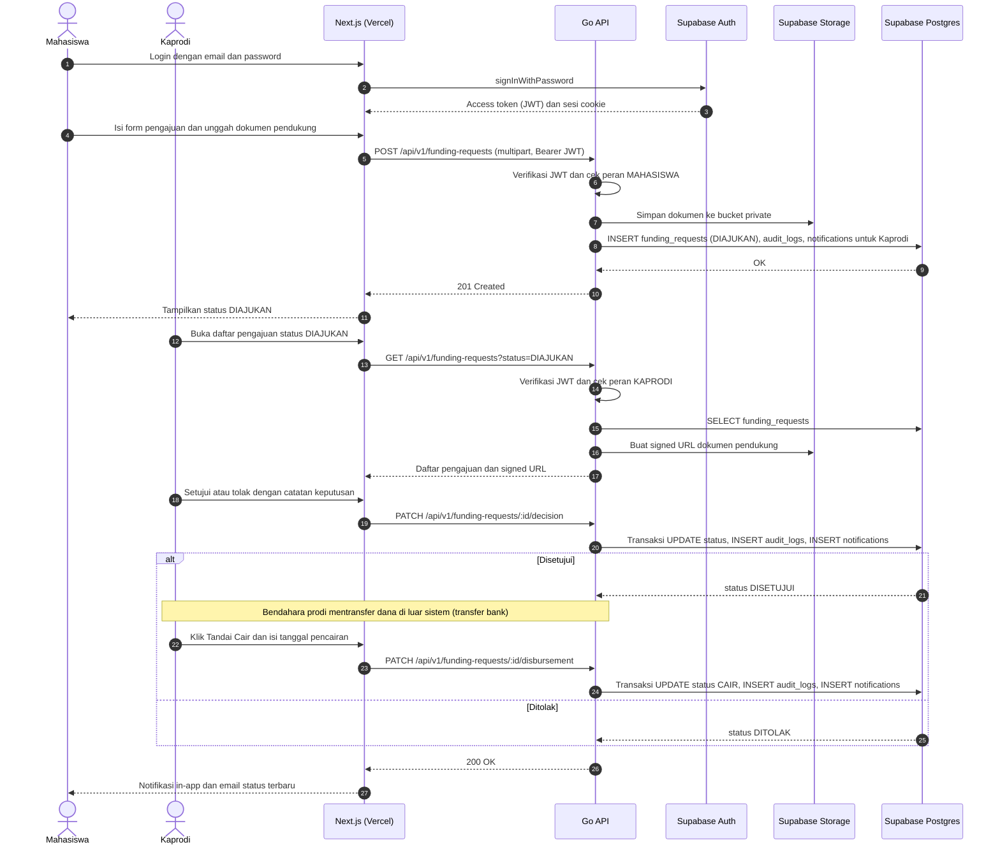

# PRD — SIMPRO (Sistem Informasi Manajemen Program Studi)

> **Asumsi:** SIMPRO melayani satu prodi (bukan *multitenant*), satu akun boleh memegang beberapa peran (mis. dosen yang juga Koordinator KP), dan Kaprodi bertindak sebagai pengelola akun serta data master karena SKPL tidak punya aktor *admin*. Pengurus Himpunan memvalidasi prestasi dan Kaprodi memutuskan pendanaan lomba.

## 1. **Overview**

SIMPRO (Sistem Informasi Manajemen Program Studi) adalah aplikasi *web* internal untuk Prodi Sarjana Sistem Informasi yang memusatkan 14 modul operasional prodi (32 kebutuhan fungsional, 10 non-fungsional) dalam satu sistem. Penggunanya adalah Kaprodi, GKM, tiga koordinator (KP, TA, Magang), dosen, pengurus Himpunan, dan mahasiswa. Model bisnisnya adalah *internal tool* satu institusi (B2B internal), bukan *marketplace* atau *multitenant*.

**Masalah yang diselesaikan:** Data prodi umumnya tersebar di *spreadsheet*, folder *drive*, grup WhatsApp, dan berkas kertas. Rekap PMB, prestasi, kepuasan, dan *tracer study* disusun manual menjelang akreditasi, sehingga memakan waktu dan rawan salah hitung. Kelengkapan artefak perkuliahan tidak terpantau sampai tenggat lewat. Pengajuan pendanaan lomba lewat *chat* tanpa jejak keputusan. Jadwal seminar/sidang TA dibuat manual, sehingga ruang atau dosen penguji bisa bentrok. Mahasiswa tidak tahu status pengajuan KP, TA, atau magangnya tanpa menanyakan koordinator.

**Tujuan Utama:** Dari sisi mahasiswa dan dosen, SIMPRO menyediakan satu pintu untuk mengajukan, mengunggah, dan memantau status (prestasi, pendanaan lomba, KP/TA/Magang, artefak, kegiatan tridarma) dari HP maupun laptop, dengan notifikasi otomatis. Dari sisi Kaprodi, GKM, dan koordinator, SIMPRO menghitung rekap dan indikator secara otomatis (rasio PMB, indeks kepuasan, persentase keterlibatan mahasiswa, dan lainnya), mencatat jejak audit setiap keputusan, dan mengekspor laporan ke Excel/PDF untuk pimpinan dan akreditasi.

## 2. **Requirements**

- **Model Data Satu Prodi:** Sistem melayani satu prodi tanpa *multitenancy*. Semua data periodik dikaitkan ke `academic_periods` (tahun ajaran + semester) agar rekap per tahun akademik cukup lewat *query* agregasi.
- **RBAC Multi-Peran:** Satu akun boleh punya banyak peran lewat `user_roles` (KAPRODI, GKM, KOORD_KP, KOORD_TA, KOORD_MAGANG, HIMPUNAN, DOSEN, MAHASISWA). Hak tulis tiap modul hanya untuk penanggung jawabnya, mahasiswa hanya melihat datanya sendiri, dan dosen pembimbing/penguji hanya melihat mahasiswa bimbingannya (NF-03).
- **Akses Data Hanya Lewat Go API:** *Frontend* tidak pernah mengakses tabel Supabase langsung. Browser hanya berbicara dengan Supabase Auth, sedangkan seluruh data lewat Go API yang memverifikasi JWT Supabase dan membaca peran dari `user_roles`. RLS tetap diaktifkan dengan kebijakan *deny-all* untuk role `anon` dan `authenticated` sebagai lapisan pertahanan kedua.
- **Akses Publik vs Privat:** Satu-satunya rute publik adalah formulir *tracer study* lewat tautan bertoken unik (lulusan dan pengguna lulusan tidak punya akun). Semua rute lain wajib *login*. Berkas SK, bukti prestasi, dan laporan disimpan di *bucket* Supabase Storage *private* dan dibuka lewat *signed URL* berumur pendek. Enkripsi *at rest* mengandalkan bawaan Supabase, dan HTTPS/TLS wajib di semua lapisan (NF-04).
- **Lifecycle Status Terstandar:** Setiap entitas transaksi punya kolom `status` dengan transisi yang divalidasi di *service layer* Go (tidak boleh loncat atau mundur):
  - Pendanaan lomba: DIAJUKAN → DISETUJUI/DITOLAK → CAIR.
  - Prestasi: DIAJUKAN → DISETUJUI/DITOLAK.
  - Pemeriksaan artefak: BELUM_DIPERIKSA/LENGKAP/TIDAK_LENGKAP/PERLU_REVISI.
  - KP dan Magang: DIAJUKAN → DISETUJUI → BERJALAN → SELESAI, atau DITOLAK.
  - TA: PROPOSAL_DIAJUKAN → BIMBINGAN → SIAP_SIDANG → LULUS, atau PROPOSAL_DITOLAK.
- **Anti-Bentrok & Integritas Data:** Ruang sidang dijaga *exclusion constraint* Postgres (`btree_gist`), sedangkan dosen penguji dicek dalam transaksi di Go. Mitra hanya bisa dipilih bila berstatus AKTIF dan masa berlakunya mencakup tanggal kegiatan. Satu mahasiswa hanya punya satu KP/Magang/TA aktif pada satu waktu, dan satu mahasiswa hanya satu respons per kuesioner (*unique constraint*).
- **Rekap Otomatis di Sisi Server:** Semua indikator (rasio keketatan, persentase daftar ulang, indeks kepuasan, waktu tunggu kerja, persentase keterlibatan mahasiswa, integrasi, dan pemanfaatan mitra) dihitung Go lewat SQL agregat. Targetnya ≤ 3 detik untuk satu tahun akademik penuh (NF-08), didukung indeks pada `periode_id`.
- **Log Audit Immutable:** Persetujuan pendanaan, validasi prestasi, dan penilaian KP/TA/Magang dicatat ke `audit_logs` (data lama dan baru). Tabel ini *append-only*, karena hak UPDATE/DELETE dicabut dari role aplikasi (NF-09).
- **Mobile-First & Ekspor Laporan:** Antarmuka berbahasa Indonesia, responsif (mahasiswa mayoritas mengakses dari HP), dan setiap rekap bisa diekspor ke `.xlsx` dan PDF dari Go (NF-01, NF-02, NF-10).
- **Keandalan & Pelindungan Data Pribadi:** Target ketersediaan ≥ 99% per bulan, dengan *backup* otomatis Supabase, `pg_dump` terjadwal, dan uji restorasi berkala (NF-06, NF-07). Data pribadi dikumpulkan seminimal mungkin dan hasil kuesioner kepuasan hanya tampil agregat (tanpa identitas responden) sesuai UU PDP No. 27/2022 (NF-05).

## 3. **Core Features**

- **Rekap PMB & *Dashboard* Indikator Prodi:** Kaprodi menginput jumlah pendaftar, lulus seleksi, dan daftar ulang per jalur dan periode. Sistem menghitung rasio keketatan dan persentase daftar ulang, lalu menampilkan grafik tren antar tahun. *Dashboard* juga memuat kartu indikator lintas modul (waktu tunggu kerja, persentase keterlibatan mahasiswa, integrasi pembelajaran, pemanfaatan mitra) (FR-01, 02, 17, 28, 30, 32).
- **Monitoring Mutu Perkuliahan & Kepuasan:** *Checklist* empat jenis artefak (RPS, bahan ajar, presensi, soal ujian) per mata kuliah per semester dengan status dan catatan GKM, serta pengingat otomatis H-7 dan H-1 tenggat lewat *email* dan notifikasi *in-app*. GKM juga membuka dan menutup kuesioner kepuasan skala 1–5 dan melihat indeks per layanan serta tren antar periode (FR-03–05, 14–15).
- **Kinerja Dosen & Riset:** Pencatatan penelitian, PkM, kegiatan tambahan, dan riwayat jabatan struktural/fungsional. Dosen menautkan mahasiswa yang terlibat dan mata kuliah tempat hasilnya diintegrasikan. Laporan per dosen dan rekap seluruh dosen bisa diekspor Excel/PDF (FR-06–08, 27, 29).
- **Kemahasiswaan (Prestasi & Pendanaan Lomba):** Pelaporan prestasi dengan bukti wajib, validasi Himpunan, dan rekap per tingkat dan tahun akademik. Pengajuan pendanaan lomba diselesaikan mahasiswa dari HP dalam kurang dari 3 menit, dengan alur DIAJUKAN → DISETUJUI/DITOLAK → CAIR dan catatan keputusan Kaprodi (FR-09–13).
- **KP, Magang, TA & Basis Data Mitra:** Alur pendaftaran, penetapan pembimbing, *logbook*, laporan akhir, dan penilaian untuk KP dan Magang. Untuk TA ada pengajuan proposal, penjadwalan seminar/sidang anti-bentrok, dan rekap status. Semuanya terhubung ke basis data mitra dalam dan luar negeri beserta masa berlakunya (FR-20–26, 31).
- **Tracer Study, Arsip SK/Aset & Administrasi Akun:** Tautan *tracer study* publik bertoken dengan pencatatan partisipasi, repositori SK yang bisa dicari per jenis dan tahun, dan inventaris aset beserta status dan lokasinya. Kaprodi mengimpor akun dosen/mahasiswa dari CSV dan mengatur peran (FR-16, 18, 19).

## 4. **User Flow**

**Mahasiswa — Ajukan Pendanaan Lomba**
1. *Login* dengan email dan *password* (Supabase Auth), lalu masuk ke *dashboard* mahasiswa.
2. Buka menu **Pendanaan Lomba** dan klik **Ajukan Pendanaan**.
3. Mengisi nama lomba, tingkat, tanggal lomba, dan estimasi biaya, lalu unggah dokumen pendukung (pengumuman lomba, RAB).
4. Klik **Kirim**. Status menjadi DIAJUKAN dan Kaprodi menerima notifikasi.
5. Memantau status DISETUJUI/DITOLAK/CAIR di halaman **Pengajuan Saya** (notifikasi juga masuk lewat *email*).

**Kaprodi — Putuskan Pendanaan Lomba**
1. Buka menu **Pendanaan Lomba** dan filter status DIAJUKAN.
2. Buka detail pengajuan dan periksa dokumen pendukung.
3. Klik **Setujui** (mengisi jumlah disetujui) atau **Tolak**, lalu isi catatan keputusan. Sistem mencatat *log* audit dan memberi notifikasi ke mahasiswa.
4. Bendahara prodi mentransfer dana ke rekening mahasiswa **di luar sistem** (transfer bank).
5. Kembali ke sistem, klik **Tandai Cair** dan isi tanggal pencairan. Status menjadi CAIR.

**Mahasiswa & Pengurus Himpunan — Lapor dan Validasi Prestasi**
1. Mahasiswa membuka **Prestasi Saya** dan klik **Tambah Prestasi**.
2. Mengisi nama prestasi, kategori (akademik/non-akademik), tingkat, penyelenggara, dan tanggal, lalu unggah sertifikat/piagam. Sistem menolak *submit* tanpa berkas bukti.
3. Status menjadi DIAJUKAN dan masuk antrean validasi Himpunan.
4. Pengurus Himpunan memeriksa bukti lalu klik **Setujui** atau **Tolak** beserta catatan.
5. Prestasi DISETUJUI otomatis masuk rekap prodi. Prestasi yang diinput langsung oleh pengurus Himpunan langsung berstatus DISETUJUI.

**Dosen & GKM — Artefak Perkuliahan**
1. Kaprodi (sekali per semester) mengaktifkan periode, menetapkan tenggat unggah, dan mengatur penawaran mata kuliah beserta dosen pengampu.
2. Dosen menerima pengingat *email* dan notifikasi *in-app* pada H-7 dan H-1 sebelum tenggat.
3. Dosen membuka **Artefak Saya**, memilih mata kuliah, lalu mengunggah RPS, bahan ajar, presensi, dan soal ujian (satu berkas per jenis).
4. GKM membuka **Monitoring Artefak**, memfilter periode, membuka berkas tiap mata kuliah, dan mencentang verifikasi pada *checklist*.
5. GKM menetapkan status LENGKAP, TIDAK_LENGKAP, atau PERLU_REVISI beserta catatan. Untuk PERLU_REVISI, dosen diberi notifikasi lalu mengulang dari langkah 3.

**GKM & Mahasiswa — Kuesioner Kepuasan**
1. GKM membuat kuesioner (judul, periode, pertanyaan per jenis layanan) lalu mengubah statusnya menjadi DIBUKA.
2. Mahasiswa *login*, membuka **Kuesioner**, menjawab skala 1–5, dan mengirim (hanya satu kali per kuesioner).
3. GKM menutup kuesioner (DITUTUP) dan melihat indeks per layanan serta tren antar periode secara agregat.

**Mahasiswa & Koordinator KP — Kerja Praktik**
1. Mahasiswa membuka **Kerja Praktik**, klik **Daftar KP**, memilih mitra dari basis data (atau mengisi nama tempat usulan bila belum terdaftar), dan mengisi rencana tanggal.
2. Koordinator KP meninjau pengajuan, menautkan atau mendaftarkan mitra, menetapkan dosen pembimbing (dan penguji), lalu klik **Setujui** (status DISETUJUI) atau **Tolak** (DITOLAK).
3. Pada tanggal mulai, status berubah otomatis menjadi BERJALAN (dijalankan *cron job* harian).
4. Mahasiswa mengisi *logbook* selama KP, lalu dosen pembimbing atau koordinator memverifikasinya.
5. Mahasiswa mengunggah laporan akhir. Pembimbing dan penguji mengisi nilai.
6. Koordinator meninjau rekap dan menyelesaikan KP (status SELESAI, nilai akhir terkunci dan tercatat di *log* audit).

Alur Magang identik dengan KP. Mitra wajib dipilih dari basis data, dan nilai pembimbing lapangan diinput koordinator dari lembar penilaian mitra karena pembimbing lapangan tidak punya akun pada MVP.

**Mahasiswa & Koordinator TA — Tugas Akhir**
1. Mahasiswa klik **Ajukan Proposal TA**, mengisi judul dan ringkasan topik (opsional memilih mitra). Status menjadi PROPOSAL_DIAJUKAN.
2. Koordinator TA meninjau. **Setujui** berarti menetapkan pembimbing 1 dan 2 (status BIMBINGAN), sedangkan **Tolak** berarti PROPOSAL_DITOLAK dengan catatan.
3. Koordinator menjadwalkan **Seminar Proposal**: memilih tanggal, jam, ruang, dan dosen penguji. Sistem menolak jadwal bila ruang atau penguji bentrok.
4. Hasil seminar dicatat (LULUS/LULUS_REVISI/TIDAK_LULUS), lalu mahasiswa menjalani bimbingan.
5. Setelah pembimbing menyatakan siap, koordinator mengubah status menjadi SIAP_SIDANG dan menjadwalkan **Seminar TA** dan **Sidang TA** dengan cara yang sama. Penguji mengisi nilai.
6. Setelah Sidang TA LULUS, status TA menjadi LULUS dan terlihat di **Rekap Status TA** (BIMBINGAN/SIAP_SIDANG/LULUS).

**Dosen & Kaprodi — Kegiatan Tridarma**
1. Dosen membuka **Kegiatan Saya**, klik **Tambah**, lalu mengisi jenis (penelitian/PkM/kegiatan tambahan), judul, tanggal, uraian, dan bukti.
2. Untuk penelitian/PkM, dosen menambahkan mahasiswa yang terlibat beserta perannya.
3. Dosen menautkan hasil kegiatan ke mata kuliah tempat diintegrasikan (bentuk integrasi dan rujukan RPS).
4. Kaprodi mengelola riwayat jabatan dosen, membuka laporan kinerja per dosen atau rekap seluruh dosen, dan melihat persentase keterlibatan mahasiswa dan integrasi per tahun akademik.
5. Kaprodi mengekspor laporan ke Excel atau PDF.

**Kaprodi — Data Prodi (PMB, SK, Aset, Mitra)**
1. Buka **PMB**, klik **Tambah Rekap**, dan isi jalur seleksi, pendaftar, lulus seleksi, dan daftar ulang. Sistem menghitung rasio keketatan dan persentase daftar ulang, lalu memperbarui grafik tren.
2. Buka **Repositori SK**, unggah SK (nomor, judul, jenis, tahun), dan cari SK lama lewat filter jenis dan tahun.
3. Buka **Inventaris Aset** dan catat aset beserta status dan lokasinya.
4. Buka **Lembaga Mitra** dan daftarkan mitra (cakupan dalam/luar negeri, jenis kerja sama, masa berlaku).
5. Buka **Rekap Pemanfaatan Mitra** untuk melihat jumlah dan persentase mitra yang dipakai KP/TA/Magang per tahun akademik, lalu ekspor bila diperlukan.

**Lulusan & Kaprodi — Tracer Study**
1. Kaprodi membuka **Tracer Study**, memilih lulusan berdasarkan tahun lulus, lalu klik **Buat Tautan**. Sistem membuat token unik per lulusan (LULUSAN) dan per pengguna lulusan (PENGGUNA_LULUSAN).
2. Kaprodi membagikan tautan lewat WhatsApp (tombol salin tautan) atau *email*.
3. Responden membuka tautan di HP tanpa *login*, mengisi waktu tunggu kerja, kesesuaian bidang, dan tempat kerja, lalu mengirim. Status menjadi SUDAH_DIISI dan token tidak bisa dipakai ulang.
4. Kaprodi memantau tingkat partisipasi dan indikator penyerapan kerja di *dashboard*, lalu mengekspornya.

## 5. **Architecture**

SIMPRO dibangun sebagai *monorepo* dua aplikasi (`apps/web` dan `apps/api`) di atas Supabase. **Next.js (App Router)** melayani seluruh UI (SSR untuk *dashboard*, CSR untuk formulir), sementara **Go** menjadi satu-satunya lapisan *business logic* dan akses data. Alasannya, aturan transisi status, validasi anti-bentrok jadwal sidang, agregasi rekap, ekspor Excel/PDF, dan *cron job* pengingat lebih aman dan cepat di layanan Go yang ringan dan mudah menangani konkurensi. Supabase menyediakan PostgreSQL, Auth, dan Storage terkelola dalam satu platform (region Singapura untuk latensi ke Indonesia), sehingga tim tidak perlu mengelola server *database* atau autentikasi sendiri pada tahap MVP. Sesi *login* dikelola Next.js lewat `@supabase/ssr`, dan setiap panggilan ke Go membawa `Authorization: Bearer <JWT>` (Next.js memproksikan `/api/*` ke Go lewat *rewrites* agar tidak perlu CORS rumit). Go memverifikasi JWT (JWKS/*JWT secret* Supabase), memuat peran dari `user_roles`, dan terhubung ke Postgres lewat *session pooler* Supabase. *Service role key* hanya ada di Go, dipakai untuk membuat akun dan *signed URL* Storage. Karena bukan *multitenant*, isolasi data dilakukan lewat RBAC, pengecekan kepemilikan baris di *service layer* (mahasiswa hanya barisnya sendiri, dosen hanya bimbingannya), dan RLS *deny-all*. Pengingat artefak dan perubahan status otomatis (DISETUJUI → BERJALAN) dijalankan oleh *cron job* internal Go, dengan *email* lewat SMTP dan notifikasi disimpan di tabel `notifications`.

## 6. **Database Schema**

Hierarki utamanya: `profiles` (akun Supabase Auth) → `lecturers` / `students` → aktivitas mereka (kegiatan dosen, prestasi, pendanaan, KP, Magang, TA), dengan `academic_periods` sebagai tulang punggung rekap tahunan dan `partner_institutions` sebagai referensi KP/Magang/TA. Semua tabel memakai `id` (UUID, `gen_random_uuid()`) sebagai *Primary Key* dan memiliki `created_at` serta `updated_at` (Timestamp) yang tidak diulang di bawah. Kolom `diunggah_oleh`, `divalidasi_oleh`, `diputuskan_oleh`, `diperiksa_oleh`, `dicatat_oleh`, dan `dibuat_oleh` adalah *Foreign Key* ke `profiles.id`.

1. **`Pengguna (profiles)` - akun login, satu baris per orang**
   - `id` (UUID): *Primary Key*, sama dengan `auth.users.id`.
   - `nama_lengkap` (Varchar): nama sesuai identitas kampus.
   - `email` (Varchar): unik, dipakai *login* dan tujuan notifikasi.
   - `no_whatsapp` (Varchar): opsional, untuk tombol *chat* WhatsApp (`wa.me`) di layar koordinator.
   - `is_active` (Boolean): akun nonaktif tidak bisa mengakses API.

2. **`Peran Pengguna (user_roles)` - pemetaan akun ke peran RBAC**
   - `user_id` (UUID): *Foreign Key* → `profiles.id`.
   - `role` (Enum): KAPRODI, GKM, KOORD_KP, KOORD_TA, KOORD_MAGANG, HIMPUNAN, DOSEN, MAHASISWA. Unik bersama `user_id`.

3. **`Periode Akademik (academic_periods)` - tahun ajaran dan semester**
   - `tahun_ajaran` (Varchar): mis. "2025/2026".
   - `semester` (Enum): GANJIL, GENAP. Unik bersama `tahun_ajaran`.
   - `tanggal_mulai`, `tanggal_selesai` (Date): rentang periode.
   - `tenggat_unggah_artefak` (Date): dasar pengingat H-7 dan H-1 (FR-05).
   - `is_aktif` (Boolean): hanya satu periode aktif.

4. **`Dosen (lecturers)` - profil dosen**
   - `user_id` (UUID): *Foreign Key* → `profiles.id`, unik.
   - `nidn` (Varchar): unik.
   - `is_dtps` (Boolean): penanda Dosen Tetap Program Studi, dasar perhitungan FR-28.

5. **`Mahasiswa (students)` - profil mahasiswa**
   - `user_id` (UUID): *Foreign Key* → `profiles.id`, unik.
   - `nim` (Varchar): unik.
   - `angkatan` (SmallInt): tahun masuk.
   - `status` (Enum): AKTIF, CUTI, LULUS, KELUAR.
   - `tanggal_lulus` (Date): terisi bila LULUS, dasar waktu tunggu kerja.

6. **`Riwayat Jabatan Dosen (lecturer_positions)` - jabatan struktural dan fungsional beserta riwayatnya**
   - `dosen_id` (UUID): *Foreign Key* → `lecturers.id`.
   - `jenis` (Enum): STRUKTURAL, FUNGSIONAL.
   - `nama_jabatan` (Varchar): mis. Kaprodi, Sekprodi, Asisten Ahli, Lektor, Lektor Kepala, Guru Besar.
   - `nomor_sk` (Varchar): SK jabatan.
   - `tmt_mulai` (Date): mulai menjabat.
   - `tmt_selesai` (Date): kosong bila masih menjabat.

7. **`Rekap PMB (admission_records)` - data PMB per periode dan jalur**
   - `periode_id` (UUID): *Foreign Key* → `academic_periods.id`.
   - `jalur_seleksi` (Varchar): mis. SNBP, SNBT, Mandiri. Unik bersama `periode_id`.
   - `jumlah_pendaftar`, `jumlah_lulus_seleksi`, `jumlah_daftar_ulang` (Integer): input Kaprodi. Rasio keketatan = pendaftar / lulus seleksi, dan persentase daftar ulang = daftar ulang / lulus seleksi (dihitung saat *query*, tidak disimpan).

8. **`Mata Kuliah (courses)` - master mata kuliah**
   - `kode_mk` (Varchar): unik.
   - `nama_mk` (Varchar): nama mata kuliah.
   - `sks` (SmallInt): bobot SKS.

9. **`Penawaran Mata Kuliah (course_offerings)` - mata kuliah yang diampu pada satu periode, sekaligus hasil pemeriksaan GKM**
   - `mata_kuliah_id` (UUID): *Foreign Key* → `courses.id`.
   - `periode_id` (UUID): *Foreign Key* → `academic_periods.id`.
   - `dosen_id` (UUID): *Foreign Key* → `lecturers.id` (dosen pengampu). Unik bersama dua kolom sebelumnya.
   - `status_pemeriksaan` (Enum): BELUM_DIPERIKSA, LENGKAP, TIDAK_LENGKAP, PERLU_REVISI.
   - `catatan_gkm` (Text): catatan pemeriksa.
   - `diperiksa_oleh` (UUID): *Foreign Key* GKM pemeriksa.
   - `diperiksa_at` (Timestamp): waktu pemeriksaan.

10. **`Artefak Perkuliahan (course_artifacts)` - berkas artefak per penawaran mata kuliah**
    - `penawaran_id` (UUID): *Foreign Key* → `course_offerings.id`.
    - `jenis` (Enum): RPS, BAHAN_AJAR, PRESENSI, SOAL_UJIAN. Unik bersama `penawaran_id`.
    - `file_path` (Varchar): lokasi berkas di Supabase Storage.
    - `tanggal_unggah` (Timestamp): waktu unggah terakhir.
    - `is_terverifikasi` (Boolean): centang *checklist* GKM.
    - `diunggah_oleh` (UUID): *Foreign Key* dosen pengunggah.

11. **`Kegiatan Dosen (lecturer_activities)` - penelitian, PkM, dan kegiatan tambahan**
    - `dosen_id` (UUID): *Foreign Key* → `lecturers.id`.
    - `periode_id` (UUID): *Foreign Key* → `academic_periods.id`.
    - `jenis` (Enum): PENELITIAN, PKM, KEGIATAN_TAMBAHAN.
    - `judul` (Varchar): judul kegiatan.
    - `uraian` (Text): peran, sumber dana, atau hasil.
    - `tanggal_kegiatan` (Date): tanggal pelaksanaan.
    - `bukti_path` (Varchar): opsional, berkas bukti.

12. **`Keterlibatan Mahasiswa (activity_student_involvements)` - mahasiswa yang terlibat pada penelitian/PkM**
    - `kegiatan_id` (UUID): *Foreign Key* → `lecturer_activities.id` (hanya jenis PENELITIAN/PKM, divalidasi di Go).
    - `mahasiswa_id` (UUID): *Foreign Key* → `students.id`. Unik bersama `kegiatan_id`.
    - `peran` (Varchar): mis. anggota peneliti, asisten lapangan.

13. **`Integrasi Pembelajaran (learning_integrations)` - keterkaitan hasil penelitian/PkM dengan mata kuliah**
    - `kegiatan_id` (UUID): *Foreign Key* → `lecturer_activities.id`.
    - `mata_kuliah_id` (UUID): *Foreign Key* → `courses.id`.
    - `periode_id` (UUID): *Foreign Key* → `academic_periods.id`. Unik bersama dua kolom sebelumnya.
    - `bentuk_integrasi` (Text): mis. studi kasus, materi ajar, proyek.
    - `rujukan_rps` (Varchar): bagian atau pertemuan RPS terkait.

14. **`Prestasi Mahasiswa (student_achievements)` - prestasi beserta validasi bukti**
    - `mahasiswa_id` (UUID): *Foreign Key* → `students.id`.
    - `periode_id` (UUID): *Foreign Key* → `academic_periods.id`.
    - `nama_prestasi` (Varchar): nama prestasi atau lomba.
    - `kategori` (Enum): AKADEMIK, NON_AKADEMIK.
    - `tingkat` (Enum): LOKAL, NASIONAL, INTERNASIONAL.
    - `penyelenggara` (Varchar): pemberi penghargaan.
    - `tanggal_prestasi` (Date): tanggal meraih.
    - `bukti_path` (Varchar): sertifikat/piagam, wajib terisi (FR-10).
    - `diajukan_oleh` (UUID): *Foreign Key* mahasiswa atau pengurus Himpunan.
    - `status` (Enum): DIAJUKAN, DISETUJUI, DITOLAK.
    - `catatan_validasi` (Text): catatan validator.
    - `divalidasi_oleh` (UUID): *Foreign Key* pengurus Himpunan.
    - `divalidasi_at` (Timestamp): waktu validasi.

15. **`Pengajuan Pendanaan Lomba (funding_requests)` - permohonan dana lomba mahasiswa**
    - `mahasiswa_id` (UUID): *Foreign Key* → `students.id`.
    - `nama_lomba` (Varchar): nama lomba.
    - `tingkat` (Enum): LOKAL, NASIONAL, INTERNASIONAL.
    - `tanggal_lomba` (Date): tanggal pelaksanaan lomba.
    - `estimasi_biaya` (Numeric): dalam Rupiah.
    - `dokumen_pendukung` (JSONB): daftar *path* berkas di Storage.
    - `status` (Enum): DIAJUKAN, DISETUJUI, DITOLAK, CAIR.
    - `jumlah_disetujui` (Numeric): terisi saat DISETUJUI.
    - `catatan_keputusan` (Text): alasan Kaprodi.
    - `diputuskan_oleh` (UUID): *Foreign Key* Kaprodi.
    - `diputuskan_at`, `dicairkan_at` (Timestamp): waktu keputusan dan pencairan.

16. **`Kuesioner Kepuasan (satisfaction_surveys)` - satu kuesioner per periode penyebaran**
    - `periode_id` (UUID): *Foreign Key* → `academic_periods.id`.
    - `judul` (Varchar): judul kuesioner.
    - `tanggal_buka`, `tanggal_tutup` (Date): rentang pengisian.
    - `status` (Enum): DRAFT, DIBUKA, DITUTUP.
    - `dibuat_oleh` (UUID): *Foreign Key* GKM.

17. **`Pertanyaan Kuesioner (survey_questions)` - pertanyaan skala Likert 1–5**
    - `kuesioner_id` (UUID): *Foreign Key* → `satisfaction_surveys.id`.
    - `jenis_layanan` (Varchar): mis. akademik, administrasi, fasilitas, kemahasiswaan (dasar indeks per layanan).
    - `teks_pertanyaan` (Text): isi pertanyaan.
    - `urutan` (SmallInt): urutan tampil.

18. **`Respons Kuesioner (survey_responses)` - satu pengisian oleh satu mahasiswa**
    - `kuesioner_id` (UUID): *Foreign Key* → `satisfaction_surveys.id`.
    - `mahasiswa_id` (UUID): *Foreign Key* → `students.id`. Unik bersama `kuesioner_id`. API tidak pernah mengembalikan jawaban per mahasiswa ke GKM.
    - `submitted_at` (Timestamp): waktu kirim.

19. **`Jawaban Kuesioner (survey_answers)` - nilai per pertanyaan**
    - `respons_id` (UUID): *Foreign Key* → `survey_responses.id`.
    - `pertanyaan_id` (UUID): *Foreign Key* → `survey_questions.id`. Unik bersama `respons_id`.
    - `nilai` (SmallInt): 1–5.

20. **`Respons Tracer Study (tracer_responses)` - tautan bertoken dan jawaban tracer study**
    - `mahasiswa_id` (UUID): *Foreign Key* → `students.id` (lulusan yang dilacak).
    - `jenis_responden` (Enum): LULUSAN, PENGGUNA_LULUSAN.
    - `token_akses` (Varchar): unik, dipakai di tautan publik.
    - `kontak_responden` (Varchar): email/WhatsApp pengguna lulusan.
    - `status` (Enum): BELUM_DIISI, SUDAH_DIISI.
    - `diisi_at` (Timestamp): waktu pengisian (dasar tingkat partisipasi).
    - `waktu_tunggu_bulan` (SmallInt): masa tunggu kerja pertama.
    - `kesesuaian_bidang` (Enum): SANGAT_SESUAI, SESUAI, KURANG_SESUAI, TIDAK_SESUAI.
    - `nama_tempat_kerja` (Varchar): nama instansi/perusahaan.
    - `jenis_tempat_kerja` (Enum): PEMERINTAH, BUMN_BUMD, SWASTA, WIRAUSAHA, LAINNYA.
    - `lokasi_kerja` (Varchar): kota/provinsi/negara (sebaran tempat kerja).
    - `penilaian_pengguna` (JSONB): jawaban khusus PENGGUNA_LULUSAN.

21. **`SK Program Studi (decrees)` - repositori Surat Keputusan**
    - `nomor_sk` (Varchar): unik.
    - `judul` (Varchar): judul SK.
    - `jenis_sk` (Varchar): mis. kurikulum, pembimbing, kepanitiaan.
    - `tahun` (SmallInt): tahun SK (indeks bersama `jenis_sk`).
    - `tanggal_penetapan` (Date): tanggal SK.
    - `file_path` (Varchar): berkas di *bucket private*.
    - `diunggah_oleh` (UUID): *Foreign Key* → `profiles.id`.

22. **`Aset Program Studi (assets)` - inventaris peralatan dan perangkat lunak**
    - `kode_aset` (Varchar): unik.
    - `nama_aset` (Varchar): nama aset.
    - `kategori` (Enum): PERALATAN, PERANGKAT_LUNAK, LAINNYA.
    - `lokasi` (Varchar): ruang atau penyimpanan.
    - `status` (Enum): BAIK, RUSAK, DALAM_PERBAIKAN, DIHAPUSKAN.
    - `tanggal_perolehan` (Date): tanggal perolehan.
    - `keterangan` (Text): catatan tambahan.
    - `dicatat_oleh` (UUID): *Foreign Key* → `profiles.id`.

23. **`Lembaga Mitra (partner_institutions)` - mitra dalam dan luar negeri untuk KP, Magang, dan TA**
    - `nama_lembaga` (Varchar): nama mitra.
    - `cakupan` (Enum): DALAM_NEGERI, LUAR_NEGERI.
    - `negara` (Varchar): negara mitra.
    - `alamat` (Text): alamat lembaga.
    - `nama_pic`, `kontak_pic` (Varchar): narahubung mitra.
    - `jenis_kerja_sama` (Varchar): mis. MoU, PKS.
    - `nomor_perjanjian` (Varchar): nomor dokumen kerja sama.
    - `tanggal_mulai_berlaku`, `tanggal_akhir_berlaku` (Date): masa berlaku.
    - `status` (Enum): AKTIF, NONAKTIF. Mitra hanya bisa dipilih bila AKTIF dan masa berlakunya mencakup tanggal kegiatan.

24. **`Kerja Praktik (kp_registrations)` - pendaftaran, pemantauan, dan penilaian KP**
    - `mahasiswa_id` (UUID): *Foreign Key* → `students.id`.
    - `periode_id` (UUID): *Foreign Key* → `academic_periods.id`.
    - `mitra_id` (UUID): *Foreign Key* → `partner_institutions.id`, wajib terisi saat DISETUJUI.
    - `tempat_usulan` (Varchar): nama tempat yang diusulkan mahasiswa.
    - `dosen_pembimbing_id`, `dosen_penguji_id` (UUID): *Foreign Key* → `lecturers.id`.
    - `tanggal_mulai`, `tanggal_selesai` (Date): jadwal pelaksanaan.
    - `status` (Enum): DIAJUKAN, DISETUJUI, DITOLAK, BERJALAN, SELESAI.
    - `catatan_koordinator` (Text): catatan keputusan.
    - `laporan_akhir_path` (Varchar): berkas laporan.
    - `nilai_pembimbing`, `nilai_penguji`, `nilai_akhir` (Numeric): penilaian (perubahannya masuk `audit_logs`).

25. **`Magang (magang_registrations)` - pendaftaran, penempatan, dan penilaian magang**
    - `mahasiswa_id` (UUID): *Foreign Key* → `students.id`.
    - `periode_id` (UUID): *Foreign Key* → `academic_periods.id`.
    - `mitra_id` (UUID): *Foreign Key* → `partner_institutions.id`, wajib.
    - `dosen_pembimbing_id` (UUID): *Foreign Key* → `lecturers.id`.
    - `nama_pembimbing_lapangan` (Varchar): pembimbing di mitra.
    - `tanggal_mulai`, `tanggal_selesai` (Date): jadwal magang.
    - `status` (Enum): DIAJUKAN, DISETUJUI, DITOLAK, BERJALAN, SELESAI.
    - `catatan_koordinator` (Text): catatan keputusan.
    - `laporan_akhir_path` (Varchar): berkas laporan.
    - `nilai_lapangan`, `nilai_dosen`, `nilai_akhir` (Numeric): penilaian.

26. **`Tugas Akhir (final_projects)` - proposal hingga kelulusan TA**
    - `mahasiswa_id` (UUID): *Foreign Key* → `students.id`.
    - `periode_id` (UUID): *Foreign Key* → `academic_periods.id` (periode pengajuan).
    - `judul` (Varchar): judul TA.
    - `ringkasan_topik` (Text): uraian singkat topik.
    - `mitra_id` (UUID): *Foreign Key* → `partner_institutions.id`, opsional bila TA di lembaga mitra.
    - `pembimbing_1_id`, `pembimbing_2_id` (UUID): *Foreign Key* → `lecturers.id`, wajib terisi saat BIMBINGAN (pembimbing 2 opsional).
    - `status` (Enum): PROPOSAL_DIAJUKAN, PROPOSAL_DITOLAK, BIMBINGAN, SIAP_SIDANG, LULUS.
    - `catatan_koordinator` (Text): catatan keputusan.
    - `nilai_akhir` (Numeric): nilai akhir TA.

27. **`Sesi Seminar/Sidang (defense_sessions)` - jadwal dan hasil seminar proposal, seminar TA, dan sidang TA**
    - `ta_id` (UUID): *Foreign Key* → `final_projects.id`.
    - `jenis` (Enum): SEMINAR_PROPOSAL, SEMINAR_TA, SIDANG_TA.
    - `waktu_mulai`, `waktu_selesai` (Timestamp): rentang sesi.
    - `ruang` (Varchar): ruang sidang. *Exclusion constraint* pada (`ruang`, rentang waktu) untuk sesi DIJADWALKAN.
    - `status` (Enum): DIJADWALKAN, LULUS, LULUS_REVISI, TIDAK_LULUS, DIBATALKAN.
    - `catatan_hasil` (Text): hasil dan revisi.
    - `nilai` (Numeric): nilai sesi.

28. **`Penguji Sidang (defense_examiners)` - dosen penguji per sesi**
    - `sesi_id` (UUID): *Foreign Key* → `defense_sessions.id`.
    - `dosen_id` (UUID): *Foreign Key* → `lecturers.id`. Unik bersama `sesi_id`, dan dicek bentrok waktu di Go.
    - `peran` (Enum): KETUA_PENGUJI, ANGGOTA_PENGUJI.
    - `nilai` (Numeric): nilai dari penguji.

29. **`Logbook (logbooks)` - catatan aktivitas harian KP dan Magang**
    - `jenis` (Enum): KP, MAGANG.
    - `kp_id` (UUID): *Foreign Key* → `kp_registrations.id`, nullable.
    - `magang_id` (UUID): *Foreign Key* → `magang_registrations.id`, nullable. *CHECK*: tepat satu dari `kp_id`/`magang_id` terisi sesuai `jenis`.
    - `tanggal` (Date): tanggal aktivitas.
    - `uraian_kegiatan` (Text): isi aktivitas.
    - `bukti_path` (Varchar): opsional, foto/berkas.
    - `status_verifikasi` (Enum): MENUNGGU, DIVERIFIKASI, PERLU_REVISI.
    - `catatan_pembimbing` (Text): catatan verifikator.

30. **`Log Audit (audit_logs)` - jejak perubahan yang tidak bisa diubah**
    - `user_id` (UUID): *Foreign Key* → `profiles.id`, pelaku.
    - `aksi` (Varchar): mis. CREATE, UPDATE, STATUS_CHANGE.
    - `entitas` (Varchar): nama tabel terkait.
    - `entitas_id` (UUID): baris terkait.
    - `data_lama`, `data_baru` (JSONB): *snapshot* sebelum dan sesudah.
    - `ip_address` (Varchar): alamat IP pelaku. Tabel ini *append-only* (UPDATE/DELETE dicabut).

31. **`Notifikasi (notifications)` - notifikasi *in-app* dan jejak pengiriman *email***
    - `user_id` (UUID): *Foreign Key* → `profiles.id`, penerima.
    - `jenis` (Varchar): mis. PENGINGAT_ARTEFAK, STATUS_PENGAJUAN, TUGAS_BARU.
    - `judul` (Varchar): judul singkat.
    - `isi` (Text): isi pesan.
    - `tautan` (Varchar): rute tujuan di aplikasi.
    - `is_dibaca` (Boolean): status baca.
    - `dikirim_email_at` (Timestamp): waktu *email* terkirim, kosong bila belum.

```mermaid
erDiagram
    profiles ||--o{ user_roles : "memiliki"
    profiles ||--o| lecturers : "profil dosen"
    profiles ||--o| students : "profil mahasiswa"
    profiles ||--o{ notifications : "menerima"
    profiles ||--o{ audit_logs : "melakukan"
    profiles ||--o{ decrees : "mengunggah"
    profiles ||--o{ assets : "mencatat"
    lecturers ||--o{ lecturer_positions : "menjabat"
    academic_periods ||--o{ admission_records : "mencakup"
    courses ||--o{ course_offerings : "ditawarkan"
    academic_periods ||--o{ course_offerings : "berlangsung di"
    lecturers ||--o{ course_offerings : "mengampu"
    course_offerings ||--o{ course_artifacts : "memiliki"
    lecturers ||--o{ lecturer_activities : "melakukan"
    academic_periods ||--o{ lecturer_activities : "terjadi di"
    lecturer_activities ||--o{ activity_student_involvements : "melibatkan"
    students ||--o{ activity_student_involvements : "terlibat"
    lecturer_activities ||--o{ learning_integrations : "diintegrasikan"
    courses ||--o{ learning_integrations : "menerima"
    academic_periods ||--o{ learning_integrations : "pada"
    students ||--o{ student_achievements : "meraih"
    academic_periods ||--o{ student_achievements : "dalam"
    students ||--o{ funding_requests : "mengajukan"
    academic_periods ||--o{ satisfaction_surveys : "untuk"
    satisfaction_surveys ||--o{ survey_questions : "berisi"
    satisfaction_surveys ||--o{ survey_responses : "menerima"
    students ||--o{ survey_responses : "mengisi"
    survey_responses ||--o{ survey_answers : "memuat"
    survey_questions ||--o{ survey_answers : "dijawab"
    students ||--o{ tracer_responses : "dilacak"
    students ||--o{ kp_registrations : "mendaftar KP"
    academic_periods ||--o{ kp_registrations : "periode KP"
    partner_institutions |o--o{ kp_registrations : "tempat KP"
    lecturers |o--o{ kp_registrations : "membimbing atau menguji"
    students ||--o{ magang_registrations : "mendaftar magang"
    academic_periods ||--o{ magang_registrations : "periode magang"
    partner_institutions ||--o{ magang_registrations : "tempat magang"
    lecturers |o--o{ magang_registrations : "membimbing"
    students ||--o{ final_projects : "mengerjakan TA"
    academic_periods ||--o{ final_projects : "periode pengajuan"
    partner_institutions |o--o{ final_projects : "lokasi TA"
    lecturers |o--o{ final_projects : "membimbing"
    final_projects ||--o{ defense_sessions : "dijadwalkan"
    defense_sessions ||--o{ defense_examiners : "diuji oleh"
    lecturers ||--o{ defense_examiners : "menguji"
    kp_registrations |o--o{ logbooks : "dicatat"
    magang_registrations |o--o{ logbooks : "dicatat"
```

Relasi kolom *actor* lain ke `profiles` (`divalidasi_oleh`, `diputuskan_oleh`, `diperiksa_oleh`, `dibuat_oleh`, `diajukan_oleh`, `diunggah_oleh` pada artefak) tidak digambar demi keterbacaan, tetapi tetap *Foreign Key* di tabel masing-masing.

## 7. **Tech Stack**

- **Framework Fullstack (Frontend):** **Next.js (App Router)** — sesuai pilihan tim. SSR untuk *dashboard* rekap, CSR untuk formulir, dan `@supabase/ssr` memudahkan sesi *login* berbasis *cookie*. Satu *deploy* ke Vercel cukup untuk tahap MVP.
- **Framework Fullstack (Backend API):** **Go + Gin** — sesuai pilihan tim. Binari kecil dan cepat untuk agregasi rekap, aman untuk transaksi anti-bentrok jadwal, dan mudah menjalankan *cron job* pengingat serta ekspor (`excelize` untuk Excel, `maroto`/`gofpdf` untuk PDF). Kode dipisah per modul (`internal/<modul>`) dengan lapisan *handler → service → repository*.
- **Styling/UI:** **Tailwind CSS + shadcn/ui** — komponen tabel, formulir, *dialog*, dan *badge* status siap pakai sehingga 14 modul cepat dibangun. *Chart* tren memakai Recharts, dan tampilan *mobile-first* karena mahasiswa mengakses dari HP.
- **Database:** **Supabase (PostgreSQL)** — sesuai pilihan tim. Postgres terkelola sekaligus Storage untuk berkas dan Auth, tanpa perlu mengurus server *database* sendiri karena ini tahap MVP. Gunakan region Singapura dan hubungkan Go lewat *session pooler*.
- **ORM:** **sqlc + pgx** — SQL ditulis langsung lalu digenerasi menjadi kode Go *type-safe*, cocok untuk *query* agregasi rekap yang berat dan sulit diekspresikan di ORM penuh. Migrasi berupa *file* SQL versi di repo lewat Supabase CLI (termasuk RLS, *exclusion constraint*, dan pencabutan hak UPDATE/DELETE pada `audit_logs`), dan sqlc membaca *file* yang sama sebagai sumber skema.
- **Autentikasi:** **Supabase Auth** — email + *password* (opsional Google OAuth akun kampus), tanpa membangun sistem *login* sendiri. Go memverifikasi JWT dan mengambil peran dari `user_roles` (bukan dari *claim* JWT) karena satu akun bisa multi-peran dan perannya bisa berubah.
- **Deployment:** **Vercel (Next.js) + Fly.io atau Railway (Go, kontainer Docker, region Singapura) + Supabase Cloud** — ketiganya punya tier gratis atau murah untuk MVP dan tidak memerlukan pengelolaan server sendiri. Pisahkan variabel lingkungan: hanya Go yang memegang *service role key* dan kredensial SMTP.
